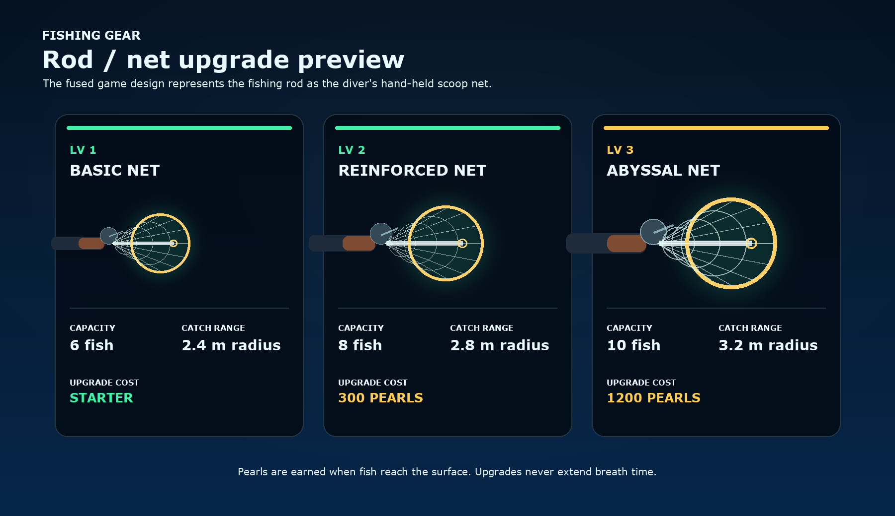

# HackRU26 · 屏息 Breathless

**English** · [简体中文](README.zh-CN.md)

> **Hold your real breath to dive and catch fish.** Your webcam, through Presage, detects whether you are holding your breath. The diver can only descend while you hold. The deeper you go, the rarer the fish. The moment you breathe underwater you have to race back to the surface, or you lose everything in your net. Fish you bring up can be minted as Solana NFTs and traded between players. The game also quietly records how long each hold lasted and your heart rate, and builds a health report whenever you ask for one.

Low-poly 2.5D, built with Three.js + TypeScript. Mostly front end, plus a local Node sensor service.

---

## Contents

1. [Overview](#1-overview)
2. [Quick start](#2-quick-start)
3. [Controls](#3-controls)
4. [Architecture](#4-architecture)
5. [Breath-hold detection](#5-breath-hold-detection)
6. [Code tour](#6-code-tour)
7. [Game design parameters](#7-game-design-parameters)
8. [Solana NFT](#8-solana-nft)
9. [Health report](#9-health-report)
10. [Local storage](#10-local-storage)
11. [Debugging tips](#11-debugging-tips)
12. [Status and to-do](#12-status-and-to-do)
13. [Working together](#13-working-together)
14. [Hackathon timeline](#14-hackathon-timeline)

---

## 1. Overview

### Core loop

```
On the surface ──hold breath──▶ dive ──Space: net fish──▶ deeper = rarer
   ▲                                                         │
   │                                          breathe underwater = OUT OF AIR
   │                                                         ▼
Surface = fish banked ◀── reach the surface within 3.2 s ────┤
                                                             └─ too late = BLACKOUT, every fish in the net is lost
```

- **Your breath is the air tank**: the game has no oxygen bar. Your lungs are the bar.
- **Greed against risk**: mythic fish only live in the Abyss (below 38 m), but the farther you are from the surface, the harder it is to get back after you breathe.
- **Night**: when the natural cycle becomes dark, newly spawned fish roll their rarity twice and keep the higher result. `N` gradually switches between morning and night. The sea-monster risk is still on the to-do list.
- **Collection** (`C`): banked fish are rendered as 512×512 cards, and that card is the NFT image. The card is fully determined by the fish's seed, so anyone can render it again and check it.
- **Rod upgrades** (`G`): in this game the fishing rod is the diver's hand net. Banked fish earn Pearls; Pearls buy a bigger net with more capacity and a longer catch reach.

### Three maps

All three maps are in the game. You choose one on the start card before a dive: a row of three map cards sits above the "Start with camera / Play with keyboard" buttons. The chosen map is also what you see behind the title screen. The full design is in [section 6 of the design doc](design/game-design-document.md#6-地图) (in Chinese). What is built:

| | Fjord 峡湾 (Norway / Iceland) | Heaven Lake 天池 (Zhangjiajie / Changbai) | Open Ocean 汪洋 |
| --- | --- | --- | --- |
| Difficulty | Casual | Normal | Hard |
| Open depth | 0–18 m, Shallows only (seabed at 20 m) | 0–38 m, Shallows + Sunken Forest (seabed at 40 m) | 0–58 m, Shallows + Coral Reef + The Abyss (seabed at 60 m) |
| Above the water | Snow peaks, a pine shore, two fishing cabins and a pier, ice floes; aurora and lit windows at night | Stone pillars, a crater rim, a lakeside pavilion, drifting mist (thicker at night), a lantern at night | A storm front with sheet lightning, sea stacks, a lighthouse whose lamp turns at night |
| Underwater | Cold teal water, gray gravel and rock, kelp, no coral | Jade-green water, sunken logs and rock shelves, sparse weeds | The original reef: coral, kelp, sand |
| Waves | Half the ocean's height | Calmest | Full |
| Unlock | Open from the start | Total banked fish value 150 | Total banked fish value 1000 |

- **Depth zones**: "Sunken Forest" is the second depth zone on Heaven Lake. It uses the Coral Reef drop table; only the look and the gauge label differ. Fish only spawn in the zones a map opens, and the depth gauge on the right shows only those zones.
- **Unlocking**: a map opens by the total catch value of banked fish (see "Catch value" in section 7). The highest total ever reached is remembered, so losing fish later cannot re-lock a map. When a dive banks enough to open a new map, a message says so.
- **Demo switch**: under the map cards there is a checkbox "Unlock all maps (demo)" that opens every map at once. It exists for demos and testing.
- **Saved progress**: the selected map, the best value and the demo switch are stored in localStorage under the key `deepbreath.maps`.
- **Still design only, not built yet**: night creatures (Fjord: deer and bear; Heaven Lake: bear and giant; Open Ocean: big waves and a sea monster), map-specific daylight hours (05:00–20:00 day on the Fjord), fishing from the boat driven by heart rate, boat durability, and losing all gear for good when the boat sinks on the Open Ocean.
- **Upgrades**: rod, bait and boat (speed / durability / rod slots), plus a set of diving gear. See [section 7 of the design doc](design/game-design-document.md#7-经济与升级) (in Chinese). The upgrade parts (rod, bait, boat engine / hull / fishing deck, net, fins, emergency tank, headlamp) have low-poly models at three levels each in `game/src/upgrades.ts`. They are not shown or used in the game yet, and buying with Pearl is not wired up.

### Hackathon positioning

| Item | Details |
| --- | --- |
| Track | Social Good (breath training / lung-health awareness); the final choice is made at submission |
| MLH prize targets | **Best Use of Presage** (breath-hold detection, heart rate) · **Best Use of Solana** (fish NFTs, trading) · possible later: ElevenLabs (sound effects / narration), Tiger Data (market and economy data), a .Tech domain |

### Multiplayer scope (important)

**Many players are online at once, but each one dives in their own separate world. Players only interact through trading.** There is no shared world and no real-time sync. Every "multiplayer" feature lives in the trading layer: wallet identity, listings, purchases, and a live feed of sales.

---

## 2. Quick start

### Requirements

- **Node.js 20+** (the dev machine runs v20.19.5)
- **macOS (Apple Silicon)** or **Windows**: the Presage Node SDK ships runtimes for `darwin-arm64`, `win32-x64` and `linux-x64/arm64`. Windows notes are under [Windows](#windows) below
- **Chrome** and a webcam (not needed for keyboard or simulation mode)

### Install and run

```bash
git clone https://github.com/LucasYanzy/HackRU26.git
cd HackRU26
npm run setup                 # installs dependencies for sensor/ and game/
cp .env.example .env          # then fill in PRESAGE_API_KEY (see below)
```

Open two terminals:

```bash
npm run sensor     # breath sensor service, ws://localhost:8787
```

```bash
npm run game       # the game, http://localhost:5173
```

(Or run `npm run dev` to start both at once. It works on macOS and Windows, and Ctrl+C stops both.)

### Windows

- **x64 machines**: follow the steps above as they are.
- **ARM machines (Snapdragon X and similar)**: the Presage SDK has no `win32-arm64` build, so ARM Node cannot load it. Use **x64 Node** instead; Windows 11 runs it under emulation:
  1. Download the x64 Node zip (for example `node-v24.x.x-win-x64.zip`) and unzip it anywhere.
  2. In every terminal, put it at the front of PATH before you run `npm run setup`, `npm run sensor` or `npm run game`:
     ```powershell
     $env:Path = "C:\path\to\node-v24.x.x-win-x64;$env:Path"
     node -p process.arch   # should print x64
     ```
  3. **Install and run with the same Node**: esbuild and rollup in `game/` are also installed per architecture. If you installed dependencies with ARM Node before, delete `sensor/node_modules` and `game/node_modules` and install again.

Open <http://localhost:5173>:

| Entry | What it does | Needs |
| --- | --- | --- |
| **Start with camera** | Real mode: webcam → Presage → breath-hold detection | The sensor running, and a Presage key |
| **Play with keyboard** | Hold `Shift` to hold your breath | Nothing |
| Simulation mode (press `K` in the game to switch) | The sensor generates a fake breathing waveform and heart rate; hold `Shift` to hold your breath | The sensor running; no key needed |

### Presage API key

- Get one at <https://physiology.presagetech.com/portal/dashboard>.
- Put it in `.env` at the repo root: `PRESAGE_API_KEY=...`
- **`.env` is in `.gitignore`. Never commit it.** Share the key with teammates privately; do not paste it into code, issues or PRs.
- With no key, the sensor switches to simulation mode by itself (`npm run sensor:sim` forces simulation).

### Testing breath detection on a real camera

Click **Start with camera**. Keep your face and chest in frame, in bright light.

1. Breathe normally for about 10 seconds so the detector learns how you breathe.
2. Then hold your breath. The label at the top left should turn green and read **HOLDING**, and the waveform goes flat.
3. As soon as you breathe, it switches back to **BREATHING**.

If it gets this wrong often, tune the constants in `sensor/breath-detector.mjs` (see section 5).

---

## 3. Controls

| Key | Action |
| --- | --- |
| `←` `→` `↑` `↓` / `WASD` | Swim (you cannot dive from the surface unless you are holding your breath) |
| `Space` | Swing the net to catch fish |
| `Shift` (hold) | Hold your breath (keyboard and simulation modes) |
| `C` | Collection and NFT panel |
| `G` | Rod / net upgrade panel |
| `H` | Health report (built only when you press it) |
| `N` | Gradually switch morning / night; natural cycle and afternoon are available in pause settings |
| `K` | Cycle the breath input: presage → sim → keyboard |
| `Esc` | Pause menu: resume, settings, back to the main menu. It closes any open panel first; inside settings it goes back one level; during calibration it goes straight to the main menu |
| `Enter` (main menu) | Same as clicking the START fish |

**Main menu**: when it opens, a rope (both ends off-screen) swings out from the left and hooks onto the right, then a few fish drop from above and hang from the rope on fishing lines. The button names are printed on the fish's bodies. A fish with a long name (4+ characters) hangs level on two lines, at the head and the tail, and the two lines even out like a pulley so the name stays level even where the rope slopes. Clicking the golden **START** fish (or pressing Enter) cuts its lines, drops it, and opens the workbench; the purple **SETTINGS** fish opens settings. You can drag and fling the fish and the rope with the mouse, and they are pushed aside when the pointer sweeps past them. The entrance animation is skipped when the system has "reduce motion" turned on.

**Workbench** (`workbench.ts`): a top-down wooden table. Everything drops onto it from above and collides (matter-js, table-plane physics with no gravity). The START fish is top left, the three map cards top right (chapters I / II / III, face down; a map's difficulty is the game difficulty), accessories bottom left (fins, emergency tank, headlamp), and catching gear bottom right (rod, net, bait).
- Everything can be dragged and flung. Click a piece of gear: it zooms to the centre, the background blurs, and its description shows on the left (placeholder text for now). Click again or press any key to set it in the PACK ring in the middle (green glow = packed); do it again on packed gear to put it back in its corner. Esc cancels.
- Click a map: the card drops into the middle, sucks in the packed gear and flips face up. Click the map itself to suck in everything on the table; the card grows to cover the screen and cuts to that map, then the start card (camera / keyboard / breath test). Click outside the map to spit the gear back out; the card flips back and returns to the top right.
- A locked map rattles and says what it needs; the "Unlock all maps (demo)" switch is at the bottom left.
- The packed gear is passed to the game (`loadout`), but the upgrade effects aren't wired into the dive yet.

**Pause details**: gameplay freezes while paused, and switching to another tab pauses it too. If you resume underwater, there is a 3-second countdown first so you can take a breath and hold it again; otherwise the breathing you did while paused would count as "breathing underwater". Going back to the main menu releases the camera and the sensor connection. If there are fish in your net, you are asked to confirm first: the fish are lost, but the hold still goes into your health data.

---

## 4. Architecture

```
┌──────────────────────── Browser (game/, Vite + Three.js) ────────────────────────┐
│                                                                                   │
│  getUserMedia 640×480 ──► BreathSource ──binary WS frames──┐                      │
│                             ▲   (breath.ts)                │                      │
│                             └── state JSON @ ~12.5 Hz ◄────┼──┐                   │
│                                                            │  │                   │
│  main.ts game loop ─► World / Diver / Fish / Hud           │  │                   │
│        │             HealthLog ─► Report (on demand)       │  │                   │
│        └─► Vault (collection) ─lazy import─► chain.ts ─────┼──┼──► Solana devnet  │
│                                                ▲           │  │    (Metaplex Core)│
│  localStorage: bank / health / wallet          └───────────┼──┼──► Irys devnet    │
└────────────────────────────────────────────────────────────┼──┼───(image + JSON)──┘
                                                             ▼  │
                         ┌────────── sensor/ (Node, :8787) ─────┴────┐
                         │  Session per WS connection                 │
                         │  SmartSpectraSDK.useCustomInput()          │
                         │    └─ sendFrame(RGBA) ─► Presage cloud     │
                         │  metrics ─► BreathDetector ─► state        │
                         └────────────────────────────────────────────┘
```

**Why does the browser open the camera, and not Node?** macOS does not grant camera permission to a node process started from an IDE or from Claude, so the SDK's `useCamera` never receives a frame. Instead the browser captures frames and pushes them to the sensor over WebSocket, and the sensor hands them to the SDK with `useCustomInput` + `sendFrame`.

### WebSocket protocol (`ws://<host>:8787`)

**Browser → sensor**

- **Binary frames**: a 12-byte header followed by RGBA pixels, all little-endian.
  | Offset | Type | Meaning |
  | --- | --- | --- |
  | 0 | f64 | Timestamp (ms, must keep increasing; the SDK restarts if the gap is over 2 s) |
  | 8 | u16 | Width (640) |
  | 10 | u16 | Height (480) |
  | 12… | u8[] | RGBA, width × height × 4 |
  - Backpressure: the browser skips frames when `ws.bufferedAmount` gets too large.
- **JSON commands**: `{ "t": "sim", "on": true }` turns simulation on or off; `{ "t": "simHold", "holding": true }` sets the simulated hold.

**Sensor → browser** (every 80 ms)

```jsonc
{
  "t": "state",
  "source": "presage" | "sim",
  "status": "running", "hint": "Move closer…",   // hint translated from the ValidationCode
  "rate":  { "value": 15, "confidence": 90 },     // breathing rate (needs a ~30 s window)
  "pulse": { "value": 72, "confidence": 90 },     // heart rate
  "frames": 1234,
  "holding": true, "holdMs": 8200, "calibrated": true,
  "flatness": 0.93, "apnea": false, "talking": false,
  "trace": [ /* the last 90 chest-movement samples */ ]
}
```

---

## 5. Breath-hold detection

File: `sensor/breath-detector.mjs`. The input is Presage's chest-movement trace, `breathing.upperTrace`.

**What real recordings told us** (2026-10-10, two 2.5-minute breath tests by the same person, 8 holds in total):

- For the first few seconds after Presage starts, the trace swings wildly (about 10 times the amplitude of normal breathing). The old detector used those seconds to learn the "normal breathing amplitude", so it called a hold right at the start and never left it: 44% accuracy, with normal breathing misread as a hold 86% of the time.
- The trace is high-pass filtered. During a hold it first jumps up with the last inhale, then takes about 3 seconds to settle back to flat. It does not stay high.
- Over 15-second holds, Presage's own apnea flag never fired once, so it is off by default.
- The signal itself separates well: the movement within 2 seconds of normal breathing is about 5–20 times the movement during a hold.
- **The trace glitches mid-hold.** In the second test the player stayed completely still and did not breathe, yet the trace jumped twice in the middle of a hold. Once it jumped up by about one breath's size, once it dipped a little. Activity alone can't tell these apart from breathing again, so the activity-only detector (v3) told the diver "you breathed" twice.
- **A real release always starts with an exhale.** All 8 releases begin with the trace dropping 1.55–3.5 × the baseline. The two glitches dropped about 1 × at most. Up is inhale, down is exhale.

**What the detector does now: holds are found by "activity"**, which is the distance the trace travels per second (path length). **Releases are found by the exhale.**

1. **Learn a baseline**: take the activity over the last 30 seconds of normal breathing and use the **median** as the baseline B, so an occasional spike does not affect it. Nothing is learned in the first 8 seconds after start. The first few seconds of a hold are dropped too, so they do not pull the baseline down.
2. **Call a hold**: the activity over the last 2 seconds is below `0.38 × B`.
3. **Call a release, mainly on the exhale**: the detector tracks a "hold level". It follows the slow settling after the inhale, but freezes while the trace jumps around, so a glitch can't drag it along. The hold ends when the trace drops more than `1.1 × B` below that level, and also below the highest point of the last 1.5 seconds, for 0.1 seconds. A jump up of more than `2 × B` also counts; that covers someone who held with empty lungs and breathes in first.
4. **In the first 2 seconds of a hold**, which may just be a pause between breaths, activity alone still ends it: the activity over 0.75 seconds is above `0.5 × B` for 0.2 seconds.
5. **Fallback**: activity over 2 seconds above `0.8 × B` for 4 seconds in a row always ends a hold, so it can never get stuck. Talking for more than 0.5 seconds also counts as a release.
6. **Right after a release**: no new hold is called for 2 seconds.
7. **Debounce on the game side** (`RELEASE_DEBOUNCE_MS` in `main.ts`): "breathing" underwater has to last 0.5 seconds before it counts.

Replaying both recordings:

| | v3 (activity only) | now (exhale) |
| --- | --- | --- |
| "You breathed" while still holding | 2 | **0** |
| Hold recognized (from the prompt) | median 2.9 s | median 2.8 s |
| Release recognized | about 1.0 s | median 1.6 s, worst 2.0 s |
| Normal breathing misread as a hold | 1.2% | 1.2% |

Releases are about 0.6 seconds slower. In return, a diver is never wrongly told they breathed. Any exhale threshold from 1.0 to 1.3 gives zero mid-hold releases; at 0.9 errors start, so 1.1 leaves margin on both sides. `--sweep` prefers 0.9 because it only sees these two recordings, and we don't trust it.

| Option | Default | Effect |
| --- | --- | --- |
| `activityWindowUs` | 2 s | Window for the hold test |
| `holdRatio` | 0.38 | Higher calls a hold more easily and earlier, with more false positives |
| `exhaleRatio` | 1.1 | How far (× B) the trace has to drop to count as an exhale. Lower releases faster, but small glitches mid-hold may count |
| `inhaleRatio` | 2.0 | How far (× B) a jump up has to go to count as breathing in first |
| `exhaleWindowUs` | 1.5 s | The drop has to happen within this window, which rules out the slow settling after a hold starts |
| `exhaleHoldUs` | 0.1 s | How long the exhale has to last |
| `quietRatio` / `levelTauUs` | 0.5 / 1 s | The hold level only follows the trace while it is quiet, and this fast |
| `trustAfterUs` | 2 s | For this long into a hold, activity alone ends it |
| `releaseWindowUs` / `releaseRatio` / `releaseHoldUs` | 0.75 s / 0.5 / 0.2 s | What "activity" means in the line above |
| `sustainedRatio` / `sustainedUs` | 0.8 / 4 s | Fallback: this much breathing for this long always ends a hold |
| `warmupUs` | 8 s | Ignores the seconds when Presage swings wildly at start-up |
| `minBaselineUs` | 6 s | How much normal breathing has to be learned before any hold is called |
| `useApnea` | false | Whether to use Presage's apnea flag |

Note: the thresholds have been checked against one person and two recordings only. **On a new person, run the breath test once to confirm them**, and check especially that "down is exhale" holds on their camera too. `analyze.mjs` prints `release reasons`; normally most should be `exhale`.

### Tuning with real data (record → analyze)

Do not change thresholds by feel. Record data first:

1. **Easiest: click "Breath test (2.5 min) · 憋气测试" on the title screen.** The screen prompts you on a fixed schedule: breathe normally for 30 seconds, then "get ready → hold for 15 seconds → breathe for 15 seconds", 4 rounds. Every second is labeled automatically, with no key to press. At the end it shows how many holds were detected, the average delay, and the share of normal breathing that was misread.
   You can also simply play in camera mode: **hold `Shift` every time you really hold your breath**, and let go when you breathe. The top left of the HUD shows "⏺ marking your hold". That is the ground truth.
2. The sensor writes the whole session to `sensor/recordings/<time>.jsonl`: the raw chest and abdomen traces, apnea, talking, heart rate, frame rate, your Shift labels, and the calibration phase. **This is physiological data. It is gitignored; do not commit it.**
3. Analyze:

```bash
node sensor/analyze.mjs
```

It prints:

- the webcam frame rate, and the interval and latency of the Presage data batches;
- the amplitude ratio between "breathing" and "holding" for the chest and abdomen traces (a larger ratio is easier to separate);
- whether the trace drifts during a hold;
- how the current detector compares with your labels: agreement, false-positive rate, flips per minute, detection delay.

```bash
node sensor/analyze.mjs --sweep
```

Grid-searches `holdRatio` / `exhaleRatio` / `exhaleWindowUs` / `trustAfterUs` and lists the best few combinations. Telling a diver they breathed while still holding costs the most.

```bash
node sensor/analyze.mjs --trace=lo --exhaleRatio=1.3
```

Replays with the abdomen trace, or with a specific set of parameters.

Note: Presage's breathing rate needs a window of about 30 s and is not available while you talk. All metrics are for wellness reference only, not for medical use.

---

## 6. Code tour

```
.
├── package.json            root scripts: setup / sensor / game / dev
├── scripts/dev.mjs         npm run dev: starts sensor and game together (cross-platform)
├── .env.example            PRESAGE_API_KEY, SENSOR_PORT
├── intro/HackRU26.md       hackathon intro and timeline (Chinese and English)
├── design/game-design-document.md  design doc (Chinese): three maps, creatures, upgrades, improvements
├── assets/                 asset library: a picture and the parameters of every fish species and the fishing rod
├── sensor/                 Node breath sensor service
│   ├── index.mjs           WS server, one Session per connection, Presage SDK, simulator (with fake heart rate)
│   ├── breath-detector.mjs breath-hold detection (section 5)
│   ├── recorder.mjs        records camera sessions as JSONL (sensor/recordings/, gitignored)
│   └── analyze.mjs         replays recordings, compares with the Shift labels, grid-searches thresholds
└── game/                   Vite + TypeScript + Three.js
    ├── index.html          DOM for the HUD, title card, collection panel and report panel
    ├── vite.config.ts      port 5173; Node polyfills (needed by Umi and Irys)
    ├── asset-library.html  dev-only preview page for the asset library (src/asset-library.ts)
    ├── tests/              node --test: render quality, daylight and weather tests
    └── src/
        ├── main.ts         entry: scene, phase machine (menu/calibrating/play/blackout), main loop, input, banking
        ├── breath.ts       BreathSource: captures and pushes camera frames, WS state, keyboard/sim modes
        ├── breathtest.ts   the 2.5-minute breath test on the title screen: prompts holds and breathing, labels them automatically
        ├── world.ts        underwater terrain built from the selected map (seabed, rocks, coral, kelp), light rays, snow, water surface, boat; fog and color by depth; day and night
        ├── daylight.ts     continuous 24-hour lighting, 12-minute natural cycle, smooth morning / afternoon / night previews
        ├── sky.ts          atmospheric sky, time-driven sun / moon and layered clouds
        ├── color-grade.ts  shared morning / afternoon / night color balance in scene materials
        ├── sunshafts.ts    soft underwater sunlight scattering, batched into one draw
        ├── water.ts        sky reflection and moving sun / moon highlights in one water draw call
        ├── weather.ts      natural weather cycle, smooth clear / cloudy / rain / storm transitions
        ├── rain.ts         GPU rain in one draw call, with quality-dependent rain limits
        ├── maps.ts         the three map definitions (depth, unlock value, palette) and the saved map progress
        ├── scenery.ts      the above-water scenery for each map
        ├── lowpoly.ts      shared low-poly helpers: flat material, vertex jitter, per-face coloring, a batcher that merges static pieces into one mesh per material
        ├── mappicker.ts    the map cards on the start card
        ├── diver.ts        low-poly diver, kicking, net, headlamp, bubbles
        ├── gear.ts         the net model that stands in for the fishing rod: grip, reel, shaft, hoop and mesh
        ├── equipment.ts    rod level, Pearl balance, saved state and the upgrade rule
        ├── gear-panel.ts   the rod / net upgrade panel
        ├── upgrades.ts     the upgrade table and low-poly models for each upgrade level (not shown in the game yet)
        ├── fish.ts         rarity table, drop rates per zone, species names, rollFish(seed), fish meshes, swim and flee AI
        ├── rng.ts          mulberry32 seeded random numbers
        ├── portrait.ts     offscreen rendering: fishIcon (192 px) and fishCard (512 px, the NFT card)
        ├── hud.ts          breath panel and waveform, depth gauge, emergency bar, net slots, banked count, toasts
        ├── vault.ts        collection panel, wallet bar, Mint button (lazy-loads chain.ts)
        ├── chain.ts        Umi, throwaway wallet, airdrop, mintFish, burnFish
        ├── polyfills.ts    Buffer and global
        ├── health.ts       HealthLog: hold time, heart rate and recovery time for every dive
        ├── report.ts       health report: metric tiles, two charts, interpretation text, save as PDF, delete data
        ├── pause.ts        Esc pause menu: resume (3-second countdown underwater), settings, back to the main menu
        ├── title.ts        main menu: a Verlet rope with fish hanging on fishing lines, mouse dragging and pushing; the START / SETTINGS fish are the buttons
        ├── workbench.ts    workbench: table physics (matter-js), inspect / pack gear, map cards that suck in, spit out, flip and transition
        ├── settings.ts     player settings (render quality, lighting effects, weather, camera preview, control hints), stored in localStorage
        ├── render-quality.ts  automatic render quality: picks a starting level from the device, steps down on sustained low frame rate
        └── style.css       dark glass-style HUD
```

---

## 7. Game design parameters

Pictures and per-species numbers for all 17 fish species and the fishing rod are in the [asset library](assets/README.md).

### Depth zones and drop rates (`ZONES` in `fish.ts`)

| Zone | Depth | Reward | common | uncommon | rare | epic | legendary | mythic |
| --- | --- | --- | --- | --- | --- | --- | --- | --- |
| Shallows | 0–18 m | ×1.0 | 70 | 25 | 5 | – | – | – |
| Coral Reef | 18–38 m | ×1.6 | 20 | 35 | 30 | 13 | 2 | – |
| The Abyss | 38–58 m | ×2.5 | – | 10 | 30 | 35 | 19 | 6 |

**Catch value** = the rarity `value` (table below) × the zone's reward multiplier (`rewardMultiplier`), rounded. A rare fish is worth 10 in the Shallows, 16 on the Reef and 25 in the Abyss. It is shown as "pts" on the toast, the HUD and the collection cards, sorts the collection, is written to the NFT metadata as `Catch value`, and counts toward map unlocks. Fish banked before this change have no stored value and count at their plain rarity value.

### Rarity (`RARITY`)

| Rarity | Color | value |
| --- | --- | --- |
| common | `#b8c4cc` | 1 |
| uncommon | `#5fd38d` | 3 |
| rare | `#4aa8ff` | 10 |
| epic | `#b46cff` | 35 |
| legendary | `#ffb340` | 150 |
| mythic | `#ff5fd2` | 800 |

The rarer the fish, the faster it swims, the more easily it flees, and the brighter it glows. Mythic fish cycle through colors.

### Main loop constants (`main.ts`)

`SWIM_ACCEL 24` · `DRAG 2.4` · `MAX_SPEED 7.5` · `SURFACE_DEPTH 0.9` · `EMERGENCY_SECONDS 3.2` (time left after you breathe) · `EMERGENCY_LIFT 18` (strength of the emergency ascent) · `FISH_PER_ZONE [16, 16, 12]`

### Rod / net upgrades (`ROD_TIERS` in `equipment.ts`)

The fishing rod is the diver's hand net. Upgrades change only the gear; they never extend breath time.

| Level | Name | Capacity | Catch radius | Upgrade cost |
| --- | --- | ---: | ---: | ---: |
| Lv1 | Basic Net | 6 | 2.4 m | starting gear |
| Lv2 | Reinforced Net | 8 | 2.8 m | 300 Pearls |
| Lv3 | Abyssal Net | 10 | 3.2 m | 1200 Pearls |

Every fish that is banked earns its catch value in Pearls; fish lost in a blackout earn nothing. The upgrade state is saved in `deepbreath.equipment` and never deletes or spends collected fish.



---

## 8. Solana NFT

**Everything runs on devnet, and all of the code is in the browser (`game/src/chain.ts`).**

- **Wallet**: the first time you open the collection panel, a throwaway keypair is generated and stored in `localStorage['deepbreath.wallet']`. It is a devnet-only test wallet and its private key sits in the browser, so **never put mainnet assets in it**.
- **Funding**: the panel has an "Airdrop 1 SOL" button, but the public devnet faucet often answers with a 429 rate limit. It is more reliable to go to <https://faucet.solana.com> (GitHub login) and request SOL for the address shown in the panel.
- **Mint flow** (`mintFish`):
  1. `fishCard(spec)` renders a PNG, which `umi.uploader.upload` uploads to Irys devnet.
  2. `uploadJson` uploads the metadata: name, symbol `DIVE`, description, image, attributes (Rarity / Species / Zone / Depth / Length / Weight / Seed).
  3. mpl-core's `create` mints a Core asset with an on-chain **Attributes plugin** (rarity / species / depth / seed), so later game logic can read the rarity straight from the chain.
  4. The asset address is written back to `FishSpec.assetId` and saved in the bank. The card shows "✓ On-chain" and links to Solana Explorer.
- **Burn** (NFT sink): `burnFish(assetId)` is written but not connected to the UI yet. It is meant for the gear economy.
- **Optional environment variable**: `VITE_SOLANA_RPC` (defaults to `https://api.devnet.solana.com`). Every `VITE_*` variable is bundled into the front end, so **never put a secret in one**.
- **Why Vite needs polyfills**: Umi and Irys depend on Node's `Buffer`, `stream` and `crypto`, so `vite.config.ts` uses `vite-plugin-node-polyfills`.

---

## 9. Health report

**Data is recorded quietly in the background. The report is built only when the player presses `H` or clicks "♥ Health report". It never opens by itself.**

`HealthLog` (`health.ts`) stores one `DiveRecord` per dive:

| Field | Meaning |
| --- | --- |
| `holdMs` | The longest continuous hold in this dive |
| `durationMs` / `maxDepth` | Time underwater, maximum depth |
| `outcome` / `fish` | `banked` / `surfaced` / `blackout`, and the number of fish |
| `restPulse` / `restRate` | Median heart rate over the 30 s before the dive, and breathing rate |
| `pulse` | Heart-rate curve underwater, `[seconds, bpm]`, about 1 Hz |
| `minPulse` / `peakPulse` | Lowest and highest heart rate underwater |
| `recoveryS` | Time after surfacing until heart rate is back within ±6 bpm of resting and stays there for 5 s |

The report (`report.ts`) contains:

- 8 metric tiles: longest hold, average hold with its trend, resting heart rate, dive reflex (how far heart rate drops during a hold), recovery time, breathing rate, total time underwater, deepest dive.
- Two charts: a bar chart of the hold time of every dive, and the heart-rate curve of the longest dive with the resting baseline, which shows the dive reflex directly.
- Automatically written interpretation text, and a disclaimer.
- "Save PDF" (the print stylesheet outputs the report only) and "Delete my health data".

Privacy: the data stays in the browser on this machine. Disclaimer: for wellness reference only, not medical advice. Do not practice breath-holding in or near water.

> In simulation mode the heart rate is fake: about 72 bpm at rest, dropping to about 58 during a hold, then jumping to about 86 after a release before it settles. It is there to demo the report without a camera.

---

## 10. Local storage

| key | Contents |
| --- | --- |
| `deepbreath.bank` | Banked fish (`FishSpec[]`, with the catch `value` and `map`, and an `assetId` once minted) |
| `deepbreath.health` | Dive records (`DiveRecord[]`, 300 at most) |
| `deepbreath.wallet` | Private key of the devnet throwaway wallet (an array of numbers) |
| `deepbreath.equipment` | Rod level and Pearl balance (`rodLevel`, `pearls`) |
| `deepbreath.settings` | Player settings: `quality` (auto / high / medium / low), `lightingEffects`, `weather` (auto / clear / cloudy / rain / storm), `showCamera`, `showHelp` |
| `deepbreath.maps` | Map progress: the selected map, the best total banked value, the demo switch |

To reset, run `localStorage.clear()` in the browser console.

---

## 11. Debugging tips

- The dev server **does not type-check**. Before opening a PR, run `npm --prefix game run build` (it runs `tsc --noEmit` first).
- These globals are available in the console: `breath`, `diver`, `fishes`, `keys`, `debugStep(seconds)`.
- When the tab is in the background, `requestAnimationFrame` drops to about 2 fps. `debugStep(2)` simulates 2 seconds directly.
- The sensor logs are in the terminal that runs `npm run sensor`. Presage status codes and ValidationCode hints are translated into the yellow hint at the top left of the HUD.
- Presage stuck on `starting`: check the key in `.env`, check that the browser is really sending frames (the frames counter in the HUD), and check that there is enough light.

### Automatic render quality

Settings → Render quality in the pause menu defaults to Auto. You can also pick high, medium or low yourself, and the choice is saved; a level you picked is never lowered automatically. Existing manual settings keep working. Frame rate is not sampled while the game is paused, and toggling the camera preview or the control hints does not reset the level Auto has already dropped to.

The game picks the starting quality from the CPU logical core count and the device-memory hint the browser provides: low at 4 cores or fewer, or 4 GB or less; high with at least 8 cores and a memory hint of 8 GB or more (or no memory hint from the browser); medium otherwise. These hints do not describe GPU performance accurately, so the game also checks the real frame intervals while it runs.

| Setting | Low | Medium | High |
| --- | --- | --- | --- |
| DPR cap | 1 | 1.5 | 2 |
| Render pixel budget | 1280 × 720 | 1920 × 1080 | 3840 × 2160 |
| Kelp / light rays / particles | 12 / 4 / 300 | 30 / 8 / 700 | 55 / 14 / 1400 |
| Water surface segments | 30 × 8 | 60 × 16 | 90 × 24 |
| Decoration animation update cap | 20 Hz | 30 Hz | 60 Hz |
| Water micro-ripple layers | 1 | 2 | 3 |
| Cloud texture samples per sky pixel | 2 | 3 | 4 |
| Sky details | Cloud deck | + high cloud veil / stars | + cloud edge detail |
| Maximum raindrops | 160 | 420 | 800 |

A large screen may use a DPR below 1 to stay within the pixel budget; the HUD still uses the browser's native resolution. After a start-up grace period, two consecutive 3-second windows that average below 45 FPS lower the quality by one level. A drop is followed by a 6-second cooldown, and within one session the quality only goes down, never up. Hidden tabs and isolated long stalls are not counted, but a sustained very low frame rate still triggers a drop.

Antialiasing is off when the game starts at low. A drop during play keeps the antialiasing setting the WebGL context was created with, so the context does not have to be rebuilt in the middle of a game. Throttling the decorations does not change the per-frame updates of the diver, fish, breath and lighting; the headlamp, day and night, fog color and NFT card resolution are kept. Light rays that cannot be seen at night or in deep water are not rendered at all, and hidden kelp is removed from the scene to avoid matrix updates.

- `npm --prefix game test`: tests for the quality levels, pixel budget, sustained stutter, recovery from the background, and the drop cooldown.
- In the console, look at `renderQuality.level` and `renderQuality.settings` to confirm the current level and budget.

### Natural daylight and water reflections

The game starts at 09:00 and completes a 24-hour cycle every 12 minutes. Sky and horizon colors, the main light's direction and intensity, underwater fog and light rays change continuously: morning is clear and slightly warm, afternoon is golden, dusk fades gradually, and night uses cool blue moonlight. The visible sun and moon follow the same continuous celestial directions as the reflected light, rising and setting at the horizon. Their halos and cloud occlusion change with time and weather. The HUD shows game time. Automatic time stops while paused or in the background, and returning to the tab does not catch up the missed time.

Esc → Settings → Time of day offers Natural cycle, Morning, Afternoon and Night. Manual changes blend over about 2 seconds, including a return to Natural cycle. You can preview them while paused. The rarity bonus for newly spawned fish follows the actual night lighting state, so it activates automatically as night falls.

Esc → Settings → Lighting effects turns sun / moon lighting, scene color grading, light rays and water reflections on or off. It defaults to on and the choice is saved. Turning it off keeps the clock, sky and fog colors, basic ambient visibility and the diver's headlamp. Changing quality or time of day keeps the chosen switch state.

Ripple normals and viewing-angle reflection approximate the sky and moving sun / moon highlights on the water. Reflection and opacity are reduced when seen from underwater. Underwater sunlight uses soft, irregular scattering that spreads and weakens with depth; red light is absorbed faster than blue. All 4 / 8 / 14 light shafts share one draw call and disappear at night, in storms or at depth. This runs in the existing water material, preserving fog and color management without a reflection camera or a second scene render. Low, medium and high use 1 / 2 / 3 micro-ripple layers. It reflects the sky and light sources; boats and fish do not have live mirror reflections.

Morning highlights are gently warm, afternoon highlights become golden, and night shifts toward muted blue. The material shaders share one color-grade state; cloud cover reduces saturation and underwater depth removes the warm cast. This adds no fullscreen pass or render target. Sky color and fog remain continuous when lighting effects are disabled.

- `npm --prefix game test` also covers the day cycle, midnight and color continuity, manual blends, pauses and returning to the cycle.
- Inspect `world.dayCycle.hour` / `world.dayCycle.mode` in the console, or preview lighting with `setTimeOfDay('afternoon')`.

### Weather

Esc → Settings → Weather offers Natural weather, Clear, Cloudy, Rain and Storm, and saves the choice. Natural weather starts clear and cycles through clear → cloudy → rain → storm → rain → cloudy → clear every 9 minutes. Manual changes and returns to natural weather blend over about 5 seconds. The HUD shows the current weather. This is an in-game cycle, with no real-world location or weather service.

Cloud cover affects the sky, sun / moon intensity, underwater rays, fog and water reflections. Wind changes wave strength, boat rocking and rain slant; storms increase rainfall. Rain animates on the GPU and adds at most one draw call. Clear / cloudy weather and underwater views do not draw rain. Low, medium and high use at most 160 / 420 / 800 raindrops. The atmospheric sky uses one draw and a seamless 256 × 256 noise texture generated once; low / medium / high use 2 / 3 / 4 cloud texture samples, and low omits the high cloud veil and stars. No sky texture is redrawn or uploaded each frame. Weather changes reuse the material and rain buffers.

Pause and background states freeze automatic weather and rain animation; manual weather previews still blend in pause settings. Weather remains active when Lighting effects is off, while sun / moon lighting, rays and water reflections stay off. Weather does not change fish populations, breathing rules or the night rarity condition. Ambient light and the headlamp keep nighttime and rainy underwater scenes readable. The Open Ocean scenery's lightning follows storm intensity and the Lighting effects switch. Weather audio is not included.

- `npm --prefix game test` covers weather continuity, frame-rate independence, pauses, preset changes and returning to natural weather.
- Inspect `world.weather.state` in the console. `world.setWeather('storm')` previews a storm temporarily; use the settings menu to save the choice.

---

## 12. Status and to-do

### ✅ Done

- Low-poly 2.5D underwater world, diver, procedurally generated fish (6 rarities, 3 depth zones)
- Diving only while you hold your breath, emergency ascent after breathing underwater, blackout that loses the fish, banking on surfacing
- Presage pipeline: browser captures frames → sensor → SDK → breath-hold detection; keyboard and simulation as fallbacks
- NFT card art (determined by the seed, reproducible), collection panel
- Solana minting: verified end to end on devnet (throwaway wallet → Irys upload of image and metadata → Metaplex Core + on-chain Attributes). Solana Explorer shows the card correctly. [Example asset](https://explorer.solana.com/address/GHBBzZ7UTJPKVXWM5bryTsyM14x4Bv23MoQsfTN5tt13?cluster=devnet)
- Health report (built on demand)
- Natural day / night cycle, water reflections and a saved lighting-effects switch
- Natural weather plus clear / cloudy / rain / storm presets, with quality-scaled clouds and rain
- Three maps (Fjord, Heaven Lake, Open Ocean): above-water scenery, depth limits, map picker on the start card, unlock by total banked fish value
- Low-poly models for the upgrade parts (code only, not in the game yet)
- Rod / net upgrade MVP: three tiers of capacity and catch radius, Pearl rewards, a visibly bigger hoop, saved locally

### 🔜 To do (say so in a PR or the group chat when you pick one up)

- [ ] **Test Presage breath detection on real cameras** and tune the thresholds (section 5)
- [ ] **Official game Collection**: every fish is a standalone asset right now, so Explorer shows Verified Collection as None. We need a Collection whose authority is held by a server, and to mint fish into it, so marketplaces can filter by Collection and fakes are prevented
- [ ] **Full gear economy**: beyond the rod / net upgrade MVP, buy air tanks, fins and a headlamp with SOL or Pearl (an SPL token); gear has durability. The low-poly models exist; what remains is showing the models in the game, buying, and applying the effects
- [ ] **NFT sinks**: sell to the market for Pearl, craft bait or items from fish, sacrifice fish to the sea monster, evolve them, redeem complete sets. `burnFish` is already written
- [ ] **Night sea monster**: high-value fish appear at night, together with the sea-monster risk
- [ ] **Three maps, what remains**: night creatures and daylight hours per map, boat durability and sinking on the ocean map. The design is in section 6 of the design doc
- [ ] **Boat fishing and heart-rate gameplay**: the calm value sets the bite speed and how far away underwater fish notice you; rod, bait and boat upgrades. The design is in sections 4.2, 6.3 and 7 of the design doc
- [ ] **Marketplace (the core of multiplayer)**: listings, purchases, a live feed of sales; players stay in separate worlds and interact only through trading
- [ ] **Backend**: a service for listings and sales, plus a dashboard for economy and fairness data (Tiger Data / Timescale)
- [ ] **Deployment**: the sensor runs one Presage session per connection, so concurrent players need thought; `.tech` domain
- [ ] **ElevenLabs**: voice or sound effects when air runs low and when a rare fish appears
- [ ] **Devpost** copy, screenshots, demo video

---

## 13. Working together

- **Branches**: `feat/xxx`, `fix/xxx`, `docs/xxx`, merged into `main` through PRs. Do not push to `main` directly.
- **Before a PR**: `npm --prefix game run build` must pass (strict TS, with `noUnused` on).
- **Secrets**: `.env`, private keys and API keys never go into the repo. Add new environment variables to `.env.example` as well (names only, no values).
- **Style**: TypeScript strict; low-poly + flat shading; color variables live in `:root` in `style.css`; comments explain only the "why".
- **Changing parameters**: gameplay constants live at the top of `main.ts` and in `RARITY` / `ZONES` in `fish.ts`. Mention any change in the PR.
- **Two READMEs**: `README.md` (English) and `README.zh-CN.md` (中文). When you change one, change the other in the same PR.

---

## 14. Hackathon timeline

Full details are in [`intro/HackRU26.md`](intro/HackRU26.md).

- Hacking: starts Saturday 10/10 at 12:00
- **Submission deadline: go by the Devpost page. Devpost shows Sunday 10:00 AM, which is earlier than the 12:00 on the official site. Use the earlier one.**
- Judging: starts Sunday 10/11 at 13:00. **The whole team has to be there**
