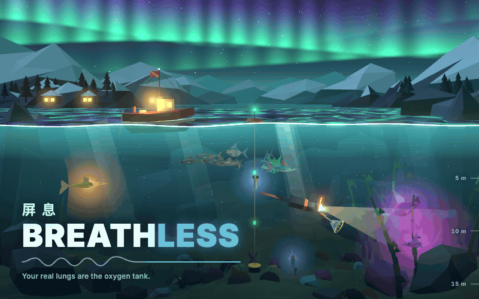

# HackRU26 · 屏息 Breathless

**English** · [简体中文](README.zh-CN.md)

<p align="center"></p>

> **Hold your real breath to dive and catch fish.** Your webcam, through Presage, detects whether you are holding your breath. The diver can only descend while you hold. The deeper you go, the rarer the fish. The moment you breathe underwater you have to race back to the surface, or you lose everything in your net. Fish you bring up can be minted as Solana NFTs and traded between players. The game also quietly records how long each hold lasted and your heart rate, and builds a health report whenever you ask for one.

> **Presage is temporarily off.** Its credits ran out (HTTP 402), so camera breath detection is switched off for now and the game plays in **keyboard mode**: hold `Shift` to hold your breath and dive. All the camera code is still in place behind two switches, both off by default; see [Turning Presage back on](#turning-presage-back-on).

Low-poly 2.5D, built with Three.js + TypeScript. Mostly front end, plus a local Node sensor service.

---

## Contents

1. [Overview](#1-overview)
2. [Quick start](#2-quick-start)
3. [Controls](#3-controls)
4. [Architecture](#4-architecture)
5. [Breath-hold detection](#5-breath-hold-detection)
6. [Code tour](#6-code-tour)
7. [Game design parameters](#7-game-design-parameters)
8. [Solana NFT](#8-solana-nft)
9. [Health report](#9-health-report)
10. [Local storage](#10-local-storage)
11. [Debugging tips](#11-debugging-tips)
12. [Status and to-do](#12-status-and-to-do)
13. [Working together](#13-working-together)
14. [Hackathon timeline](#14-hackathon-timeline)

---

## 1. Overview

### Core loop

```
On the surface ──hold breath──▶ dive ──Space: net fish──▶ deeper = rarer
   ▲                                                         │
   │                                          breathe underwater = OUT OF AIR
   │                                                         ▼
Surface = fish banked ◀── reach the surface within 3.2 s ────┤
                                                             └─ too late = BLACKOUT, every fish in the net is lost
```

- **Your breath is the air tank**: the game has no oxygen bar. Your lungs are the bar.
- **Greed against risk**: the deeper you dive, the rarer the fish and the more they are worth (mythic only below 50 m, and the trench has no bottom), but the farther you are from the surface, the harder it is to get back after you breathe.
- **Night**: when the natural cycle becomes dark, newly spawned fish roll their rarity twice and keep the higher result. `N` gradually switches between morning and night. The sea-monster risk is still on the to-do list.
- **Collection** (`C`): banked fish are rendered as 512×512 cards, and that card is the NFT image. The card is fully determined by the fish's seed, so anyone can render it again and check it. Every banked fish is minted as an NFT automatically in the background; **Sell** turns one into Pearls (section 7).
- **Rod upgrades** (`G`): in this game the fishing rod is the diver's hand net. Selling fish earns Pearls; Pearls buy a bigger net with more capacity and a longer catch reach.

### Three maps

All three maps are in the game. You choose one on the start card before a dive: a row of three map cards sits above the "Start with camera / Play with keyboard" buttons. The chosen map is also what you see behind the title screen. The full design is in [section 6 of the design doc](design/game-design-document.md#6-地图) (in Chinese). What is built:

| | Fjord 峡湾 (Norway / Iceland) | Heaven Lake 天池 (Zhangjiajie / Changbai) | Open Ocean 汪洋 |
| --- | --- | --- | --- |
| Difficulty | Casual | Normal | Hard |
| Zones above the seabed | 0–58 m, Shallows + Kelp Forest | 0–98 m, Shallows + Sunken Forest + Deep Basin | 0–60 m, Shallows + Coral Reef + The Abyss |
| Seabed | About 60 m, continuous rocky floor | About 100 m, continuous lake floor | 62 m shelf, then the bottomless trench |
| Above the water | Three staggered ranges of snow peaks with pine groves on the near slopes, a pine shore, two fishing cabins and a pier, ice floes; lit windows at night and, on most nights, curtains of aurora that the water mirrors | Stone pillars, a crater rim, a lakeside pavilion, drifting mist (thicker at night), a lantern at night | A storm front with sheet lightning, sea stacks, a lighthouse whose lamp turns at night |
| Underwater | Cold teal water, gray gravel and rock, kelp, no coral | Jade-green water, sunken logs and rock shelves, sparse weeds | The original reef: coral, kelp, sand |
| Waves | Half the ocean's height | Calmest | Full |
| Weather | Mostly fair, a short storm | Mostly fair, a short storm | Stormy: a third of the time in a storm, with twice the swell and rogue waves that capsize the boat |
| Sharks | None | None | One or two by day, two to four at night; hunt by your heart rate; rarer fish |
| Unlock | Open from the start | Total banked fish value 150 | Total banked fish value 1000 |

- **The trench**: only the Open Ocean has a bottomless trench under the boat. Fjord and Heaven Lake have continuous floors across the full width, with local height variation around 60 m and 100 m. The diver, fish, camera and sonar respect the drawn floor.
- **Depth zones**: Fjord opens Shallows and Kelp Forest; Heaven Lake opens Shallows, Sunken Forest and Deep Basin. Drop rates depend on absolute depth. Only the Open Ocean spawns a following trench school and shows an infinite Trench band; finite maps use a depth gauge scaled to their seabed.
- **Unlocking** (the thresholds exist, but the on-chain check from `player_state` v2 is coming next; all maps are still open today): a map opens by the lifetime catch value of every fish ever banked (see "Catch value" in section 7). Selling fish never lowers it, so a map never re-locks and progress never stalls. Unlocking Heaven Lake opens a deeper finite floor; Open Ocean adds the bottomless trench. When a dive banks enough to open a new map, a message says so.
- **Demo switch**: under the map cards there is a checkbox "Unlock all maps (demo)" that opens every map at once. It exists for demos and testing.
- **Saved progress**: the selected map, the lifetime banked value and the demo switch are stored in localStorage under the key `deepbreath.maps`. Unlock gating on lifetime banked value moves on chain with player_state v2, which is coming next; until then all maps are open.
- **Still design only, not built yet**: night creatures (Fjord: deer and bear; Heaven Lake: bear and giant; Open Ocean: big waves and a sea monster), map-specific daylight hours (05:00–20:00 day on the Fjord), fishing from the boat driven by heart rate, boat durability, and losing all gear for good when the boat sinks on the Open Ocean.
- **Upgrades**: rod, bait and boat (speed / durability / rod slots), plus a set of diving gear. See [section 7 of the design doc](design/game-design-document.md#7-经济与升级) (in Chinese). The upgrade parts (rod, reel, bait, boat engine / hull / fishing deck, net, fins, emergency tank, headlamp) have low-poly models at three levels each in `game/src/upgrades.ts`. The workbench uses these display models, and 27 of the 30 variants (everything except the reel, which is generated live) are archived as PNG/GLB in [the equipment asset library](assets/README.md#7-equipment-upgrade-models). Purchase and diving effects for the other equipment remain separate gameplay work.

### Hackathon positioning

| Item | Details |
| --- | --- |
| Track | Maverick |
| MLH prize targets | **Best Use of Presage** (breath-hold detection, heart rate) · **Best Use of Solana** (fish NFTs, trading) · possible later: ElevenLabs (sound effects / narration), Tiger Data (market and economy data), a .Tech domain |

### Multiplayer scope (important)

**Many players are online at once, but each one dives in their own separate world. Players only interact through trading.** There is no shared world and no real-time sync. Every "multiplayer" feature lives in the trading layer: wallet identity, listings, purchases, and a live feed of sales.

---

## 2. Quick start

### Desktop app

Just want to play? Open https://breathless.gotclass.xyz in a browser, or download the desktop app for Windows, macOS or Linux from [Releases](https://github.com/Breathless-Game/Breathless/releases). It is a window onto the same site (so it is always up to date and needs the internet) and asks for the discrete GPU on dual-GPU laptops. The builds are unsigned, so the first launch shows a warning: [how to open it anyway](desktop/README.md#first-launch-of-an-unsigned-build). Wallet login inside the desktop app is not done yet. Building and releasing it: [desktop/README.md](desktop/README.md).

### Requirements

- **Node.js 20+** (the dev machine runs v20.19.5)
- **macOS (Apple Silicon)** or **Windows**: the Presage Node SDK ships runtimes for `darwin-arm64`, `win32-x64` and `linux-x64/arm64`. Windows notes are under [Windows](#windows) below
- **Chrome** and a webcam (not needed for keyboard or simulation mode)

### Install and run

```bash
git clone https://github.com/Breathless-Game/Breathless.git
cd Breathless
npm run setup                 # installs dependencies for sensor/ and game/
cp .env.example .env          # then fill in PRESAGE_API_KEY (see below)
```

Open two terminals:

```bash
npm run sensor     # breath sensor service, ws://localhost:8787
```

```bash
npm run game       # the game, http://localhost:5173
```

(Or run `npm run dev` to start both at once. It works on macOS and Windows, and Ctrl+C stops both.)

After a `git pull`, start them the same way. If the pull added a dependency, the game and the sensor notice it is missing when they start and install it first.

### Windows

- **x64 machines**: follow the steps above as they are.
- **ARM machines (Snapdragon X and similar)**: the Presage SDK has no `win32-arm64` build, so ARM Node cannot load it. Use **x64 Node** instead; Windows 11 runs it under emulation:
  1. Download the x64 Node zip (for example `node-v24.x.x-win-x64.zip`) and unzip it anywhere.
  2. In every terminal, put it at the front of PATH before you run `npm run setup`, `npm run sensor` or `npm run game`:
     ```powershell
     $env:Path = "C:\path\to\node-v24.x.x-win-x64;$env:Path"
     node -p process.arch   # should print x64
     ```
  3. **Install and run with the same Node**: esbuild and rollup in `game/` are also installed per architecture. If you installed dependencies with ARM Node before, delete `sensor/node_modules` and `game/node_modules` and install again.

Open <http://localhost:5173>:

| Entry | What it does | Needs |
| --- | --- | --- |
| **Start with camera** (temporarily off: hidden unless the build sets `VITE_PRESAGE_ENABLED=1`) | Real mode: webcam → Presage → breath-hold detection | The sensor running with `PRESAGE_ENABLED=1`, and a Presage key |
| **Play with keyboard** | Hold `Shift` to hold your breath | Nothing |
| Simulation mode (press `K` in the game to switch; dev builds only while Presage is off) | The sensor generates a fake breathing waveform and heart rate; hold `Shift` to hold your breath | The sensor running; no key needed |

### Presage API key

- Get one at <https://physiology.presagetech.com/portal/dashboard>.
- Put it in `.env` at the repo root: `PRESAGE_API_KEY=...`
- **`.env` is in `.gitignore`. Never commit it.** Share the key with teammates privately; do not paste it into code, issues or PRs.
- With no key, the sensor switches to simulation mode by itself (`npm run sensor:sim` forces simulation).

### Turning Presage back on

Presage is **temporarily off**: there are two switches, one per side, and both are off unless set to `1` (or `true`).

- **Server, `PRESAGE_ENABLED=1`** in the repo-root `.env` (or the environment). Off, the sensor never loads the SmartSpectra SDK, ignores `PRESAGE_API_KEY` even if `.env` still has one, drops camera frames and only runs the simulator; its startup log says `Presage SmartSpectra is disabled`. Market, NFT metadata and everything else on the server work the same either way.
- **Game, `VITE_PRESAGE_ENABLED=1` at build time** (in `game/.env`, or on the command line: `VITE_PRESAGE_ENABLED=1 npm run build`). Off, the game never asks for the camera, hides **Start with camera** and the camera preview setting, skips calibration, and `K` offers the keyboard only (plus the simulator in a dev build). The health report keeps hold times, depth and outcomes; heart and breathing rate need the camera, so those tiles are hidden unless older camera dives have them.
- Turn **both** on, then restart the sensor and rebuild the game. Production runs on Vercel, which has no `/sensor` WebSocket, so it stays keyboard-only: live camera sensing needs a self-hosted `npm start` behind HTTPS (see Self-hosting), or a game built with `VITE_SENSOR_URL` pointing at such a sensor. With only the server on, the game stays keyboard-only; with only the game on, the server answers "turned off" and the game falls back to the keyboard.

### Testing breath detection on a real camera

Click **Start with camera**. Keep your face and chest in frame, in bright light.

1. Breathe normally for about 10 seconds so the detector learns how you breathe.
2. Then hold your breath. The label at the top left should turn green and read **HOLDING**, and the waveform goes flat.
3. As soon as you breathe, it switches back to **BREATHING**.

If it gets this wrong often, tune the constants in `sensor/breath-detector.mjs` (see section 5).

### Self-hosting / 自托管

The live build is at <https://breathless.gotclass.xyz>. It runs on Vercel, which deploys every push to `main` automatically (deploy/VERCEL.md). CI runs the game and sensor tests and the game's strict TypeScript build; the Anchor contract tests have a separate local-validator workflow (contracts/README.md).

`npm start` is the self-hosting server (production ran on it until 2026-10-13): one Node process on one port serves the built game, the breath sensor (WebSocket at `/sensor`) and the PEARL market (`/api/market`, section 8) together, so a single tunnel or reverse proxy can front it.

```bash
npm run setup      # once: installs sensor/ and game/ dependencies
npm run build      # builds game/ into game/dist
npm start          # http://127.0.0.1:8794, sensor at ws://127.0.0.1:8794/sensor
```

| Variable | Default | Meaning |
| --- | --- | --- |
| `PRESAGE_ENABLED` | off | `1` turns Presage live sensing on. **Temporarily off**: unset, the server ignores `PRESAGE_API_KEY` and never loads the SDK ([Turning Presage back on](#turning-presage-back-on)). |
| `VITE_PRESAGE_ENABLED` | off | Build time, for the game: `1` brings back the camera option. Leave it unset on Vercel, which cannot serve `/sensor` (deploy/VERCEL.md). |
| `PRESAGE_API_KEY` | empty | Goes in `.env` at the repo root **on the server only**. Without it the server runs the simulator. Ignored unless `PRESAGE_ENABLED=1`. |
| `PORT` | `8794` | HTTP + WebSocket port. Dev mode (`npm run sensor`) keeps `SENSOR_PORT`, 8787. |
| `HOST` | `127.0.0.1` | Bind address. Loopback, because the tunnel / proxy on the same machine is the only way in. |
| `MAX_LIVE_SESSIONS` | `1` | Players using live Presage at the same time. The SDK's native state is process-global, so it can't run two sessions in one process; `0` turns live sensing off. Anyone over the cap sees "Server busy" and plays with the keyboard. |
| `MAX_CONN_PER_IP` | `8` | Open sensor connections per player IP (read from `CF-Connecting-IP` / `X-Forwarded-For` when the proxy is local). |
| `SENSOR_RECORD` | off | `1` writes live sessions to `sensor/recordings/`. Off by default in serve mode: strangers' breathing data is never written to disk. (Dev mode records as before.) |
| `FISH_MARKET_PROGRAM_ID` | empty | PEARL market mode: empty = server mode, a program id = program mode (section 8). |
| `MARKET_DIR` | `sensor` | Where the market keeps its keypairs and state (`.market-*`), relative to the repo root. Never overwrite or delete them when you update the code; back them up. If the market can't start, the game and sensor still serve and `/api/market` answers 503. |
| `SOLANA_RPC` | devnet | The Solana RPC every server-side call uses: the market, the fish collection, payouts and burns (falls back to `VITE_SOLANA_RPC`, then `https://api.devnet.solana.com`). The public devnet endpoint rate-limits hard (HTTP 429) as soon as someone bulk-sells, so production should use a dedicated devnet RPC from a provider. That URL usually contains an API key: put it **only** in the server's `.env`, never commit it, and never put it in a `VITE_*` variable (those are bundled into the page). Logs show only its origin. |
| `SOLANA_RPC_CONCURRENCY` | `3` | Market RPC calls in flight at once. A 429 pauses all of them with backoff; raise this only on a paid RPC plan. |

- **The camera needs HTTPS.** Browsers only allow `getUserMedia` on `https://` pages (or `localhost`), so put a tunnel (e.g. Cloudflare Tunnel) or a TLS reverse proxy in front of `127.0.0.1:8794`. The built game connects to `wss://<same host>/sensor` by itself; set `VITE_SENSOR_URL` at build time to point it elsewhere.
- **Solana RPC hiccups don't take the server down.** All market RPC goes through one limiter (`SOLANA_RPC_CONCURRENCY`) with a shared 429 backoff, and confirmations are polled over HTTP (no websocket subscriptions). A burn that fails after a payout is retried in memory, and on start-up and every 10 minutes the market burns the fish its sold ledger says were paid but not burned yet, one account lookup per fish and no chain-wide scan, stopping early on a 429 (`[market] sweep: ...` in the log). A stray promise rejection is logged as `[process] unhandled rejection (kept running)` instead of exiting; `[process] BUG: ...` lines are programming errors worth a look.
- **Production is Vercel** (since 2026-10-13): the game as static files and every `/api` route in one function, with the market's state in Upstash Redis. Vercel deploys every push to `main` through its own GitHub integration, and every PR branch gets a Preview. There is no `/sensor` WebSocket, so it is keyboard mode only. Setup, environment variables, a preview with a test wallet and rolling back a bad deploy: [deploy/VERCEL.md](deploy/VERCEL.md#english). GitHub Actions (`.github/workflows/ci.yml`) only runs the tests and the build; it deploys nothing.
- **The old Dell setup is retired.** Until 2026-10-13 production ran `npm start` on a team machine (systemd + a self-hosted GitHub Actions runner + Cloudflare Tunnel). Its scripts (`deploy/SETUP.md`, `deploy/deploy.sh`, `deploy/bootstrap-dell.sh`, the systemd unit and sudoers file) were removed from the repo; they are still in the git history if you want to self-host that way.
- **Bandwidth.** Live mode sends every 640×480 camera frame as a JPEG, 30 fps, about **3–6 Mbit/s of upload per player** (Chrome at quality 0.7: 16–20 kB per frame for a plain scene, 30–35 kB for a busy one). Presage wants ~25+ fps and its trace degrades below ~15, so the game keeps the frame rate and gives up quality instead: it aims at 25 kB per frame (6 Mbit/s at 30 fps) and steps the JPEG quality between 0.8 and 0.4 when frames run larger or a slow uplink makes it skip frames. A ~5 Mbit/s uplink keeps 30 fps for typical scenes; slower ones skip frames. The sensor decodes with [sharp](https://sharp.pixelplumbing.com/) (libvips): about 2 ms per frame on its own thread, roughly 3% of one core more than raw frames. Keyboard and simulator mode send no frames.
  - Raw RGBA (1.23 MB per frame, ≈295 Mbit/s at 30 fps) is still the default for a dev build talking to a sensor on the same machine. Add `?frames=raw` or `?frames=jpeg` to the page URL (or set `VITE_FRAME_FORMAT` at build time) to force either.
  - To check a deployment's upload path from a player's network without a camera: `node sensor/stream-test.mjs wss://<your host>/sensor` streams synthetic JPEG frames for 20 s and prints the upload rate, frames skipped and frames Presage accepted (`--raw`, `--fps`, `--quality`, `--image face.jpg` are options).

---

## 3. Controls

Every dive key can be rebound in **Settings → Controls** (on the Settings desk, or from any table). Bindings are stored per device (`deepbreath.controls`). The defaults:

| Key | Action |
| --- | --- |
| `←` `→` `↑` `↓` / `WASD` | Swim left / right / up / down (you cannot dive from the surface unless you are holding your breath) |
| `Shift` (hold) | Hold your breath (keyboard and simulation modes) |
| `Space` | Swing the net to catch fish |
| `Tab` | Flip the hotbar to your bag of fish and back |
| `Q` / `E` | Previous / next gear |
| `1`–`6` | Quick gear (fixed, not rebindable) |
| `V` | Sonar |
| `F` | Climb aboard from the surface beside the boat; mash it to heave a capsized boat upright (Open Ocean storms) |
| `N` | Gradually switch morning / night; natural cycle and afternoon are available in settings |
| `K` | Cycle the breath input: presage → sim → keyboard (Presage off: keyboard only; sim too in a dev build) |
| `C` | Collection and NFT panel (tick-box bulk sell) |
| `G` | Rod / net upgrade panel |
| `B` | Illustrated field guide and first-dive tutorial |
| `H` | Health report (built only when you press it) |
| `Esc` | Aboard / back (fixed). Closes any open panel first; mid-dive it takes you to the workbench, there is no pause menu; on a table it goes back one step |
| `Enter` (main menu) | Same as clicking the START fish |

`B` opens and closes the illustrated field guide and first-dive tutorial. The six notebook chapters cover workbench assembly, loadout, diving, catching, surfacing and deep sonar. The first visit offers an optional step-by-step tour; its choice and completed lessons are saved locally. Opening the book pauses the dive, and `Esc` or `B` closes it.

**Main menu**: when it opens, a rope (both ends off-screen) swings out from the left and hooks onto the right, then a few fish drop from above and hang from the rope on fishing lines. The button names are printed on the fish's bodies. A fish with a long name (4+ characters) hangs level on two lines, at the head and the tail, and the two lines even out like a pulley so the name stays level even where the rope slopes. Clicking the golden **START** fish (or pressing Enter) pans the camera down to the workbench (the rope and its fish ride up to the top of the screen and stay live); the other fish go to the tables: **AQUARIUM** (your tank), **HEALTH** (your trip reports) and **SETTINGS**. **GUIDE** and **TUTORIAL** hang on a second rope behind them. Everywhere except the title, a draggable guide / tutorial launcher stays on screen. You can drag and fling the fish and the rope with the mouse, and they are pushed aside when the pointer sweeps past them. The entrance animation is skipped when the system has "reduce motion" turned on.

**Workbench** (`workbench.ts`, chart in `chart.ts`): a wooden table seen at an angle (2.5D, its own Three.js scene), with a folded sea chart in the middle and a READY tray on the right.
- The gear (fins, emergency tank, headlamp, rod, net, bait) drops in as 3D models and lands with a thud: a bounce, a puff of dust, a camera shake, and nearby pieces jump. Hand-rolled physics: gravity, a bounce off the tabletop, circle collisions on the table.
- Hover a piece for its name and effect. Click it to set it in the READY tray (green ring); click it there to toss it back onto the table. Pieces can also be dragged (onto the tray to get them ready) and thrown.
- The title rope is pulled taut across the screen high up (about a fifth of the way down), with the fish reeled up close under it so they hang clear above the back of the table; they cast soft shadows on it. Gear can be set down on the chart too; clicking the chart makes whatever lies on it hop off and land beside it.
- The chart is a simulated sheet of paper (`paper.ts`, a height field): it remembers its fold, and its stiffness smooths kinks out. On the table it lies with its edges on the tabletop and only the fold standing up; gear lying on it presses that patch flat, and a thud nearby makes the edges jump and fall back. Held up, its ends curl a little. Moving the pointer over it wrinkles the paper right around the pointer, across the way it moves; the wrinkles smooth out once it stops. Carried, it sags a little with inertia and comes back without wobbling.
- Click the chart: it is picked up, flattened out (its ends still curl a little) and carried to the middle of the screen over the blurred table, where it stays in your hands, leaning gently toward the pointer; the place pins ride on the paper with the three places, one per chapter (I Fjord, II Heaven Lake, III Open Ocean; a place's difficulty is the game difficulty). Every place can be picked (no unlocking from the chart). Picking one turns the world behind the table to that map and shows, in the panel on the right, a frame of it rendered from where the dive starts, its description and your ready gear, then **Dive** (or click the place again, or Enter): the frame grows from the panel to the full screen, the live game takes over underneath in exactly that view, and the frame fades off it; then the start card (camera / keyboard / breath test). Click outside the chart or press Esc to fold it back.
- Esc on the bare table pans back up to the title.
- The packed gear is passed to the game (`loadout`), but the upgrade effects aren't wired into the dive yet.

**Tables and going aboard**: there is no pause menu. Switching to another browser tab, or pressing `Esc` or `F` in a dive, takes you aboard to the workbench with the dive held where it was; `Esc` on the table dives on again. When you resume underwater there is a 3-second countdown first so you can take a breath and hold it again; otherwise the breathing you did while away would count as "breathing underwater". The AQUARIUM, HEALTH and SETTINGS tables work from the title and from any table, including aboard mid-dive: a 3D glass aquarium tank, a health desk (the latest trip report on paper, earlier ones in a jar) and a settings desk (language, controls, time of day, delete my health data). Going back to the main menu releases the camera and the sensor connection. If there are fish in your net, you are asked to confirm first: the fish are lost, but the hold still goes into your health data.

**HUD**: the hotbar sits at the bottom centre (`Tab` flips it to your bag of fish), the camera preview at the top left, and the breath readout floats over the diver's head. There is no BANKED panel.

**Language**: Settings has a language choice, English or 中文, one at a time (`deepbreath.language`).

---

## 4. Architecture

```
┌──────────────────────── Browser (game/, Vite + Three.js) ────────────────────────┐
│                                                                                   │
│  getUserMedia 640×480 ──► BreathSource ──binary WS frames──┐                      │
│                             ▲   (breath.ts)                │                      │
│                             └── state JSON @ ~12.5 Hz ◄────┼──┐                   │
│                                                            │  │                   │
│  main.ts game loop ─► World / Diver / Fish / Hud           │  │                   │
│        │             HealthLog ─► Report (on demand)       │  │                   │
│        └─► Vault (collection) ─lazy import─► chain.ts ─────┼──┼──► Solana devnet  │
│                                                ▲           │  │    (Metaplex Core)│
│  localStorage: bank / health / wallet          └───────────┼──┼──► Irys devnet    │
└────────────────────────────────────────────────────────────┼──┼───(image + JSON)──┘
                                                             ▼  │
                         ┌────────── sensor/ (Node, :8787) ─────┴────┐
                         │  Session per WS connection                 │
                         │  SmartSpectraSDK.useCustomInput()          │
                         │    └─ sendFrame(RGBA) ─► Presage cloud     │
                         │  metrics ─► BreathDetector ─► state        │
                         └────────────────────────────────────────────┘
```

**Why does the browser open the camera, and not Node?** macOS does not grant camera permission to a node process started from an IDE or from Claude, so the SDK's `useCamera` never receives a frame. Instead the browser captures frames and pushes them to the sensor over WebSocket, and the sensor hands them to the SDK with `useCustomInput` + `sendFrame`.

**Player data lives on chain.** Gear, PEARL, aquarium and progress are read from Solana (`player-chain.ts`, `player-sync.ts`, `player-state.ts`); the server stores no player data and `localStorage` is only a cache. Health and breath data are the exception: they never leave the browser (section 9).

### WebSocket protocol (`ws://<host>:8787` in dev, same-origin `/sensor` with `npm start`)

**Browser → sensor**

- **Binary frames**: a 12-byte header followed by the image, all little-endian. `game/src/frame-codec.ts` writes them and `sensor/frames.mjs` reads them; `game/tests/frame-protocol.test.mjs` tests the two against each other.
  | Offset | Type | Meaning |
  | --- | --- | --- |
  | 0 | f64 | Timestamp (ms, must keep increasing; the SDK restarts if the gap is over 2 s) |
  | 8 | u16 | Bits 0–11: width (640). Bits 12–15: format, `0` = raw RGBA, `1` = JPEG |
  | 10 | u16 | Height (480) |
  | 12… | u8[] | Raw: RGBA, width × height × 4. JPEG: one JPEG image of width × height |
  - Format 0 leaves the width field as it always was, so raw frames are byte-for-byte the original protocol. The sensor decodes JPEG to RGBA and hands Presage exactly what raw frames gave it. Decoding runs one frame at a time with one newer frame waiting; a frame that arrives while one waits replaces it, so a slow server drops frames instead of queueing them.
  - Backpressure: the browser skips frames while `ws.bufferedAmount` is over 100 kB (JPEG) or 4 frames (raw), sends at most 30 fps, and encodes at most two JPEGs at a time, sent in capture order (`game/src/frame-pump.ts`).
  - Capture (`game/src/breath.ts`, `camera-encoder.worker.ts`): Chrome and Edge feed a `MediaStreamTrackProcessor` to a worker that encodes with `OffscreenCanvas.convertToBlob`, so the send rate follows the camera, not the game's render rate. Safari and Firefox copy each presented video frame to that worker as an `ImageBitmap`. Without a worker the page encodes with `canvas.toBlob`, which Chrome runs only when the main thread is idle: a busy three.js page got as little as ~1 frame a second out of it. No frames go out while the tab is hidden (Presage bills per measurement); they resume when it is visible again.
- **JSON commands**: `{ "t": "sim", "on": true }` turns simulation on or off; `{ "t": "simHold", "holding": true }` sets the simulated hold; `{ "t": "seed", "baseline": 0.8 }` (`"type": "seed"` also works) hands back a live baseline from an earlier connection's `state` (sim sessions always report `baseline: null`). It is used only if this connection has no baseline yet and only if it is a finite number in [0.001, 1000]; anything else is ignored. It stays in memory: never logged or written to disk. `{ "t": "stats", "pipe": "mstp", "camFps": 30, "capFps": 29.9, "rvfcFps": 14.2, "renderFps": 14.1, "sentFps": 29.8, "skippedEncoder": 0, "skippedBackpressure": 2, "encodeMsAvg": 5.1, "quality": 0.7 }` comes every ~10 s while live: the camera pipeline's performance numbers (camera rate from `getSettings().frameRate`, frames captured, `requestVideoFrameCallback` and render rates, frames sent and skipped, encode time, JPEG quality), never breath or health data. The sensor keeps only those fields as finite, clamped numbers (`sensor/client-stats.mjs`) and appends them to its once-a-minute `frames, last 60 s` log line; they are never recorded or stored anywhere else.

**Sensor → browser** (every 80 ms)

```jsonc
{
  "t": "state",
  "source": "presage" | "sim",
  "status": "running", "hint": "Move closer…",   // hint translated from the ValidationCode
  "rate":  { "value": 15, "confidence": 90 },     // breathing rate (needs a ~30 s window)
  "pulse": { "value": 72, "confidence": 90 },     // heart rate
  "frames": 1234,
  "holding": true, "holdMs": 8200, "releasing": false,  // releasing: a release is waiting to be confirmed
  "calibrated": true,  // a hold can be called: baseline known and "warm" (past the start-up swings)
  "warm": true, "baseline": 0.8,  // baseline: null until learned or seeded; the game keeps it for its next seed
  "flatness": 0.93, "apnea": false, "talking": false,
  "trace": [ /* the last 90 chest-movement samples */ ]
}
```

Errors arrive as `{ "t": "error", "message": "…" }`. `"code": "busy"` means every live Presage slot (`MAX_LIVE_SESSIONS`) is taken: the game stops sending frames and falls back to the keyboard. With Presage off (`PRESAGE_ENABLED` unset) a game asking for the camera gets that same `busy` once, with `"reason": "off"`, so every build falls back. `"code": "frames"` means the sensor can't decode JPEG (sharp isn't installed): the game switches to raw frames.

---

## 5. Breath-hold detection

File: `sensor/breath-detector.mjs`. The input is Presage's chest-movement trace, `breathing.upperTrace`.

**What real recordings told us** (2026-10-10, two 2.5-minute breath tests by the same person, 8 holds in total):

- For the first few seconds after Presage starts, the trace swings wildly (about 10 times the amplitude of normal breathing). The old detector used those seconds to learn the "normal breathing amplitude", so it called a hold right at the start and never left it: 44% accuracy, with normal breathing misread as a hold 86% of the time.
- The trace is high-pass filtered. During a hold it first jumps up with the last inhale, then takes about 3 seconds to settle back to flat. It does not stay high.
- Over 15-second holds, Presage's own apnea flag never fired once, so it is off by default.
- The signal itself separates well: the movement within 2 seconds of normal breathing is about 5–20 times the movement during a hold.
- **The trace glitches mid-hold.** In the second test the player stayed completely still and did not breathe, yet the trace jumped twice in the middle of a hold. Once it jumped up by about one breath's size, once it dipped a little. Activity alone can't tell these apart from breathing again, so the activity-only detector (v3) told the diver "you breathed" twice.
- **A real release always starts with an exhale.** All 8 releases begin with the trace dropping 1.55–3.5 × the baseline. The two glitches dropped about 1 × at most. Up is inhale, down is exhale.

**What the detector does now: holds are found by "activity"**, which is the distance the trace travels per second (path length). **Releases are found by the exhale.**

1. **Learn a baseline once**: nothing is learned in the first 8 seconds after start; then take the activity over the next 6 seconds of normal breathing and use the **median** as the baseline B, so an occasional spike does not affect it. B is then **frozen**, so the deep breaths and gasps around dives cannot drag it around, and it is **never relearned**: a Presage restart in the same connection (camera reopen, stall, error) keeps it, and the game sends it back as a `seed` when it reconnects, so a new dive skips learning and only waits 3 s for the new pipeline.
2. **Call a hold**: the activity over the last 2 seconds is below `0.38 × B`.
3. **Call a release, mainly on the exhale**: the detector tracks a "hold level". It follows the slow settling after the inhale, but freezes while the trace jumps around, so a glitch can't drag it along. The hold ends when the trace drops more than `1.1 × B` below that level, and also below the highest point of the last 1.5 seconds, for 0.1 seconds. A jump up of more than `2 × B` also counts; that covers someone who held with empty lungs and breathes in first.
4. **In the first 2 seconds of a hold**, which may just be a pause between breaths, activity alone still ends it: the activity over 0.75 seconds is above `0.5 × B` for 0.2 seconds.
5. **Fallback**: activity over 2 seconds above `0.8 × B` for 4 seconds in a row always ends a hold, so it can never get stuck. Talking for more than 0.5 seconds also counts as a release.
6. **Blip tolerance**: the exhale, inhale and early-activity rules above only start a *pending* release (`releasing: true` in the state, `holding` stays true). If within 0.8 seconds the trace is back within `0.5 × B` of the hold level and has sat quiet there for 0.3 seconds, it was a blip (a spike, a short dip, a head twitch) and the hold carries on with its original start. Otherwise the release stands, with the reason that started it. A real exhale now ends a hold ~1.3 s after it starts (was ~0.5 s). Talking and the 4-second fallback end a hold at once.
7. **Right after a release**: no new hold is called for 2 seconds.
8. **Debounce on the game side** (`RELEASE_DEBOUNCE_MS` in `main.ts`): "breathing" underwater has to last 0.5 seconds before it counts.

Replaying both recordings:

| | v3 (activity only) | now (exhale) |
| --- | --- | --- |
| "You breathed" while still holding | 2 | **0** |
| Hold recognized (from the prompt) | median 2.9 s | median 2.8 s |
| Release recognized | about 1.0 s | median 1.6 s, worst 2.0 s |
| Normal breathing misread as a hold | 1.2% | 1.2% |

Releases are about 0.6 seconds slower. In return, a diver is never wrongly told they breathed. Any exhale threshold from 1.0 to 1.3 gives zero mid-hold releases; at 0.9 errors start, so 1.1 leaves margin on both sides. `--sweep` prefers 0.9 because it only sees these two recordings, and we don't trust it.

| Option | Default | Effect |
| --- | --- | --- |
| `activityWindowUs` | 2 s | Window for the hold test |
| `holdRatio` | 0.38 | Higher calls a hold more easily and earlier, with more false positives |
| `exhaleRatio` | 1.1 | How far (× B) the trace has to drop to count as an exhale. Lower releases faster, but small glitches mid-hold may count |
| `inhaleRatio` | 2.0 | How far (× B) a jump up has to go to count as breathing in first |
| `exhaleWindowUs` | 1.5 s | The drop has to happen within this window, which rules out the slow settling after a hold starts |
| `exhaleHoldUs` | 0.1 s | How long the exhale has to last |
| `quietRatio` / `levelTauUs` | 0.5 / 1 s | The hold level only follows the trace while it is quiet, and this fast |
| `trustAfterUs` | 2 s | For this long into a hold, activity alone ends it |
| `releaseWindowUs` / `releaseRatio` / `releaseHoldUs` | 0.75 s / 0.5 / 0.2 s | What "activity" means in the line above |
| `sustainedRatio` / `sustainedUs` | 0.8 / 4 s | Fallback: this much breathing for this long always ends a hold |
| `warmupUs` | 8 s | Ignores the seconds when Presage swings wildly at start-up |
| `minBaselineUs` | 6 s | How much normal breathing is learned, once, before any hold is called; the baseline is fixed after that |
| `releaseConfirmUs` / `settleUs` / `settleRatio` | 0.8 s / 0.3 s / 0.5 | Blip tolerance: a release has 0.8 s to turn out to be a blip, i.e. the trace back within 0.5 × B of the hold level and quiet for 0.3 s |
| `seededWarmupUs` | 3 s | Warmup when the baseline is already known: the start-up swings can't read as a hold then, so only one 2-s activity window plus margin is needed |
| `useApnea` | false | Whether to use Presage's apnea flag |

Note: the thresholds have been checked against one person and two recordings only. **On a new person, run the breath test once to confirm them**, and check especially that "down is exhale" holds on their camera too. `analyze.mjs` prints `release reasons`; normally most should be `exhale`.

### Tuning with real data (record → analyze)

Do not change thresholds by feel. Record data first:

1. **Easiest: click "Breath test (2.5 min) · 憋气测试" on the title screen.** The screen prompts you on a fixed schedule: breathe normally for 30 seconds, then "get ready → hold for 15 seconds → breathe for 15 seconds", 4 rounds. Every second is labeled automatically, with no key to press. At the end it shows how many holds were detected, the average delay, and the share of normal breathing that was misread.
   You can also simply play in camera mode: **hold `Shift` every time you really hold your breath**, and let go when you breathe. The top left of the HUD shows "⏺ marking your hold". That is the ground truth.
2. The sensor writes the whole session to `sensor/recordings/<time>.jsonl`: the raw chest and abdomen traces, apnea, talking, heart rate, frame rate, your Shift labels, and the calibration phase. **This is physiological data. It is gitignored; do not commit it.**
3. Analyze:

```bash
node sensor/analyze.mjs
```

It prints:

- the webcam frame rate, and the interval and latency of the Presage data batches;
- the amplitude ratio between "breathing" and "holding" for the chest and abdomen traces (a larger ratio is easier to separate);
- whether the trace drifts during a hold;
- how the current detector compares with your labels: agreement, false-positive rate, flips per minute, detection delay.

```bash
node sensor/analyze.mjs --sweep
```

Grid-searches `holdRatio` / `exhaleRatio` / `exhaleWindowUs` / `trustAfterUs` and lists the best few combinations. Telling a diver they breathed while still holding costs the most.

```bash
node sensor/analyze.mjs --trace=lo --exhaleRatio=1.3
```

Replays with the abdomen trace, or with a specific set of parameters.

Note: Presage's breathing rate needs a window of about 30 s and is not available while you talk. All metrics are for wellness reference only, not for medical use.

---

## 6. Code tour

```
.
├── package.json            root scripts: setup / sensor / game / dev
├── scripts/dev.mjs         npm run dev: starts sensor and game together (cross-platform)
├── scripts/ensure-deps.mjs runs before the game and the sensor start: installs dependencies that are missing
├── .env.example            PRESAGE_API_KEY, SENSOR_PORT
├── intro/HackRU26.md       hackathon intro and timeline (Chinese and English)
├── design/game-design-document.md  design doc (Chinese): three maps, creatures, upgrades, improvements
├── assets/                 asset library: a picture and the parameters of every fish species and the fishing rod
├── sensor/                 Node breath sensor service
│   ├── index.mjs           WS server, one Session per connection, Presage SDK, simulator (with fake heart rate)
│   ├── breath-detector.mjs breath-hold detection (section 5)
│   ├── recorder.mjs        records camera sessions as JSONL (sensor/recordings/, gitignored)
│   └── analyze.mjs         replays recordings, compares with the Shift labels, grid-searches thresholds
└── game/                   Vite + TypeScript + Three.js
    ├── index.html          DOM for the HUD, title card, collection panel and report panel
    ├── vite.config.ts      port 5173; Node polyfills (needed by Umi and Irys)
    ├── asset-library.html  dev-only preview page for the asset library (src/asset-library.ts)
    ├── tests/              node --test: render quality, daylight, weather and fish economy tests
    └── src/
        ├── main.ts         entry: scene, phase machine (menu/calibrating/play/blackout), main loop, input, banking
        ├── breath.ts       BreathSource: captures and pushes camera frames, WS state, keyboard/sim modes
        ├── breathtest.ts   the 2.5-minute breath test on the title screen: prompts holds and breathing, labels them automatically
        ├── world.ts        underwater terrain built from the selected map (seabed shelf with the trench gap under the boat, endless trench walls, rocks, coral, kelp), light rays, snow, water surface, boat; fog and color by depth; day and night
        ├── seabed-layout.ts the sand as a height grid, and where each map's rock outcrops, stacked back wall, kelp groves and seagrass meadows stand on it
        ├── kelp.ts         the four plants (giant kelp, seagrass, broad-leaved kelp, sea fern) as one flat-shaded mesh
        ├── kelp-motion.ts  how plants move: current, swell, leaf flutter, the diver's wake (shared by the shader and the tests)
        ├── flora.ts        what grows on each map and in which colors; how leaf color changes with depth
        ├── daylight.ts     continuous 24-hour lighting, 12-minute natural cycle, smooth morning / afternoon / night previews
        ├── sky.ts          atmospheric sky, time-driven sun / moon and layered clouds
        ├── color-grade.ts  shared morning / afternoon / night color balance in scene materials
        ├── sunshafts.ts    soft underwater sunlight scattering, batched into one draw
        ├── water.ts        GPU waves, facet color and the faceted road of sun / moon glitter
        ├── water-geometry.ts deterministic, watertight triangles with face color and patch attributes
        ├── shark.ts        sharks on Open Ocean: day/night population; pulse sets senses, speed and bite; their swimming (pure rules)
        ├── shark-fx.ts     the low-poly shark model and how it turns, leans and sweeps its tail
        ├── storm.ts        rough seas: when rogue waves form, the wave's shape, the capsize and how the boat lies, what is lost (pure rules)
        ├── storm-fx.ts     what a rogue wave looks like: foam on the crest, spray, the burst on impact, cargo and fish overboard
        ├── weather.ts      natural weather cycle, smooth clear / cloudy / rain / storm transitions
        ├── rain.ts         GPU rain in one draw call, with quality-dependent rain limits
        ├── maps.ts         the three map definitions (open zones and shelf depth, unlock value, palette) and the saved map progress
        ├── scenery.ts      the above-water scenery for each map
        ├── aurora.ts       the fjord's northern lights: ray curtains, when they show, and the glow the water mirrors
        ├── lowpoly.ts      shared low-poly helpers: flat material, vertex jitter, per-face coloring, a batcher that merges static pieces into one mesh per material
        ├── mappicker.ts    the map cards on the start card
        ├── diver.ts        low-poly diver, kicking, net, headlamp, bubbles
        ├── gear.ts         the net model that stands in for the fishing rod: grip, reel, shaft, hoop and mesh
        ├── equipment.ts    rod level, Pearl balance, saved state and the upgrade rule
        ├── gear-panel.ts   the rod / net upgrade panel
        ├── upgrades.ts     upgrade definitions and the centred workbench model API
        ├── fish.ts         rarity table, zone names, species names, rollFish(seed, depth), catch value by depth, fish meshes, swim and flee AI
        ├── marine.ts        non-fish species: sharks, octopus, lantern anglers, turtles and jellyfish (35 species in all with fish.ts)
        ├── fish-card-geometry.ts draws the fish card; the in-game card and the NFT image share this code (bundled into sensor/fish-card.gen.mjs)
        ├── depth-odds.ts   drop rates by depth (RARITY_BY_DEPTH), zoneName(depth); no imports, tested in tests/depth-odds.test.mjs
        ├── rng.ts          mulberry32 seeded random numbers
        ├── portrait.ts     offscreen rendering: fishIcon (192 px) and fishCard (512 px, the NFT card)
        ├── hud.ts          breath panel and waveform, depth gauge, emergency bar, net slots, banked count, toasts
        ├── vault.ts        collection panel: NFT status, Sell / Mint & sell, wallet bar
        ├── market.ts       pure economy rules: NFT status machine, legacy migration, sell value, lifetime unlock value
        ├── nft-queue.ts    background mint and sell queue (lazy-loads chain.ts and pearl.ts)
        ├── pearl.ts        PEARL client: balance, sell, spend (server side: sensor/market.mjs)
        ├── chain.ts        Umi, throwaway wallet, airdrop, mintFish, burnFish
        ├── player-chain.ts  on-chain player actions: gear, crafting, synthesis and feeding burn PEARL in one transaction
        ├── player-sync.ts   reads the chain as the source of truth; localStorage is only a cache
        ├── player-state.ts  client for the player_state program (PlayerState and Aquarium accounts)
        ├── polyfills.ts    Buffer and global
        ├── health.ts       HealthLog: hold time, heart rate and recovery time for every dive
        ├── report.ts       health report: metric tiles, two charts, interpretation text, save as PDF, delete data
        ├── trip.ts          trips: stats from the first dive until back in port, then the trip report
        ├── health-desk.ts   the health desk: latest trip report on paper, a jar of earlier ones
        ├── controls.ts      rebindable controls (Settings → Controls), saved per device
        ├── pause.ts        Esc pause menu: resume (3-second countdown underwater), settings, back to the main menu
        ├── title.ts        main menu: a Verlet rope with fish hanging on fishing lines, mouse dragging and pushing; the START / SETTINGS fish are the buttons
        ├── workbench.ts    workbench: 2.5D table scene, gear drop physics, READY tray, sea chart that opens into the three places
        ├── table-scene.ts   the tables: aquarium, health desk and settings desk, reachable from any table
        ├── aquarium-tank.ts the 3D glass aquarium tank and its fish
        ├── chart.ts        the sea chart drawing (folded map texture and the open chart)
        ├── settings.ts     player settings (render quality, lighting effects, weather, camera preview, control hints), stored in localStorage
        ├── render-quality.ts  automatic render quality: picks a starting level from the device, steps down on sustained low frame rate
        ├── showcase.ts     showcase page (`/showcase.html`): the scene in the GIF at the top of the README, built from the game's own diver and fish models
        └── style.css       dark glass-style HUD
```

---

## 7. Game design parameters

Pictures and per-species numbers for all 17 fish species and the fishing rod are in the [asset library](assets/README.md).

### Depth zones and drop rates (`RARITY_BY_DEPTH` in `depth-odds.ts`)

Fjord has a finite seabed around 60 m; Heaven Lake's is around 100 m. Only the Open Ocean continues forever below its 62 m shelf. Each finite map's last named zone extends to 2 m above its nominal floor: Kelp Forest is 18–58 m and Deep Basin is 38–98 m. Fish counts grow with the depth span, keeping the expanded water stocked. Drop rates and catch value still depend on absolute depth: 30 m in Fjord's Kelp Forest rolls exactly like 30 m on the Open Ocean's reef.

Rarity is a smooth function of the depth a fish is caught at: percent weights at these anchor depths, linearly interpolated in between, and constant below 350 m. Epic only appears below 15 m, legendary below 30 m, mythic below 50 m. The spacing comes from the measured swim speed of ~7.75 m/s: a 30 s hold reaches ~115 m and back with no fishing, 60 s ~230 m.

| Depth | common | uncommon | rare | epic | legendary | mythic |
| --- | --- | --- | --- | --- | --- | --- |
| 0 m | 90 | 9.5 | 0.5 | – | – | – |
| 15 m | 80 | 17 | 3 | – | – | – |
| 30 m | 68 | 24 | 7 | 1 | – | – |
| 50 m | 58 | 28 | 10.5 | 3 | 0.5 | – |
| 80 m | 48 | 31 | 14 | 5.5 | 1.3 | 0.2 |
| 120 m | 39 | 32 | 18 | 8 | 2.4 | 0.6 |
| 200 m | 30 | 30 | 22 | 12 | 4.5 | 1.5 |
| 350 m+ | 22 | 26 | 25 | 16.5 | 7.5 | 3 |

At night every fish rolls twice and keeps the rarer result (`rollFor` in `main.ts`).

Per net of 6 fish (the Lv1 net; day, expected count = 6 × P(legendary or mythic)): at 80 m that is 6 × 1.5% = 0.09, about 1 legendary-or-better per ~11 nets; at 120 m 6 × 3.0% = 0.18, about 1 per ~5.6 nets.

### Catch value (`rewardMultiplierAt` in `fish.ts`)

| Depth | 0–18 m | 18–38 m | 38–60 m | 60 m+ (The Trench) |
| --- | --- | --- | --- | --- |
| Reward multiplier | ×1.0 | ×1.6 | ×2.5 | ×2.5, plus 1 for every 50 m below 60 m, up to ×6 (reached at 235 m) |

**Catch value** = the rarity `value` (table below) × the reward multiplier at the depth the fish was rolled at (where it spawned), rounded. A rare fish is worth 10 in the Shallows, 16 on the Reef, 25 in the Abyss, 35 at 110 m and 60 from 235 m down. It is shown as "pts" on the toast, the HUD and the collection cards, sorts the collection, is written to the NFT metadata as `Catch value`, and counts toward map unlocks, and is what selling the fish pays in Pearls. Fish banked before this change have no stored value and count at their plain rarity value.

### Rarity (`RARITY`)

| Rarity | Color | value |
| --- | --- | --- |
| common | `#b8c4cc` | 1 |
| uncommon | `#5fd38d` | 3 |
| rare | `#4aa8ff` | 10 |
| epic | `#b46cff` | 35 |
| legendary | `#ffb340` | 150 |
| mythic | `#ff5fd2` | 800 |

The rarer the fish, the faster it swims, the more easily it flees, and the brighter it glows. Mythic fish cycle through colors.

### Main loop constants (`main.ts`)

`SWIM_ACCEL 24` · `DRAG 2.4` · `MAX_SPEED 7.5` · `SURFACE_DEPTH 0.9` · `EMERGENCY_SECONDS 3.2` (time left after you breathe) · `EMERGENCY_LIFT 18` (strength of the emergency ascent) · `FISH_PER_ZONE [32, 32, 24]` (fish per zone, for the zones a map opens on its shelf) · `TRENCH_FISH 12` (a school kept in a window around the diver's depth in the trench, each rolled for the depth it spawns at) (only Open Ocean generates the bottomless trench)

The playable corridor over the shelf is 280 m wide (`x = -140…140`); below the shelf, the trench walls keep the diver under the boat. Diver movement and camera look-ahead share the same clamped boundary, so pressing into either edge never reveals the empty side of the map.

Net capacity and catch radius are no longer constants in `main.ts`: they come from the equipped net tier below.

### Rod / net upgrades (`ROD_TIERS` in `equipment.ts`)

The fishing rod is the diver's hand net. Upgrades change only the gear; they never extend breath time.

| Level | Name | Capacity | Catch radius | Upgrade cost |
| --- | --- | ---: | ---: | ---: |
| Lv1 | Basic Net | 6 | 2.4 m | starting gear |
| Lv2 | Reinforced Net | 8 | 2.8 m | 300 Pearls |
| Lv3 | Abyssal Net | 10 | 3.2 m | 1200 Pearls |

**Economy**: banking pays nothing. Each banked fish is queued as an NFT (`pending → minting → minted`, or `failed` with automatic backoff and a Retry button). Pearls come only from **selling** a minted fish in the collection: the NFT is burned and its catch value is paid in PEARL, an SPL token (see "PEARL coin" below). An unminted fish shows **Mint & sell** (the market only buys NFTs), a fish that is minting cannot be sold yet, epic and rarer fish ask to confirm, and "Sell all commons" sells the commons one by one. Upgrades burn PEARL. Fish lost in a blackout earn nothing. Rules: `game/src/market.ts`; background queue: `game/src/nft-queue.ts`.

**Saves from before selling**: fish banked under the old rule already paid their Pearls, so they are marked legacy: shown as "Paid out", not sellable, not auto-minted (the manual Mint button stays). Pearls already earned become a local legacy balance, shown together with PEARL and spent first. The upgrade state is saved in `deepbreath.equipment`.


---

## 8. Solana NFT

**Everything runs on devnet, and all of the code is in the browser (`game/src/chain.ts`).**

- **Wallet**: the first time you open the collection panel, a throwaway keypair is generated and stored in `localStorage['deepbreath.wallet']`. It is a devnet-only test wallet and its private key sits in the browser, so **never put mainnet assets in it**.
- **Funding**: the panel has an "Airdrop 1 SOL" button, but the public devnet faucet often answers with a 429 rate limit. It is more reliable to go to <https://faucet.solana.com> (GitHub login) and request SOL for the address shown in the panel.
- **Mint queue** (`nft-queue.ts`): one mint at a time in the background, resumed on page load. When the wallet has too little SOL it tries one airdrop; if the faucet refuses, minting pauses with a "needs devnet SOL" note in the collection and checks the balance again every minute or when the panel opens.
- **Mint flow** (`mintFish`):
  1. Nothing is uploaded. The URI points at our own server: `game/src/nft-uri.ts` encodes the fish (seed, rarity, depth, value, size, colours, zone, name) into `<origin>/api/nft/meta/v1/….json`, and `sensor/nft-meta.mjs` generates the Metaplex JSON (name, symbol `DIVE`, description, image, attributes: Rarity / Species / Zone / Depth / Length / Weight / Catch value / Seed) and a 512×512 PNG of the same low-poly fish (`sensor/fish-png.mjs`) from the path alone, so it survives restarts with no database. The origin is `VITE_NFT_ORIGIN` if set, else the page's own https origin, else `https://breathless.gotclass.xyz`; never localhost. On the server, `PUBLIC_ORIGIN` (optional) fixes the origin of the JSON's image URL, which otherwise follows the request's Host. (Fish minted earlier pointed at Irys devnet, whose gateway now redirects in a loop; on the next page load `NftQueue` re-points those at our host with mpl-core `update`, signed by the session key.)
  2. The collection panel links every minted fish and the Phantom wallet to Solana Explorer ("View on Explorer ↗"), which always works even when a wallet hides devnet collectibles.
  3. mpl-core's `create` mints a Core asset with an on-chain **Attributes plugin** (rarity / species / depth / value / seed), so later game logic can read the rarity straight from the chain and the market pays the catch value the collection shows. The recorded depth is the catch depth, capped at 1000 m (`MAX_RECORDED_DEPTH_M` in `fish.ts`); the HUD still shows the real depth.
  4. The asset address is written back to `FishSpec.assetId` and saved in the bank. The card shows "✓ On-chain" and links to Solana Explorer.
- **Metaplex Core collection**: every catch is a Metaplex Core NFT in the Breathless collection, and the server co-signs the mint.
- **Art match**: the NFT image is drawn by the same code as the in-game card (`game/src/fish-card-geometry.ts`, bundled into `sensor/fish-card.gen.mjs`), so the card you see is the card you own. There are 35 species across 6 rarities (`fish.ts`, `marine.ts`).
- **Sell** (NFT sink): `sellToMarket` in `pearl.ts` sells the NFT to the PEARL market, which burns it and pays its catch value in PEARL (see "PEARL coin" below).
- **Aquarium feeding**: feeding the fish in your aquarium burns PEARL on chain, and fish grow.
- **Optional environment variable**: `VITE_SOLANA_RPC` (defaults to `https://api.devnet.solana.com`). Every `VITE_*` variable is bundled into the front end, so **never put a secret in one**.
- **Why Vite needs polyfills**: Umi and Irys depend on Node's `Buffer`, `stream` and `crypto`, so `vite.config.ts` uses `vite-plugin-node-polyfills`.

### PEARL coin / 珍珠币

Pearls, the in-game currency, are a real SPL token, **PEARL** (decimals 0), on devnet. Client: `game/src/pearl.ts` (`pearlBalance`, `sellToMarket`, `spendPearls`), signed by the owner wallet from `wallet.ts` (the burner today, Phantom later). Server: `sensor/market.mjs`, same-origin at `/api/market/{info,quote,sell}`. The market picks a mode at start-up:

- **Program mode** (`FISH_MARKET_PROGRAM_ID` set): the `fish_market` Anchor program owns the PEARL mint (PDA `pearl`). One `sell_fish` instruction burns the fish and mints its value to the seller, atomically, and enforces `config.max_value`. The server is only the **oracle**: `POST /api/market/quote` checks that the seller owns the fish and that its value is sane, then returns a `sell_fish` tx it has partially signed. The player signs it, sends it and pays the fees.
- **Server mode** (the fallback): the market wallet creates the PEARL mint and holds its authority. The player transfers the fish to the market wallet, and `POST /api/market/sell` verifies that transfer on-chain, mints the PEARL and burns the fish. A sold set in `sensor/.market-state.json` makes retries safe (no double pay).
- **Spend**: `spendPearls` burns PEARL from the player's token account, in both modes.
- **Price**: the catch value comes from the fish's on-chain Attributes (`value`), so a sale pays exactly the "Sell · N Pearls" the collection shows. Fish minted without it are recomputed as rarity value × the depth multiplier (`rewardMultiplierAt` in `fish.ts`, mirrored in `sensor/market-rules.mjs`: ×1 / 1.6 / 2.5, then +1 per 50 m below 60 m, at most ×6). Anything above rarity value × 6, or deeper than 1000 m (`MAX_DEPTH_M`, equal to the game's `MAX_RECORDED_DEPTH_M`; the tests check), is rejected.
- **Trust model**: this is a devnet hackathon build. Client wallets mint the fish, so anyone can mint a "mythic" and sell it. The rarity cap, plus `max_value` in program mode, only bounds each sale, and PEARL has no real value. The server keys (`sensor/.market-oracle.json` or `MARKET_ORACLE_KEYPAIR`, and `sensor/.market-keypair.json`) are mode 600 and gitignored. They are never logged and never go in `VITE_*`.
- **Dev**:
  - Run `npm run market` (port 8795, `MARKET_PORT` overrides) next to `npm run dev`. Vite proxies `/api` to it. `npm start` serves the market itself (section 2, Self-hosting).
  - On start the market prints its public key. In server mode, fund that key at <https://faucet.solana.com> if the airdrop is rate-limited.
  - Tests: `npm --prefix sensor test`. Devnet sell and spend check against the running market: `npm --prefix sensor run market:e2e`.

### player_state program

The `player_state` Anchor program (devnet `EUzJF8sYEMiqM2XV7FrPoPiQ89VHJvJ4VeeFtuXVaWJQ`) keeps player data on chain. The chain is the source of truth; localStorage is only a cache. Details: [contracts/DEPLOYED.md](contracts/DEPLOYED.md) and [contracts/README.md](contracts/README.md).

- **v1, live**: gear upgrades, crafting, synthesis upgrades and aquarium feeding each burn PEARL and update the PlayerState / Aquarium accounts in one transaction. A new player approves their wallet once, at their first purchase (account init is batched into it). A session key handles path choices and shark bites.
- **v2, deployed on chain, game wiring coming next**: boat parts (`buy_boat`), ships (`set_ship`, unlocked by lifetime banked value 0 / 50 / 150 / 500 / 1200 / 2500), lifetime banked value recorded by an oracle `record_catch` inside each fish mint, and map thresholds (Heaven Lake 150, Open Ocean 1000). None of this is live in the game yet; all maps are still open today.

---

## 9. Health report

**Data is recorded quietly in the background. The report is built only when the player presses `H` or clicks "♥ Health report". It never opens by itself.**

`HealthLog` (`health.ts`) stores one `DiveRecord` per dive:

| Field | Meaning |
| --- | --- |
| `holdMs` | The longest continuous hold in this dive |
| `durationMs` / `maxDepth` | Time underwater, maximum depth |
| `outcome` / `fish` | `banked` / `surfaced` / `blackout`, and the number of fish |
| `restPulse` / `restRate` | Median heart rate over the 30 s before the dive, and breathing rate |
| `pulse` | Heart-rate curve underwater, `[seconds, bpm]`, about 1 Hz |
| `minPulse` / `peakPulse` | Lowest and highest heart rate underwater |
| `recoveryS` | Time after surfacing until heart rate is back within ±6 bpm of resting and stays there for 5 s |

The report (`report.ts`) contains:

- 8 metric tiles: longest hold, average hold with its trend, resting heart rate, dive reflex (how far heart rate drops during a hold), recovery time, breathing rate, total time underwater, deepest dive.
- Two charts: a bar chart of the hold time of every dive, and the heart-rate curve of the longest dive with the resting baseline, which shows the dive reflex directly.
- Automatically written interpretation text, and a disclaimer.
- "Save PDF" (the print stylesheet outputs the report only) and "Delete my health data".

Dives made with sharks in the water (see "Sharks" in section 11) are marked. Being hunted raises the pulse, so the report leaves them out of the resting heart rate, dive reflex, recovery and the heart-rate chart, and says how many it left out. Their breath-hold times, depth and fish still count.

Trips: stats run from the first dive until you return to port, then a trip report appears on paper at the health desk (latest on the desk, earlier ones in a jar). The health report, the trip report and the health desk all carry a wellness-only, not-medical-advice note.

Privacy: health and breath data stay in the browser's localStorage and never go on chain or to the server. "Delete my health data" removes all health and trip data on this device, for every wallet. Disclaimer: for wellness reference only, not medical advice. Do not practice breath-holding in or near water.

> In simulation mode the heart rate is fake: about 72 bpm at rest, dropping to about 58 during a hold, then jumping to about 86 after a release before it settles. It is there to demo the report without a camera.

---

## 10. Local storage

| key | Contents |
| --- | --- |
| `deepbreath.bank` | Banked fish (`FishSpec[]` with the catch `value`, `map`, NFT status `nft`, `assetId` once minted, `legacy` for fish paid out under the old rule) |
| `deepbreath.<owner>.<name>` | Per-wallet data, keyed by wallet address, for example `.trips` (trip reports) and `.health` (dive records, `DiveRecord[]`, 300 at most); cached player state is kept the same way |
| `deepbreath.controls` | Rebound keys (Settings → Controls), per device |
| `deepbreath.language` | Language: English or 中文 |
| `deepbreath.wallet` | Private key of the devnet throwaway wallet (an array of numbers) |
| `deepbreath.equipment` | Rod level, cached PEARL balance and legacy local Pearls (`rodLevel`, `pearls`, `legacyPearls`) |
| `deepbreath.pearl.pending` | PEARL sales already sent, so a retry after a timeout resumes instead of starting over |
| `deepbreath.settings` | Player settings: `quality` (auto / high / medium / low), `lightingEffects`, `weather` (auto / clear / cloudy / rain / storm), `showCamera`, `showHelp`, `sharks` (ask / on / off) |
| `deepbreath.maps` | Map progress: the selected map, the lifetime banked value (`bestValue`), the demo switch |

To reset, run `localStorage.clear()` in the browser console.

---

## 11. Debugging tips

### Underwater visibility

The starter headlamp now reaches 24 m at 96 cd, with stronger focus/diffuser upgrades and a wider, soft nearby fill. It begins lighting shallow water after submerging and reaches full daytime output at 36 m. Deep-water ambient light has a small lift so nearby rocks and fish remain legible while distant water stays dark.

Settings offers **Headlamp brightness** (Normal / Bright / Extra bright), both on the settings table and in Esc → Settings. This saved display preference changes light output, keeping the purchased range and beam shape. A small **↑ Surface to bank** cue appears below 3 m when the net reaches 80% capacity; out of air changes it to **↑ Surface now**. It shows the ascent distance and clears near the surface or outside a dive.

- The dev server **does not type-check**. Before opening a PR, run `npm --prefix game run build` (it runs `tsc --noEmit` first).
- These globals are available in the console: `breath`, `diver`, `fishes`, `keys`, `debugStep(seconds)`.
- When the tab is in the background, `requestAnimationFrame` drops to about 2 fps. `debugStep(2)` simulates 2 seconds directly.
- The sensor logs are in the terminal that runs `npm run sensor`. Presage status codes and ValidationCode hints are translated into the yellow hint at the top left of the HUD.
- Presage stuck on `starting`: check the key in `.env`, check that the browser is really sending frames (the frames counter in the HUD), and check that there is enough light.

### Re-recording the GIF at the top of the README

Start the game first (`npm run game`), then run the command below. You need Chrome and ffmpeg on your machine. The script renders `game/showcase.html` frame by frame in headless Chrome and writes `docs/showcase.gif`, which loops seamlessly from the last frame back to the first.

```bash
npm run showcase:gif
```

### Automatic render quality

Settings → Render quality in the pause menu defaults to Auto. You can also pick high, medium or low yourself, and the choice is saved; a level you picked is never lowered automatically. Existing manual settings keep working. Frame rate is not sampled while the game is paused, and toggling the camera preview or the control hints does not reset the level Auto has already dropped to.

The game picks the starting quality from the CPU logical core count and the device-memory hint the browser provides: low at 4 cores or fewer, or 4 GB or less; high with at least 8 cores and a memory hint of 8 GB or more (or no memory hint from the browser); medium otherwise. These hints do not describe GPU performance accurately, so the game also checks the real frame intervals while it runs.

| Setting | Low | Medium | High |
| --- | --- | --- | --- |
| DPR cap | 1 | 1.5 | 2 |
| Render pixel budget | 1280 × 720 | 1920 × 1080 | 3840 × 2160 |
| Tall kelp per 140 m of shelf / light rays / particles | 12 / 4 / 300 | 30 / 8 / 700 | 55 / 14 / 1400 |
| Low plants per tall kelp | 1.5 (Heaven Lake 2) | same | same |
| Water surface segments | 44 × 8 | 88 × 16 | 132 × 24 |
| Decoration animation update cap | 20 Hz | 30 Hz | 60 Hz |
| Water triangles | 704 | 2816 | 6336 |
| Sun / moon reflection | Integrated facet shading | Same lighting response | Same lighting response |
| Sun / moon glow | Core + 2 halo layers | + soft shoulder | + broad aureole |
| Cloud texture samples per sky pixel | 2 | 3 | 4 |
| Sky details | Cloud deck | + high cloud veil / stars | + cloud edge detail |
| Maximum raindrops | 160 | 420 | 800 |
| Diver bubbles (limit / burst scale / geometry) | 12 / 0.5 / low | 32 / 0.75 / low | 72 / 1 / high |
| Bubble physics update cap | 20 Hz | 30 Hz | 60 Hz |

A large screen may use a DPR below 1 to stay within the pixel budget; the HUD still uses the browser's native resolution. After a start-up grace period, two consecutive 3-second windows that average below 45 FPS lower the quality by one level. A drop is followed by a 6-second cooldown, and within one session the quality only goes down, never up. Hidden tabs and isolated long stalls are not counted, but a sustained very low frame rate still triggers a drop.

Antialiasing is off when the game starts at low. A drop during play keeps the antialiasing setting the WebGL context was created with, so the context does not have to be rebuilt in the middle of a game. Throttling the decorations does not change the per-frame updates of the diver body, fish, breath and lighting; bubble particles use the quality-specific physics update cap above. The headlamp, day and night, fog color and NFT card resolution are kept. Light rays that cannot be seen at night or in deep water are not rendered at all. Every plant on the seabed is part of one mesh that sways in the vertex shader, so a lower level only rebuilds that mesh with fewer plants; the plants that remain keep their place and shape.

Diver bubbles spawn from the mask and snorkel anchor, rise with buoyancy and horizontal drag, and fade out before their lifetime ends. Low and medium quality use the low-poly bubble mesh with smaller particle budgets; high quality uses the subdivided mesh and full burst size. Switching quality trims excess live bubbles and rebinds the remaining meshes before releasing the old shared geometry.

Near the surface, a shared ripple mesh marks the diver's contact with the water and briefly expands when the diver enters or exits. The boat's navigation lamps and a soft surface fill use the same day, night, cloud and lighting-effects state as the world lights, so the boat remains readable through the water without becoming a separate lighting style.

- `npm --prefix game test`: tests for the quality levels, pixel budget, sustained stutter, recovery from the background, and the drop cooldown.
- In the console, look at `renderQuality.level` and `renderQuality.settings` to confirm the current level and budget.

### Natural daylight and water reflections

The game starts at 09:00 and completes a 24-hour cycle every 12 minutes. Sky and horizon colors, the main light's direction and intensity, underwater fog and light rays change continuously: morning is clear and slightly warm, afternoon is golden, dusk fades gradually, and night uses cool blue moonlight. The visible sun and moon follow the same continuous celestial directions as the reflected light, rising and setting at the horizon. Their halos and cloud occlusion change with time and weather. The HUD shows game time. Automatic time stops while paused or in the background, and returning to the tab does not catch up the missed time.

Esc → Settings → Time of day offers Natural cycle, Morning, Afternoon and Night. Manual changes blend over about 2 seconds, including a return to Natural cycle. You can preview them while paused. The rarity bonus for newly spawned fish follows the actual night lighting state, so it activates automatically as night falls.

Esc → Settings → Lighting effects turns sun / moon lighting, scene color grading, light rays and water reflections on or off. It defaults to on and the choice is saved. Turning it off keeps the clock, sky and fog colors, basic ambient visibility and the diver's headlamp. Changing quality or time of day keeps the chosen switch state.

The sea keeps its original low-poly triangles, blue-green facet colours and flat normals. Sun, moon and sky reflections shade those same animated faces directly, with restrained colour mixing that retains the water's own tone. There are no inset reflection wedges, halos, independent twinkle masks or reflection-driven changes in opacity. Reflective facet centres follow the same wave-height function as the surface vertices. Wind broadens the reflection consistently across quality levels; moonlight and cloud cover reduce its energy. Calm lakes and gentle Fjord swells keep broad whitecap patches out of the foreground, while rougher waves retain crest foam and boat wakes. Waves and reflections share the existing water draw, without extra geometry, a reflection camera or another scene render; boats and fish do not have live mirror reflections.

Large luminous sun and moon discs use warm gold and cool silver-blue layered halos. Low keeps the core and primary halos; higher settings add softer transitions. Clouds attenuate their light before compositing so a thick storm can hide the bright core. No fullscreen bloom pass or render target is allocated. Their compressed elevation keeps the enlarged discs within the side-on camera at noon.

Reflection and opacity are reduced underwater. Sunlight scatters through soft, irregular openings, spreads and weakens with depth, and loses red light faster than blue. All 4 / 8 / 14 shafts share one draw, skipped at night, in storms, at depth or with effects disabled.

Morning highlights are gently warm, afternoon highlights become golden, and night shifts toward muted blue. The material shaders share one color-grade state; cloud cover reduces saturation and underwater depth removes the warm cast. This adds no fullscreen pass or render target. Sky color and fog remain continuous when lighting effects are disabled.

- `npm --prefix game test` also covers the day cycle, midnight and color continuity, manual blends, pauses, returning to the cycle, and watertight water geometry at every quality level.
- Inspect `world.dayCycle.hour` / `world.dayCycle.mode` in the console, or preview lighting with `setTimeOfDay('afternoon')`.

### Seabed, rocks and kelp

High quality adds subtle procedural mineral grain and strata to rocks, sand ripples/grain to the floor, and fine moving water ripples. These are material details: mesh silhouettes, polygon counts and the dominant faceted colours stay unchanged. Fine patterns fade at distance to prevent shimmer; Medium and Low disable the added textures. No image downloads or extra draw calls are needed.

Underwater boundaries use radial distance haze with a smooth fade at both ends. The lateral transition starts beyond the playable ±200 m corridor and reaches the water colour before the sand mesh ends at ±290 m; the floor also extends farther forward and backward. Near rocks, fish and plants stay readable while distant silhouettes dissolve into the water, without a fullscreen blur pass. Above-water fog is unchanged, and only Open Ocean widens visibility for trench walls.

Rock meshes use the same bounds as their placement data, so jitter and rotation cannot lift them off their supports. Broad layered outcrops replace tall stacks of pointed stones. Moss coats lit upward-facing facets in coherent patches and fades out below 85 m, without a separate floating mesh. Everything on the shelf rests on something. The sand is a height grid; rocks and plants are placed by reading the same triangles the sand is drawn with. On the near shelf, rocks form outcrops: one part-buried boulder, two or three rocks leaning on it and scree around it, with open sand between outcrops and no boulder in the lane the diver swims in. Along the back, rock is piled on rock from the bottom up, so the wall has tall stacks but nothing hangs in open water. Coral grows on the wall's rocks and on the sand; Heaven Lake's ledges jut out of its stacks.

Four plants grow there, all built from flat quads and triangles with one color per face, like the sand and rocks. Giant kelp is the forest: kinked straps with triangular leaves, up to 48 m tall and at least 5 m short of the surface. It stands in groves around the outcrops; one plant in ten stands in the diver's lane and about one in seven in front of it. Outcrops, groves and meadows are counted per metre of shelf and laid out to the farthest edge a map can open (200 m each way), so the forest is as dense at the ends as under the boat. Seagrass grows in meadows on open sand; broad-leaved kelp and sea ferns keep to the rocks. Each map has its own mix and colors (`flora.ts`): dark olive kelp with red sea ferns on the Fjord, yellow-green weeds on Heaven Lake, emerald kelp with teal fans and purple ferns on the Open Ocean. Faces are brighter and warmer near the surface and dimmer and bluer at depth.

Plants sway in the vertex shader. A slow wave of current crosses the bed, so neighbors move one after another; tall kelp bends into an S and its tips trace loops; leaf tips flutter; the swell that rocks the boat moves the upper water back and forth; wind makes all of it stronger. Plants within 4.5 m of the diver bend away and trail in the direction of the swim.

- `npm --prefix game test` checks that every rock rests on sand or rock, plants root on the drawn sand clear of the trench, any quality prefix is spread over the shelf, faces are single-colored, roots never move and stems never stretch.

### Sharks (Open Ocean)

Sharks always hunt on the Open Ocean. Before the first dive there, the game shows a warning explaining the bite penalty.

One or two hunt during daytime dives (morning and afternoon), and two to four at night. The group size is picked once for each day/night period, independently of your pulse; hunting intensity does:

| Your pulse above rest | Notice you from | Charge at |
| --- | --- | --- |
| Up to 4 bpm | 9 m | 4.2 m/s |
| About 23 bpm | 16.5 m | 5.5 m/s |
| 42 bpm or more | 24 m | 6.8 m/s |

Hunting intensity scales smoothly between these values. At full speed (about 7.5 m/s), the diver can escape even a frenzied shark. Charges break off after 3.5 s, with a full 14 s recovery at a calm pulse or 8 s in a frenzy; turning acceleration is also lower. The first charge waits 5–8 s and sharks do not attack within 5 m of the surface. A bite still ends the dive, forfeits its unsettled catch and resets dive gear; weakening attacks changes the opportunity to escape. Their faceted skin responds to sunlight, moonlight and the headlamp; individual charges warm the eyes, open the jaws and strengthen the tail beat.

- **The pulse** is Presage's heart rate, compared with your own resting pulse, learned while you float at the surface. In keyboard mode there is no sensor, so the game estimates a pulse from how hard you swim (shown as `♥ ~80`): drifting slowly past a shark keeps it low.
- **What it pays**: while sharks are out, every newly spawned fish rolls its rarity three times instead of the usual one by day or two at night and keeps the best.
- **What it costs**: those dives are left out of the heart-rate figures in the health report (section 9).
- `npm --prefix game test` covers the pulse scale, pack size, bites, escape at full speed even at a high pulse, full recovery after a missed charge, the safe surface and day/night transitions, rapid setting changes and departure when disabled.
- In the console, `sharkPack.sharks` lists them.

### Rough seas (Open Ocean)

Ordinary wave crests carry moving, broken whitecaps in the existing water draw. Their coverage scales with map swell and wind: calm Heaven Lake stays quiet, Fjord has sparse white water, and stormy Open Ocean has stronger crests. Boat wakes leave longer drifting foam trails. Foam stays aligned with the same surface function that moves the boat; spray and foam use bounded instance pools.

The Open Ocean has its own climate: of every nine minutes of natural weather, about three are a strong storm, in two spells (the other maps have one spell of just under a minute). A storm there also doubles the swell on top of what the wind lifts, so crests reach about 2 m. The water is the same low-poly surface with taller waves; the boat rides and pitches on the surface under its keel, a swimmer at the surface rises and falls with it, and the surface camera rides up to 1.35 m higher to stay above the crests.

While a dive is on and the storm is strong (0.55 or more), a rogue wave forms 10 to 22 s in and every 38 to 70 s after one has passed. It rises 150 m to one side of the boat as one more crest on the same water, 3.2 m tall, steep on the face that leads and long behind, and crosses at 11 m/s: about 13 s from first sight to the boat, with a warning on screen. Broken foam follows the crest and water tangent, with fine spray stretched along its flight. Floating patches drift and spread while their opacity fades, and their emission dims at night. The boat rides up the face and tips down it; when the crest is 3.5 m away an upright boat capsizes. It is flung over past keel-up, its bow kicks, it slews round, the wave carries it 5 m, and it rocks to rest. Spray bursts over it, foam is left on the water, and the deck cargo (crates, planks, barrels, a life ring) and the lost fish are thrown into the sea: the cargo floats off and sinks after about 20 s, the fish swim away. Then:

- A third of the fish in your net (rounded up) are lost.
- One piece of the gear packed for this dive goes overboard. That slot works at its basic level for the rest of the dive, as if it had not been packed; what you own is untouched and it is back on the next dive. The net is never lost.
- Nothing can be banked while the boat is keel up. Surfacing keeps the catch in the net.

To right it, surface within 9 m of the boat (where the wave left it). A large `F` appears in the middle of the screen with a ring around it: mash it. Each press heaves the boat 8.5% of the way up, with a lurch and a slap of water, and the ring fills; left alone the boat slumps back at 16% a second. So it takes about twenty presses at five a second (four seconds), fewer than two a second gets nowhere, and holding the key down does nothing. When the ring is full the boat tips, falls upright in 0.7 s with a crash of spray, and is back at its mooring. Away from the boat, the screen only says to surface beside it. Leaving the dive or starting a new one also rights it. A capsized boat is not capsized again. Fish already banked are NFTs and are never touched.

- `npm --prefix game test` covers when waves form, the crossing time, the single capsize, how many presses righting takes and how it slumps, the losses and the two climates.
- In the console, `world.setWeather('storm')` on the Open Ocean brings the waves; `stormSea.x = -40` puts one four seconds from the boat.

### Weather

On clear Fjord nights, the aurora has fine drifting rays, a soft green lower edge and a fading violet crown. Its folds and light are animated on the GPU without per-frame geometry uploads or extra draw calls. Clouds dim it, and the Lighting effects switch hides both the aurora and its water reflection. Preview an aurora surge in `events-lab.html` with the `aurora` button.

Esc → Settings → Weather offers Natural weather, Clear, Cloudy, Rain and Storm, and saves the choice. Natural weather starts clear and cycles through clear → cloudy → rain → storm → rain → cloudy → clear every 9 minutes. Manual changes and returns to natural weather blend over about 5 seconds. The HUD shows the current weather. This is an in-game cycle, with no real-world location or weather service.

Cloud cover affects the sky, sun / moon intensity, underwater rays, fog and water reflections. Wind changes wave strength, boat rocking and rain slant; storms increase rainfall. Rain animates on the GPU and adds at most one draw call. Clear / cloudy weather and underwater views do not draw rain. Low, medium and high use at most 160 / 420 / 800 raindrops. The atmospheric sky uses one draw and a seamless 256 × 256 noise texture generated once; low / medium / high use 2 / 3 / 4 cloud texture samples, and low omits the high cloud veil and stars. No sky texture is redrawn or uploaded each frame. Weather changes reuse the material and rain buffers.

Pause and background states freeze automatic weather and rain animation; manual weather previews still blend in pause settings. Weather remains active when Lighting effects is off, while sun / moon lighting, rays and water reflections stay off. Weather does not change fish populations, breathing rules or the night rarity condition. Ambient light and the headlamp keep nighttime and rainy underwater scenes readable. The Open Ocean scenery's lightning follows storm intensity and the Lighting effects switch. In rain, the Fjord's peaks, Heaven Lake's pillars and crater rim, and the ocean's sea stacks lose their facets and snow and become flat silhouettes in the haze color, darker the nearer the ridge stands. Chimney and incense smoke leans with the wind. Weather audio is not included.

- `npm --prefix game test` covers weather continuity, frame-rate independence, pauses, preset changes and returning to natural weather.
- Inspect `world.weather.state` in the console. `world.setWeather('storm')` previews a storm temporarily; use the settings menu to save the choice.

---

## 12. Status and to-do

### ✅ Done

- Low-poly 2.5D underwater world, diver, procedurally generated fish (6 rarities, odds set by depth, 3 named zones and a bottomless trench)
- Diving only while you hold your breath, emergency ascent after breathing underwater, blackout that loses the fish, banking on surfacing
- Presage pipeline: browser captures frames → sensor → SDK → breath-hold detection; keyboard and simulation as fallbacks
- NFT card art (determined by the seed, reproducible), collection panel
- Solana minting: verified end to end on devnet (throwaway wallet → Irys upload of image and metadata → Metaplex Core + on-chain Attributes). Solana Explorer shows the card correctly. [Example asset](https://explorer.solana.com/address/GHBBzZ7UTJPKVXWM5bryTsyM14x4Bv23MoQsfTN5tt13?cluster=devnet)
- Health report (built on demand)
- Natural day / night cycle, water reflections and a saved lighting-effects switch
- Natural weather plus clear / cloudy / rain / storm presets, with quality-scaled clouds and rain
- Three maps (Fjord, Heaven Lake, Open Ocean): above-water scenery, deeper finite seabeds on Fjord and Heaven Lake, and a bottomless trench only on Open Ocean, map picker on the start card, unlock by total banked fish value
- Faceted PBR models for all nine equipment categories at three levels, used by the workbench, with PNG/GLB assets and an interactive equipment catalog
- Rod / net upgrade MVP: three tiers of capacity and catch radius, a visibly bigger hoop, saved locally
- Fish economy: every banked fish auto-minted as an NFT, selling burns it for Pearls, map progress counts lifetime value
- On-chain purchases: gear upgrades, crafting, synthesis upgrades and aquarium feeding burn PEARL through the `player_state` program (v1)
- 3D aquarium tables: glass tank, health desk and settings desk, reachable from any table
- Trips: stats from the first dive until back in port, then a trip report on paper
- Rebindable controls (Settings → Controls) and English / 中文 language
- Collection bulk sell: tick boxes with select-all
- NFT art match: the NFT image is drawn by the same code as the in-game card
- Auto-deployed from `main` by Vercel to <https://breathless.gotclass.xyz>

### 🔜 To do (say so in a PR or the group chat when you pick one up)

- [ ] **player_state v2 wiring**: boat parts, ships, lifetime banked value recorded on chain and map thresholds (program already deployed; game wiring in progress)
- [ ] **Test Presage breath detection on real cameras** and tune the thresholds (section 5)
- [ ] **Full gear economy**: beyond the rod / net upgrade MVP, buy air tanks, fins and a headlamp with SOL or Pearl (an SPL token); gear has durability. The low-poly models exist; what remains is showing the models in the game, buying, and applying the effects
- [ ] **More NFT sinks**: selling is done; still to do: craft bait or items from fish, sacrifice fish to the sea monster, evolve them, redeem complete sets
- [ ] **Night sea monster**: high-value fish appear at night, together with the sea-monster risk
- [ ] **Three maps, what remains**: night creatures and daylight hours per map, boat durability and sinking on the ocean map. The design is in section 6 of the design doc
- [ ] **Boat fishing and heart-rate gameplay**: the calm value sets the bite speed and how far away underwater fish notice you; rod, bait and boat upgrades. The design is in sections 4.2, 6.3 and 7 of the design doc
- [ ] **Marketplace (the core of multiplayer)**: listings, purchases, a live feed of sales; players stay in separate worlds and interact only through trading
- [ ] **Backend**: a service for listings and sales, plus a dashboard for economy and fairness data (Tiger Data / Timescale)
- [ ] **Deployment**: the sensor runs one Presage session per connection, so concurrent players need thought; `.tech` domain
- [ ] **ElevenLabs**: voice or sound effects when air runs low and when a rare fish appears
- [ ] **Devpost** copy, screenshots, demo video

---

## 13. Working together

- **Branches**: `feat/xxx`, `fix/xxx`, `docs/xxx`, merged into `main` through PRs. Do not push to `main` directly.
- **Before a PR**: `npm --prefix game run build` must pass (strict TS, with `noUnused` on).
- **Secrets**: `.env`, private keys and API keys never go into the repo. Add new environment variables to `.env.example` as well (names only, no values).
- **Style**: TypeScript strict; low-poly + flat shading; color variables live in `:root` in `style.css`; comments explain only the "why".
- **Changing parameters**: gameplay constants live at the top of `main.ts`, in `RARITY` / `ZONES` in `fish.ts`, in `RARITY_BY_DEPTH` in `depth-odds.ts`, and in `MAPS` in `maps.ts`. Mention any change in the PR.
- **Fish card art**: after changing `fish.ts`, `marine.ts` or `fish-card-geometry.ts`, run `npm --prefix game run build:fish-card` and commit the result. Otherwise a test fails and CI blocks the deploy.
- **Two READMEs**: `README.md` (English) and `README.zh-CN.md` (中文). When you change one, change the other in the same PR.

---

## 14. Hackathon timeline

Full details are in [`intro/HackRU26.md`](intro/HackRU26.md).

- Hacking: starts Saturday 10/10 at 12:00
- **Submission deadline: go by the Devpost page. Devpost shows Sunday 10:00 AM, which is earlier than the 12:00 on the official site. Use the earlier one.**
- Judging: starts Sunday 10/11 at 13:00. **The whole team has to be there**
