# 素材库 · 鱼和鱼竿

[English](README.md) · **简体中文**

《屏息 Breathless》里的每条鱼和鱼竿都是用代码生成的低多边形模型，游戏不带任何模型文件和贴图。这个目录是这些素材的目录册：每个素材一张图、决定它外形的参数，以及怎么重新渲染、怎么加新的。

---

## 目录

1. [这个目录里有什么](#1-这个目录里有什么)
2. [鱼](#2-鱼)
3. [鱼竿](#3-鱼竿)
4. [怎么用这些素材](#4-怎么用这些素材)
5. [重新渲染图片](#5-重新渲染图片)
6. [新增或修改素材](#6-新增或修改素材)

---

## 1. 这个目录里有什么

```
assets/
├── README.md            本页的英文版
├── README.zh-CN.md      本页
├── fish/                17 张鱼的图，每个鱼种一张：512 × 512 PNG，透明背景
├── gear/                鱼竿：1024 × 512 PNG，透明背景和深色水底各一张
└── cards/               一张 NFT 卡牌示例：512 × 512 PNG
```

这些图是渲染出来的。游戏不读取它们：每条鱼和鱼竿都由下面的代码实时画出来。

| 素材 | 生成函数 | 源码 |
| --- | --- | --- |
| 鱼的模型 | `buildFishMesh(spec)` | [`game/src/fish.ts`](../game/src/fish.ts) |
| 鱼的图片、图标和 NFT 卡牌 | `fishSprite` / `fishIcon` / `fishCard` | [`game/src/portrait.ts`](../game/src/portrait.ts) |
| 鱼竿 | `buildFishingNetMesh()` | [`game/src/gear.ts`](../game/src/gear.ts) |
| 预览页 | `asset-library.html` | [`game/asset-library.html`](../game/asset-library.html)、[`game/src/asset-library.ts`](../game/src/asset-library.ts) |

---

## 2. 鱼

一共 17 个鱼种，分 6 档稀有度。一条鱼的外形和行为由三样东西决定：

- **鱼种**决定体型、鳍的比例、花纹和游动方式。
- **稀有度**决定颜色范围、发光强度、基础速度和价值。
- **seed** 决定具体的颜色、大小和名字，所以同一个鱼种的两条鱼不会完全一样。

下面每张图是该鱼种的一条鱼。预览页用的 seed 列在[第 5 节](#5-重新渲染图片)；保存的图大多是用更早的 seed 渲染的，见那里的说明。

稀有度只看抓到鱼时的深度，和地图、区域名都无关：[`game/src/depth-odds.ts`](../game/src/depth-odds.ts) 里的 `RARITY_BY_DEPTH` 给出若干锚点深度的百分比权重，锚点之间线性插值，350 m 以下保持不变。完整的表见[主 README](../README.zh-CN.md#7-游戏设计参数) 第 7 节。下面每档稀有度列出表里的几个点。

### 图鉴

#### Common（普通）

颜色 `#b8c4cc` · value 1 · 基础速度 2.2 · 基础逃跑半径 3 · 水面 90%，50 m 处 58%，350 m 以下 22%

| Sand Minnow | Grey Perch | Mud Goby |
| :---: | :---: | :---: |
| 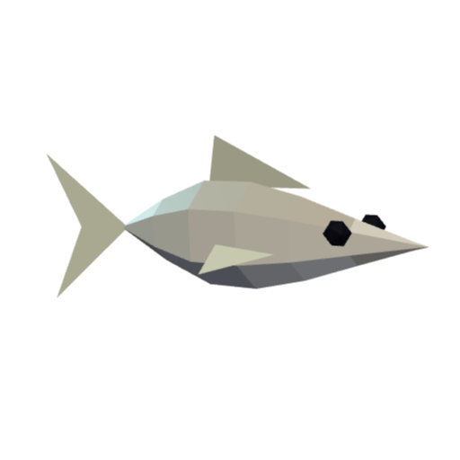 | 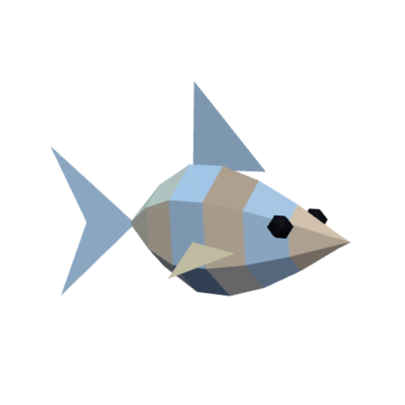 | 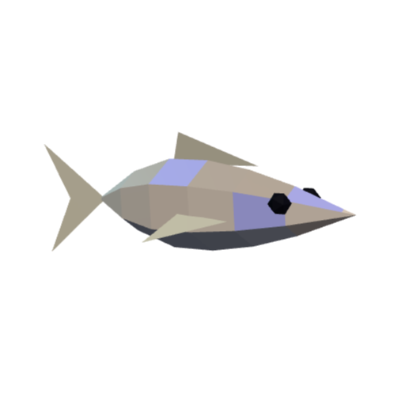 |
| slim · solid | perch · stripes | slim · spots |

#### Uncommon（少见）

颜色 `#5fd38d` · value 3 · 基础速度 2.8 · 基础逃跑半径 3.6 · 水面 9.5%，50 m 处 28%，350 m 以下 26%

| Striped Wrasse | Coral Chromis | Silver Snapper |
| :---: | :---: | :---: |
| 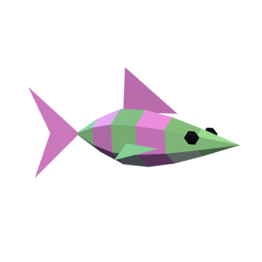 | 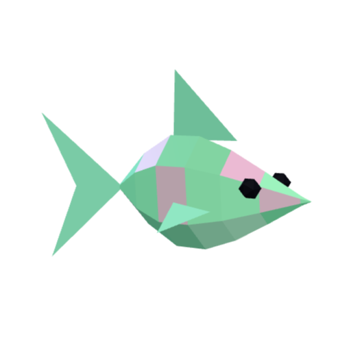 | 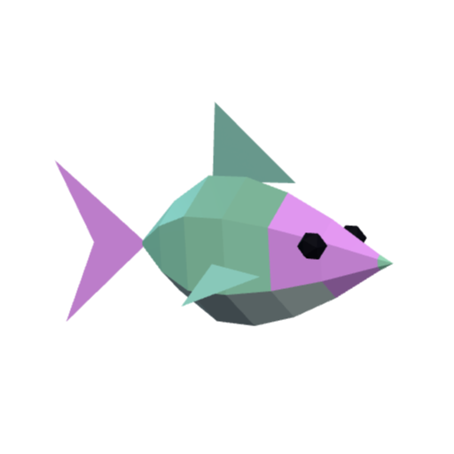 |
| slim · stripes | perch · glow | perch · mask |

#### Rare（稀有）

颜色 `#4aa8ff` · value 10 · 基础速度 3.4 · 基础逃跑半径 4.4 · 水面 0.5%，50 m 处 10.5%，350 m 以下 25%

| Azure Tang | Neon Cardinal | Spotted Grouper |
| :---: | :---: | :---: |
| 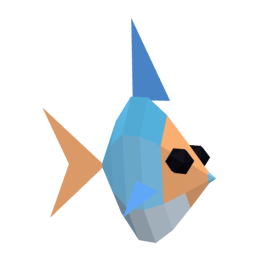 | 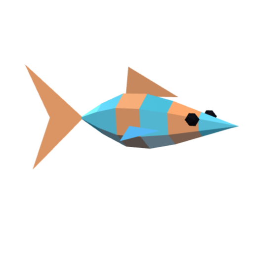 | 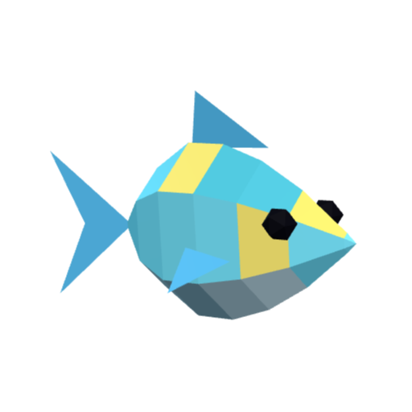 |
| disc · mask | slim · stripes | bulky · spots |

#### Epic（史诗）

颜色 `#b46cff` · value 35 · 基础速度 4.2 · 基础逃跑半径 5.2 · 只在 15 m 以下出现：50 m 处 3%，350 m 以下 16.5%

| Violet Lionfish | Ember Triggerfish | Ghost Angelfish |
| :---: | :---: | :---: |
| 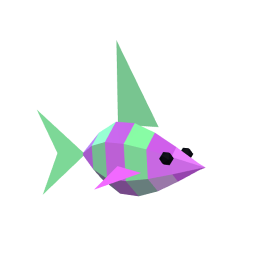 | 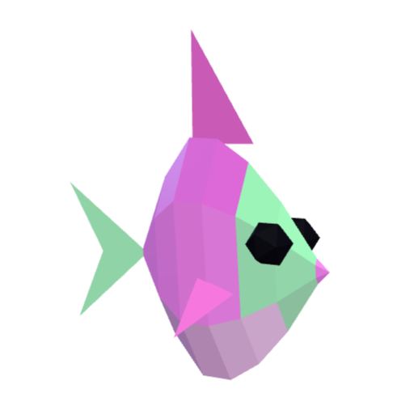 | 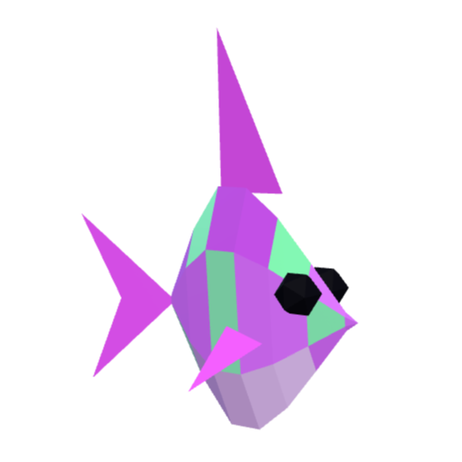 |
| perch · stripes | disc · mask | disc · glow |

#### Legendary（传说）

颜色 `#ffb340` · value 150 · 基础速度 5 · 基础逃跑半径 6 · 只在 30 m 以下出现：50 m 处 0.5%，350 m 以下 7.5%

| Golden Koi Dragon | Abyssal Sunfish | Crowned Sailfish |
| :---: | :---: | :---: |
| 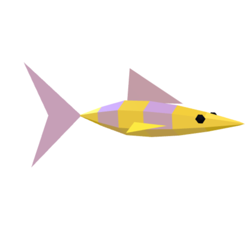 | 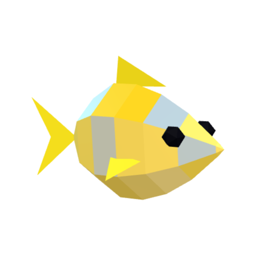 | 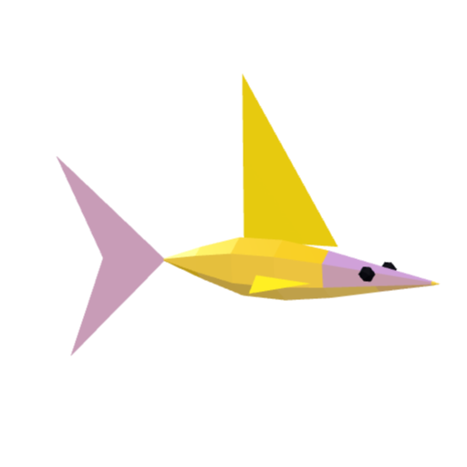 |
| long · stripes | bulky · glow | long · mask |

#### Mythic（神话）

颜色 `#ff5fd2` · value 800 · 基础速度 5.8 · 基础逃跑半径 7 · 只在 50 m 以下出现：80 m 处 0.2%，350 m 以下 3%

| Moonfin Leviathan | Prism Coelacanth |
| :---: | :---: |
| 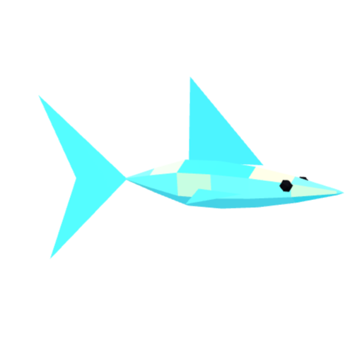 |  |
| long · glow | bulky · spots |

### 体型

每个鱼种都从 5 种体型（`SHAPES`）里选一种。尺寸单位是模型单位；scale 为 1 时，1 个单位等于 28 cm。

| 体型 | 长 | 高 | 宽 | 尾 | 背鳍 | 样子 | 鱼种 |
| --- | --- | --- | --- | --- | --- | --- | --- |
| `slim` | 1.5 | 0.42 | 0.28 | 0.45 | 0.25 | 小而细长 | Sand Minnow、Mud Goby、Striped Wrasse、Neon Cardinal |
| `perch` | 1.3 | 0.62 | 0.34 | 0.5 | 0.35 | 最常见的鱼形 | Grey Perch、Coral Chromis、Silver Snapper、Violet Lionfish |
| `disc` | 1 | 1.05 | 0.24 | 0.45 | 0.45 | 又高又扁，高度超过长度 | Azure Tang、Ember Triggerfish、Ghost Angelfish |
| `long` | 2.3 | 0.4 | 0.3 | 0.6 | 0.5 | 又长又矮，最长的体型 | Golden Koi Dragon、Crowned Sailfish、Moonfin Leviathan |
| `bulky` | 1.8 | 1.1 | 0.6 | 0.75 | 0.4 | 又大又高又厚 | Spotted Grouper、Abyssal Sunfish、Prism Coelacanth |

身体是 7 圈六边形连成的管子，鱼头和尾根各封一个口。另外有一片三角形背鳍、两片胸鳍、两只眼睛，尾巴单独挂在一个轴上，所以能摆动。一条鱼共 134 个三角形。每个面都是平面着色，只有一种颜色。

### 花纹

花纹决定哪些面涂成强调色。

| 花纹 | 涂在哪里 |
| --- | --- |
| `solid` | 不涂。鱼只有背、身体、腹部三种颜色 |
| `stripes` | 身体上隔一圈涂一圈，加上背鳍和尾巴。每次生成有 55% 的概率带条纹；没有条纹时只有鳍是强调色 |
| `spots` | 上半身零散的几个面 |
| `mask` | 上半身靠近头的部分，加上尾巴 |
| `glow` | 上半身每三个面涂一个。这种鱼不管稀有度多低，发光强度至少是 0.18 |

### 颜色

稀有度给出色相、饱和度、亮度的范围，seed 在范围里取一个点。强调色的色相和身体色相相差 140–220°。

| 稀有度 | 稀有度颜色 | 色相 | 饱和度 | 亮度 | 发光 | value |
| --- | --- | --- | --- | --- | --- | --- |
| common | `#b8c4cc` | 20–60° | 0.08–0.25 | 0.45–0.6 | 0 | 1 |
| uncommon | `#5fd38d` | 90–170° | 0.35–0.55 | 0.45–0.55 | 0 | 3 |
| rare | `#4aa8ff` | 185–225° | 0.65–0.85 | 0.5–0.6 | 0.05 | 10 |
| epic | `#b46cff` | 265–330° | 0.6–0.85 | 0.5–0.6 | 0.15 | 35 |
| legendary | `#ffb340` | 30–48° | 0.85–1 | 0.52–0.6 | 0.45 | 150 |
| mythic | `#ff5fd2` | 0–360° | 0.8–1 | 0.6–0.7 | 0.7 | 800 |

其余颜色都从身体颜色推出来：背部更暗（亮度 × 0.7），腹部更浅、饱和度更低，鳍的色相偏 15°，强调色饱和度更高、亮度固定 0.55。legendary 的鱼金属感更强（0.45，其他是 0.1）。mythic 的鱼游动时发光颜色会在所有色相之间循环。

### 大小和名字

- **scale**：0.85–1.25，再乘以 `1 + 0.12 × 稀有度序号`（common 是 0，mythic 是 5）。越稀有的鱼越大。
- **长度**：`体型长度 × scale × 28` cm。
- **重量**：`(长度 / 30)³ × 体型高度 × 0.7–1.1` kg。
- **名字**：稀有度对应的一个前缀，加上鱼种名。例如 "Starborn Moonfin Leviathan"。

| 稀有度 | 前缀 |
| --- | --- |
| common | Plain, Dusty, Little, Shy |
| uncommon | Banded, Lively, Bright, Speckled |
| rare | Glimmering, Deepwater, Royal, Twilight |
| epic | Phantom, Venomous, Storm, Midnight |
| legendary | Sunforged, Ancient, Crowned, Gilded |
| mythic | Prismatic, Eternal, Starborn |

### 鱼种参数

外形。每个值都是在上面体型基础上的倍数，1 表示不变。

| 鱼种 | 稀有度 | 体型 | 花纹 | `tailTaper` | `headVolume` | `bodyWidth` | `dorsal` | `pectoral` | `tailSpread` |
| --- | --- | --- | --- | --- | --- | --- | --- | --- | --- |
| Sand Minnow | common | `slim` | `solid` | 0.58 | 0.82 | 0.82 | 0.7 | 0.75 | 0.9 |
| Grey Perch | common | `perch` | `stripes` | 0.72 | 1.08 | 1 | 1.1 | 1 | 1 |
| Mud Goby | common | `slim` | `spots` | 0.8 | 1.2 | 1.15 | 0.5 | 1.3 | 0.8 |
| Striped Wrasse | uncommon | `slim` | `stripes` | 0.62 | 0.98 | 0.9 | 1.2 | 0.9 | 1.05 |
| Coral Chromis | uncommon | `perch` | `glow` | 0.7 | 0.92 | 0.86 | 1 | 0.85 | 1.1 |
| Silver Snapper | uncommon | `perch` | `mask` | 0.65 | 1.14 | 1.05 | 0.85 | 1.05 | 0.95 |
| Azure Tang | rare | `disc` | `mask` | 0.7 | 0.9 | 1 | 1.2 | 0.85 | 1.2 |
| Neon Cardinal | rare | `slim` | `stripes` | 0.56 | 0.85 | 0.78 | 0.8 | 0.8 | 1.25 |
| Spotted Grouper | rare | `bulky` | `spots` | 0.82 | 1.22 | 1.08 | 0.8 | 1.1 | 0.85 |
| Violet Lionfish | epic | `perch` | `stripes` | 0.72 | 0.96 | 0.95 | 1.9 | 1.45 | 1 |
| Ember Triggerfish | epic | `disc` | `mask` | 0.74 | 1.18 | 1.12 | 1 | 0.9 | 0.9 |
| Ghost Angelfish | epic | `disc` | `glow` | 0.64 | 0.88 | 0.92 | 1.45 | 1.25 | 1.08 |
| Golden Koi Dragon | legendary | `long` | `stripes` | 0.5 | 1.14 | 0.9 | 0.7 | 1.1 | 1.35 |
| Abyssal Sunfish | legendary | `bulky` | `glow` | 0.9 | 1.28 | 1.2 | 0.65 | 0.8 | 0.72 |
| Crowned Sailfish | legendary | `long` | `mask` | 0.46 | 0.82 | 0.72 | 2.1 | 0.85 | 1.5 |
| Moonfin Leviathan | mythic | `long` | `glow` | 0.42 | 1.2 | 0.88 | 1.35 | 1.2 | 1.55 |
| Prism Coelacanth | mythic | `bulky` | `spots` | 0.78 | 1.12 | 1.08 | 1.15 | 1.35 | 1.05 |

- `tailTaper`：尾根处身体有多细，越小越细。到身体长度的 35% 处恢复正常粗细。
- `headVolume`：头有多大，越大头越大。从身体最后 42% 开始逐渐变化。
- `bodyWidth`：身体有多厚。
- `dorsal`：背鳍有多高。
- `pectoral`：胸鳍往外伸多远。
- `tailSpread`：尾鳍有多大。

行为。`swimSpeed` 和 `fleeRadius` 是在稀有度基础值上的倍数，最后两列是相乘后的结果。

| 鱼种 | `swimSpeed` | `turnRate` | `fleeRadius` | 速度 | 逃跑半径 |
| --- | --- | --- | --- | --- | --- |
| Sand Minnow | 1.18 | 3.4 | 0.95 | 2.6 | 2.85 |
| Grey Perch | 0.94 | 2.5 | 1 | 2.07 | 3 |
| Mud Goby | 0.78 | 2.1 | 0.9 | 1.72 | 2.7 |
| Striped Wrasse | 1.12 | 3.2 | 1.05 | 3.14 | 3.78 |
| Coral Chromis | 1.08 | 3 | 1.1 | 3.02 | 3.96 |
| Silver Snapper | 0.98 | 2.7 | 1.02 | 2.74 | 3.67 |
| Azure Tang | 1.06 | 2.8 | 1.05 | 3.6 | 4.62 |
| Neon Cardinal | 1.25 | 3.7 | 1.14 | 4.25 | 5.02 |
| Spotted Grouper | 0.82 | 2 | 0.96 | 2.79 | 4.22 |
| Violet Lionfish | 0.9 | 2.4 | 1.15 | 3.78 | 5.98 |
| Ember Triggerfish | 0.88 | 2.2 | 1.1 | 3.7 | 5.72 |
| Ghost Angelfish | 1 | 2.6 | 1.2 | 4.2 | 6.24 |
| Golden Koi Dragon | 0.94 | 2 | 1.12 | 4.7 | 6.72 |
| Abyssal Sunfish | 0.7 | 1.6 | 1.25 | 3.5 | 7.5 |
| Crowned Sailfish | 1.2 | 2.3 | 1.3 | 6 | 7.8 |
| Moonfin Leviathan | 0.88 | 1.8 | 1.35 | 5.1 | 9.45 |
| Prism Coelacanth | 0.76 | 1.9 | 1.3 | 4.41 | 9.1 |

鱼平时以速度的 55% 巡游。潜水员进入逃跑半径后，它以速度的 1.6 到 2.6 倍游开，潜水员越近它越快。`turnRate` 是转向的快慢，越大转得越快。

### 从 seed 到 NFT 卡牌

`rollFish(seed, depth, odds?)` → `FishSpec` → `buildFishMesh(spec)` → `fishCard(spec)`

同一个 seed 在同一个深度永远生成同一条鱼，所以任何人都能重新渲染卡牌来核对。深度决定稀有度的掉率，也会和捕获价值一起存在鱼身上；第三个参数 `odds` 可以覆盖掉率（标题页用到了它）。`fishCard` 画出用于铸造的 512 × 512 图片：稀有度颜色做背景，上面是鱼，以及它的名字、大小、深度和编号。

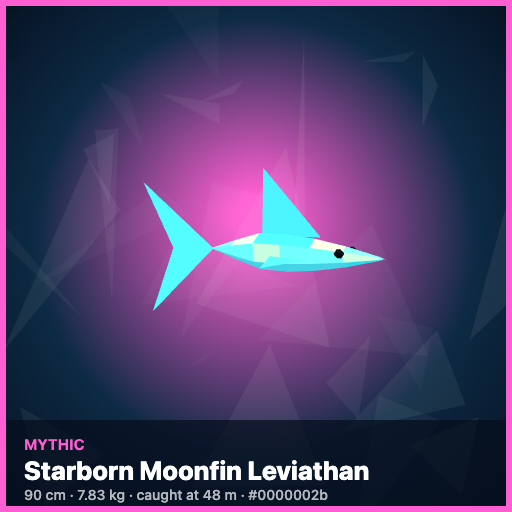

---

## 3. 鱼竿

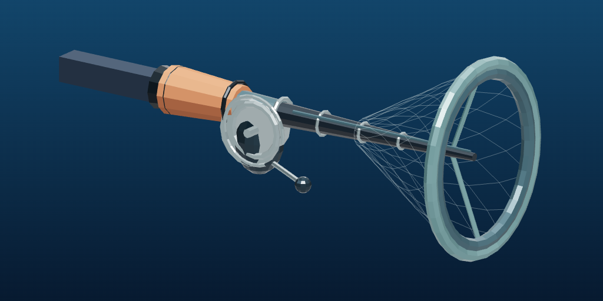

策划案里这件道具叫鱼竿。在水下，游戏把它当抄网用：保留鱼竿的握把、线轮、杆身和金属箍，前端装一个网圈和网兜。`buildFishingNetMesh()` 返回模型 `group` 和一个叫 `tip` 的标记点。

| 部件 | 几何体 | 尺寸（模型单位） | 颜色 | 沿杆方向的位置（x） |
| --- | --- | --- | --- | --- |
| 手臂 | 长方体 | 0.7 × 0.14 × 0.14 | `#1d2b3a`，潜水服的颜色 | 0–0.7 |
| 握把 | 六边柱 | 半径 0.09–0.12，长 0.38 | `#7e4c32` | 0.59–0.97 |
| 线轮 | 八边柱 | 半径 0.14，厚 0.1 | `#344956`，金属质感 | 0.98，在杆身下方 |
| 线轮摇柄 | 长方体 | 0.22 × 0.035 × 0.035 | `#344956`，金属质感 | 1.1 |
| 杆身 | 六边柱，一头细 | 半径 0.035–0.06，长 1.35 | `#c9d2d7`，金属质感 | 0.585–1.935 |
| 金属箍 | 圆环 | 半径 0.07，管径 0.018 | `#ffd166` | 1.55 |
| 网圈 | 十二边圆环 | 半径 0.42，管径 0.04 | `#ffd166` | 2.0 |
| 网兜 | 线段 | 从半径 0.1 到半径 0.42 的圆锥 | `#dffaf7`，不透明度 58% | 1.45–2.0 |
| `tip` | 空的标记点 | – | – | 2.0，网圈正中 |

- **轴心**：模型的原点是潜水员的肩膀，鱼竿指向 +x。`diver.ts` 把它挂在身体的 `(0.6, 0, 0.3)` 处，挥动时整个 group 一起转。
- **抓鱼点**：按 `Space` 挥竿。离 `tip` 最近、并且在当前渔网等级的收网范围以内的那条鱼被抓住，网里最多装这一等级的容量那么多条鱼。等级定义在 [`game/src/equipment.ts`](../game/src/equipment.ts) 的 `ROD_TIERS`：Lv1 是 2.4 m、6 条，Lv2 是 2.8 m、8 条，Lv3 是 3.2 m、10 条。`Diver.setNetLevel()` 让整个模型在 Lv1 之上每升一级放大 12%。
- **网兜**：108 条线段，一次绘制调用（5 圈、每圈 12 个点，加上沿圆锥方向的 12 条线）。它用线来画，没有用实心圆锥，这样从任何角度看都像网。
- **还没做的**：[策划案](../design/game-design-document.md#7-经济与升级)第 7.1 节里鱼竿、鱼饵、船的升级目前只有设计。上面的渔网等级是游戏里唯一的升级，三个等级共用这一个模型，只是放大。

---

## 4. 怎么用这些素材

**当图片用**。这个目录里的 PNG 可以直接放进幻灯片、Devpost 页面或视频。鱼的图和 `gear/fishing-net.png` 是透明背景。`gear/fishing-net-dark.png` 后面有深色的水，因为浅色的网兜在浅色背景上看不清。

**在代码里用**。可以直接生成模型，也可以要任意尺寸的图片：

```ts
import { rollFish, buildFishMesh } from './fish';
import { fishCard, fishSprite } from './portrait';
import { buildFishingNetMesh } from './gear';

const spec = rollFish(43, 350);             // Starborn Moonfin Leviathan，在 350 m 抓到
scene.add(buildFishMesh(spec).group);       // 3D 模型
img.src = fishSprite(spec, 256);            // 透明背景 PNG 的 data URL，尺寸任意
img.src = fishCard(spec);                   // 512 × 512 的 NFT 卡牌

const rod = buildFishingNetMesh();
scene.add(rod.group);                       // rod.tip 是网圈正中的标记点
```

---

## 5. 重新渲染图片

有人改了模型以后，这些图就过时了。重新渲染的步骤：

1. 启动游戏：`npm run game`。
2. 打开 <http://localhost:5173/asset-library.html>。这个页面用当前的代码画出所有鱼种和鱼竿。它只在开发服务器上有，不会打进正式构建。
3. 每个格子下面有下载链接，文件名已经对好。把文件存到 `assets/fish/`、`assets/gear/` 和 `assets/cards/`。

要别的尺寸，在这个页面的控制台里执行：`await assetLibrary.sprite('azure-tang', 1024)`，返回一个 data URL。

页面把每个 seed 都放在 350 m 抽。这是 `RARITY_BY_DEPTH` 最深的锚点，每档稀有度（包括神话）都能抽到。页面给每个鱼种用的是在这个深度能生成它的最小 seed。带条纹的鱼种会等到一次有条纹的生成。页面画的鱼是这些：

| 稀有度 | 鱼种 | seed | 调用 |
| --- | --- | --- | --- |
| common | Grey Perch | 8 | `rollFish(8, 350)` |
| common | Mud Goby | 9 | `rollFish(9, 350)` |
| common | Sand Minnow | 7 | `rollFish(7, 350)` |
| uncommon | Coral Chromis | 14 | `rollFish(14, 350)` |
| uncommon | Silver Snapper | 24 | `rollFish(24, 350)` |
| uncommon | Striped Wrasse | 27 | `rollFish(27, 350)` |
| rare | Azure Tang | 1 | `rollFish(1, 350)` |
| rare | Neon Cardinal | 11 | `rollFish(11, 350)` |
| rare | Spotted Grouper | 5 | `rollFish(5, 350)` |
| epic | Ember Triggerfish | 20 | `rollFish(20, 350)` |
| epic | Ghost Angelfish | 30 | `rollFish(30, 350)` |
| epic | Violet Lionfish | 2 | `rollFish(2, 350)` |
| legendary | Abyssal Sunfish | 107 | `rollFish(107, 350)` |
| legendary | Crowned Sailfish | 36 | `rollFish(36, 350)` |
| legendary | Golden Koi Dragon | 89 | `rollFish(89, 350)` |
| mythic | Moonfin Leviathan | 43 | `rollFish(43, 350)` |
| mythic | Prism Coelacanth | 104 | `rollFish(104, 350)` |

> **这个目录里的 PNG 比这张表旧。** 它们是稀有度还按区域决定的时候渲染的，用的 seed 不一样。有 5 个 seed 没变（Grey Perch 8、Azure Tang 1、Spotted Grouper 5、Violet Lionfish 2、Moonfin Leviathan 43），这几张图仍然对得上。另外 12 张图画的是同一鱼种的另一条鱼：体型和花纹一样，具体颜色和大小不同。示例卡牌还是同一条 Starborn Moonfin Leviathan（90 cm、7.83 kg、#0000002b），但保存的 PNG 上写的是 "caught at 48 m"，页面现在渲染出来是 "caught at 350 m"。按上面的步骤重新渲染一遍，图就和表一致了。

---

## 6. 新增或修改素材

**新增鱼种**

1. 在 `fish.ts` 的 `SPECIES_BY_RARITY` 里，往对应稀有度下加一个 `SpeciesProfile`。选一种体型和一种花纹，再填各个倍数。
2. 打开预览页，确认它和旁边的鱼种能一眼分开。
3. 把它的图存成 `assets/fish/<鱼种名>.png`，并加进这个目录的两份 README。

> **这会改变已有的 seed**。`rollFish` 按鱼种在该稀有度列表里的位置来选。增加或删除鱼种后，已有的 seed 在这个稀有度下可能生成另一个鱼种。玩家收藏里的鱼保留存档时的鱼种，但是用旧的 seed 重新生成会得到另一条鱼，和改动前铸造的卡牌就对不上了。

**新增体型或花纹**

- 体型：加进 `Archetype` 和 `SHAPES`。
- 花纹：加进 `FishPattern` 和 `buildFishMesh` 里的 `switch`。

**修改已有鱼种的外形**

改一个 profile 会改变这个鱼种所有鱼的画法，包括玩家已经有的鱼。已经铸造的卡牌图片保持上传时的样子。

**鱼竿**

改 `gear.ts` 里的 `buildFishingNetMesh()`。原点留在肩膀、鱼竿沿 +x，`tip` 留在网圈正中，因为抓鱼的距离是从它算的。然后重新渲染 `gear/`。

**改完以后**，执行 `npm --prefix game run build`，重新渲染图片，并更新这里两份 README 里的表格。
