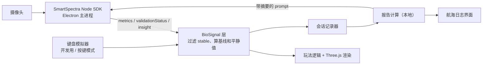
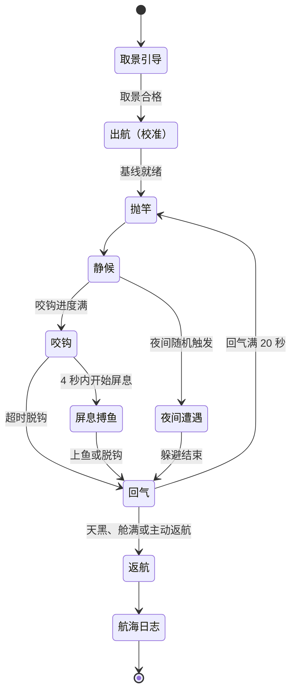

# 游戏策划案 ·《屏息》（暂定名 / Stillwater）

> HackRU Fall 2026 · 版本 v2（转向 Presage 后重写）· 2026-10-10
>
> 一句话：**用摄像头读你的心跳和呼吸来钓鱼**。心静，鱼才咬钩；屏住呼吸，才能把鱼拉上来、潜到海底。一局结束，游戏把这局的憋气和心率数据整理成一份身心小结。

## 1. 这次转向改了什么

| | 旧版 | 新版 |
| --- | --- | --- |
| 输入 | 未定 | 摄像头无接触测心率、呼吸、憋气（Presage SmartSpectra SDK），键鼠只做确认 |
| 心率与钓鱼 | "正相关" | **心率越平稳、渔获越好**（相对玩家自己的基线）。原因见 §3 |
| 憋气 | 仅图 3 潜水 | 每条鱼都要短屏息搏鱼；图 3 的潜水是长屏息 |
| 小怪 | 夜间出现 | 夜间出现，应对方式是"屏住呼吸别被发现" |
| 新增 | — | 局后《航海日志》身心小结（憋气 + 心率数据） |
| 保留 | 2.5D 多边形唯美休闲风、三张图、鱼竿 / 鱼饵 / 船升级、图 3 永久损失风险 | 不变 |

## 2. 设计支柱

1. **身体就是手柄**：玩家能直接看到游戏"看见"了自己的呼吸（浮漂跟着呼吸起伏），这是第一眼的惊喜。
2. **奖励平静，不奖励硬撑**：憋气有硬上限、随时可以放弃、没有"最长憋气"排行榜。
3. **慢节奏**：SDK 要求人坐稳、别说话、镜头固定，所以玩法天然是安静的休闲游戏，不做任何需要狂按键的操作。
4. **数据只跟自己比**：报告是健康参考，不是诊断。

## 3. Presage SmartSpectra：能拿到什么、有什么限制

以下摘自 SDK 公开文档（2026-10-10 查阅），**一切以开工后的实测为准**。

### 3.1 用得上的指标

| 指标 | Node 字段 | 生效时间 | 有效范围 | 在游戏里做什么 |
| --- | --- | --- | --- | --- |
| 心率 | `cardio.pulseRate` | 约 12 秒（12 秒滑动平均） | 40–110 次/分 | 平静值、报告 |
| 呼吸率 | `breathing.rate` | 约 30 秒（30 秒平均） | 5–40 次/分 | 平静值、报告 |
| 胸部呼吸波形 | `breathing.upperTrace` | 实时波形（30 秒后才标记稳定） | 同上 | 浮漂起伏、屏息兜底检测 |
| 呼吸暂停 | `breathing.apnea`（`detected` 布尔） | 待实测 | — | **屏息检测（核心）** |
| 心率变异性 | `cardio.hrv`（`rmssd` / `sdnn` / `meanNn` / `baevsky`） | 约 60 秒 | 心率 40–110 | 仅报告 |
| 吸呼比 | `breathing.inhaleExhaleRatio` | 待实测 | — | 仅报告 |
| 说话检测 | `face.talking` | 实时 | — | 说话会吓跑鱼；同时标记这段呼吸数据无效 |
| 取景质量 | `validationStatus` 事件（代码 + 提示语） | 实时 | — | 取景引导、信号灯 |

每个读数都带 `stable` 标记（心率置信度 ≥40、呼吸率 ≥45、HRV ≥50 才为真）。**规则：`stable` 为假的读数不参与任何判定，也不进报告。**

### 3.2 硬限制（直接决定了玩法）

- **心率是 12 秒平均值**，反应慢，不能做即时判定，只能当"状态"用。即时判定全部交给屏息和呼吸波形。
- **超过 110 次/分不在有效范围内**，而且要求人坐着不动。所以"心率越高钓得越好"做不了：想拉高心率就得动，一动信号就丢。这就是把旧版"正相关"改成"越平稳越好"的原因。
- **开局要等约 30 秒**呼吸数据才有效 → 把这段时间做成"出航"过场（§5.2）。
- **取景**：只能有一张脸；脸和上胸都要入镜、光线均匀；镜头必须固定（呼吸指标不能手持）；深色衣服和细条纹会干扰呼吸测量；帧率要保持 25 fps 以上。
- **平台**：Android、iOS 17+、C++（macOS / Linux / Windows）、Node.js 20+ / Electron 28+。**没有纯浏览器版**。Node 版不支持 Intel Mac。
- **联网与额度**：API key 走服务端校验，错误码里有 `NetworkError` 和 `CreditExhausted`，说明需要联网且有用量额度。具体额度文档没写，要在后台确认。
- **合规**：文档明确写着指标仅供一般健康参考、未经 FDA 批准、不能用于诊断或治疗。（公开报道里 Presage 另有一款获 FDA 许可的临床产品，和 SDK 指标不是一回事，路演时不要混着说。）

## 4. 平台与技术方案

**推荐：Electron 桌面应用 + Three.js。** 笔记本放在桌上正好满足"镜头固定、脸和上胸入镜"，全队可以用 Web 技术，评审时直接让评委坐到电脑前。iPhone 方案需要手机支架，且要写 Swift，不推荐。



要点：

- **BioSignal 层是唯一的接口**。玩法代码只读 `{ hr, br, breathWave, holding, talking, calm, signalOk }`，不直接碰 SDK。
- **键盘模拟器第一个写**：按住 `B` = 屏息，上下键调心率。这样做玩法的人不用等 SDK 接好，演示时信号出问题也能切过去。它同时就是给不适合憋气的玩家用的"按键模式"。
- `sdk.useFile(path)` 可以喂录好的视频，用来离线调试和回归。
- 已知坑：`decodeMetrics` 要先用 `setMetricsClass` 注册 protobuf 类，否则返回原始 Buffer；Electron 里设了 CSP 的话 `worker-src` 要加 `blob:`；macOS 要在 `Info.plist` 写 `NSCameraUsageDescription`。
- 数据全部存本地 JSON，不做服务器、不做账号。API key 放 `.env`，不进仓库。
- Presage 提供了 Claude Code 可用的 agent skill 和 MCP 服务器（见文末链接），写接入代码时可以装上。

## 5. 核心玩法

### 5.1 一局的流程



一局 = 游戏里的一天。1 游戏小时 = 现实 15 秒，白天 05:00–20:00 共 3 分 45 秒，夜晚 2 分 15 秒。一条鱼的完整循环约 30–50 秒，一个白天能钓 4–7 条。

### 5.2 出航 = 校准

- 小船从码头划向钓点，镜头缓慢推进，配环境音。这段同时是开场动画（旧版"有时间再做"的过渡动画并到这里）。
- 最短 35 秒，等心率和呼吸率都 `stable` 后结束；90 秒还没稳定就提示调整取景，或切到按键模式。
- 结束时记下本局基线：`HR0` = 最后 15 秒稳定心率的中位数，`BR0` = 当时的稳定呼吸率。**之后所有判定都相对这两个值**，不用绝对数字，因为每个人差别很大。

### 5.3 平静值 Calm（0–1）

```
calm_hr = clamp((1.10·HR0 − HR) / (0.20·HR0), 0, 1)    心率比基线低 10% 得 1，高 10% 得 0
calm_br = clamp((1.30·BR0 − BR) / (0.60·BR0), 0, 1)    呼吸率比基线低 30% 得 1，高 30% 得 0
Calm    = 0.6·calm_hr + 0.4·calm_br                    正好在基线时为 0.5
```

- 分三档显示：**静**（≥0.7）、**稳**（0.4–0.7）、**躁**（<0.4）。
- 信号不稳时冻结在上一个值，不惩罚玩家。
- 检测到说话：当前咬钩进度清零（"嘘，鱼被吓跑了"）。

### 5.4 静候与咬钩

- 浮漂跟着玩家的呼吸波形上下起伏，水面涟漪同步。
- 咬钩等待时间 `T = T图 × 鱼饵系数 × (1.5 − Calm)`。图 1 的 `T图` 为 12 秒：最平静时 6 秒咬钩，最烦躁时 18 秒。
- 稀有度按静候期间的平均 Calm 抽取：

| 平均 Calm | 普通 | 稀有 | 史诗 | 传说 |
| --- | --- | --- | --- | --- |
| 躁 <0.4 | 85% | 15% | 0 | 0 |
| 稳 0.4–0.7 | 65% | 28% | 6% | 1% |
| 静 ≥0.7 | 40% | 40% | 15% | 5% |

### 5.5 屏息搏鱼

- 浮漂下沉，提示"屏息！"，玩家有 4 秒开始憋气（留出检测延迟）。
- 需要憋住的时间：普通 3 秒、稀有 5 秒、史诗 8 秒、传说 12 秒。屏幕中央一个圆环走满即上鱼。
- 中途恢复呼吸：完成度 ≥50% 得半价的鱼，<50% 脱钩。**没有其他惩罚。**
- 屏息判定：以 `breathing.apnea.detected` 为主；若实测延迟太大，用"呼吸波形在 1.5 秒内振幅低于阈值"兜底。

### 5.6 回气

- 每次屏息后强制 20 秒：浮标引导"吸 4 秒、呼 6 秒"两轮，期间不能抛竿。
- 作用有两个：保证安全；给报告提供"恢复速度"数据。

### 5.7 潜水（图 3）

- 在潜点按空格，3 秒倒数"正常吸一口气"（不要深吸快呼），然后屏息下潜。
- 深度随屏息时间增加，分浅 / 中 / 深三层，路过的宝物自动拾取。
- **恢复呼吸 = 立刻上浮，已拾取的全部带走**，没有任何损失。
- 标准档上限 20 秒，到点强制上浮，多憋没有奖励。
- 深层会出现海怪的影子，3 秒内上浮即可躲开。这个设计是故意把威胁做成"催你上来"，而不是"逼你多憋"。
- 每次潜水后回气 40 秒，一天最多潜 3 次。

### 5.8 夜间遭遇

| 小怪 | 出现 | 应对 | 失败后果 |
| --- | --- | --- | --- |
| 野鹿 | 图 1 夜 | 无需应对，只是吓你一跳 | 无 |
| 野熊 | 图 1、图 2 夜 | 屏息 5 秒等它走开 | 本竿作废，被叼走 1 条鱼 |
| 巨人 | 图 2 夜 | 屏息 8 秒 | 本竿作废，船耐久 −1 |
| 海怪 | 图 3 深潜时 | 3 秒内上浮 | 船耐久 −2 |

- 出现前有 3 秒预兆（灌木响动、水面波纹）。
- 被吓到后心率上升，Calm 自然下降，渔获自然变差，不需要额外规则。心率的上升幅度和平复时间记进报告。
- 留在夜里的理由：夜间有专属的稀有鱼。玩家自己选择天黑前返航还是冒险。

## 6. 地图

| | 图 1 · 挪威 / 冰岛峡湾 | 图 2 · 张家界 / 长白山天池 | 图 3 · 汪洋 |
| --- | --- | --- | --- |
| 难度 | 休闲（教学） | 普通 | 困难 |
| 咬钩基准 `T图` | 12 秒 | 16 秒 | 20 秒 |
| 夜间遭遇概率（每游戏小时） | 15% | 30% | — |
| 小怪 | 野鹿、野熊 | 野熊、巨人 | 海怪 |
| 特有机制 | 无 | 夜雾（看不清预兆，只能靠声音） | 潜水；海浪（20 秒内 Calm 低于 0.4 则船耐久 −1） |
| 失败代价 | 丢一竿、丢一条鱼 | 加上船耐久损失 | **沉船：带出海的鱼竿、鱼饵、船升级全部永久丢失，舱内渔获清空，金币保留** |
| 解锁 | 初始 | 累计收入 300 金 | 累计收入 1200 金 |

图 3 随时可以返航止损，是否继续由玩家决定。

## 7. 经济与升级

渔获售价：普通 10、稀有 30、史诗 100、传说 400 金。潜水宝物：浅 20、中 80、深 300 金。

| 升级 | Lv1（初始） | Lv2 | Lv3 |
| --- | --- | --- | --- |
| 鱼竿 | 最高钓稀有；屏息容错 0.5 秒 | 200 金：最高史诗；容错 1.0 秒 | 800 金：最高传说；容错 1.5 秒 |
| 鱼饵 | 等待时间 ×1.0 | 150 金：×0.8 | 600 金：×0.6 |
| 船 · 速度 | 每天换钓点 1 次 | 200 金：2 次 | 700 金：3 次 |
| 船 · 耐久 | 3 | 200 金：5 | 700 金：8 |
| 船 · 鱼台 | 舱容量 5 条 | 200 金：8 条 | 700 金：12 条 |

抽到超过鱼竿等级的鱼，按鱼竿上限降档。以上数值全是占位，等核心循环能玩了再调。

## 8. 界面

- **主界面**：一张静态的峡湾场景，三个按钮：出航、商店、航海日志。右上角常驻信号灯。
- **取景引导**：摄像头预览 + 人形轮廓框，下方直接显示 SDK 给的提示语（太暗、太近、胸部未入镜、画面里有多张脸等）。
- **钓鱼 HUD**（尽量少）：左上游戏时钟；右上信号灯；左下心率数字（不稳定时显示 `--`）；底部呼吸波形条；右下 Calm 圆环；屏息时屏幕中央出现进度环和秒数。
- **航海日志**：见 §9。
- **美术**：2.5D 正交镜头、低多边形、柔和渐变天空。模型用 CC0 低多边形素材包（Kenney、Quaternius），不自己建模。

## 9. 航海日志（身心小结）

每局结束自动生成。**数字全部本地计算，大模型只负责写一段话，不让它碰数字。**

### 9.1 内容

| 板块 | 指标 | 算法 |
| --- | --- | --- |
| 静息基线 | 静息心率、静息呼吸率、HRV（RMSSD / SDNN）、Baevsky 压力指数、吸呼比 | 取"静候"阶段的稳定读数中位数，剔除每次屏息或遭遇后的 20 秒 |
| 屏息表现 | 次数、最长、平均、累计时长、完成率 | 每次屏息记一条 |
| 屏息心率反应 | 屏息前心率 → 屏息中最低心率 | 屏息前 10 秒均值，对比屏息开始到结束后 12 秒内的最小值。**只统计 ≥15 秒的屏息**（心率是 12 秒平均，短屏息看不出变化） |
| 恢复速度 | 屏息结束后回到基线的秒数 | 心率回到屏息前 ±5% 且呼吸率 ≤ 基线 ×1.2，上限记 60 秒 |
| 平静与受惊 | "静"档时间占比；每次遭遇的心率峰值涨幅和平复时间 | 来自 Calm 和遭遇事件记录 |
| 数据质量 | 稳定信号占本局时长的比例 | 低于 60% 时在报告顶部提示"本局数据仅供娱乐" |
| 趋势 | 与最近 5 局对比 | 读本地存档 |

灰字标注常见参考值（成人静息心率 60–100 次/分、静息呼吸 12–20 次/分），并注明不是诊断标准。不做"健康评分"，改发三枚徽章：**稳如磐石**（平静占比）、**深海之肺**（屏息）、**回气如风**（恢复）。

### 9.2 示例（数字为虚构）

```
航海日志 · 第 3 天 · 峡湾              数据质量 87%

静息      心率 68 次/分   呼吸 13 次/分   RMSSD 42 ms
屏息      7 次   最长 18 秒   平均 8 秒   完成 6/7
心率反应  最长一次屏息：71 → 65 次/分
恢复      平均 14 秒回到基线（上一局 19 秒）
平静      "静"档占 58%   被野熊吓到：+9 次/分，22 秒平复

今天你在等鱼的时候呼吸很稳，后半局越来越静。被熊吓到后恢复得比上一局快。
下次可以在回气时把呼气再拉长一点试试。

本内容仅供一般健康参考，不是医疗诊断或建议。
```

### 9.3 文字解读

- 首选 Presage 自带的 LLM Insights（`sdk.requestInsight(prompt)`，结果从 `insight` 事件异步返回）。它只能看到心率、HRV、呼吸率三项，所以**屏息统计要自己写进 prompt 当背景**。prompt 上限 2048 字节，用英文写指令更省。
- prompt 里写死：三句话 + 一条呼吸小建议；用简体中文输出；不做诊断、不给医疗建议、不用"正常 / 异常"这类词。
- 服务可能不返回结果，所以必须有本地模板兜底（按数值区间拼句子）。

### 9.4 措辞红线

不出现"诊断、疾病、风险、异常、正常"；只说"本局""相对你自己的基线"；每份报告底部固定带免责声明。

## 10. 屏息安全（必须做，不是可选项）

首次启动弹出，确认后才能进游戏：

- 请坐着玩。不要在水里、站立或开车时玩。
- 憋气前正常吸一口气即可，**不要连续深吸快呼**。
- 头晕、胸闷、手麻、眼前发黑，立刻恢复呼吸。游戏里任何时候恢复呼吸都不会有额外惩罚。
- 有心脏或呼吸系统疾病、高血压、癫痫，或处于孕期：请选"按键模式"，用按住空格代替憋气。

系统层面的保证：任何档位单次屏息硬上限 30 秒；到点强制结束且无额外奖励；每次屏息后强制回气；不做最长憋气排行榜。

屏息档位（奖励完全相同，只是时长不同）：轻松 ×0.6、标准 ×1.0（默认，本文所有时长均为标准档）、挑战 ×1.5。

## 11. 范围与优先级

离提交截止（周日 12:00）约 21 小时，按下面的顺序砍。

**P0 · 没有就没法演示**

- Electron 接入 SDK，BioSignal 层 + 键盘模拟器
- 安全确认页、取景引导、出航校准
- 图 1 单场景完整循环：抛竿 → 静候 → 咬钩 → 屏息搏鱼 → 回气
- HUD：心率、呼吸波形、Calm、屏息环、信号灯
- 航海日志数字版（§9.1 前四个板块）
- 评审模式开关：咬钩时间减半，1 游戏小时 = 8 秒

**P1 · 做了演示才出彩**

- 潜水（一个潜点场景，复用屏息检测）
- 报告的文字解读（LLM Insights + 模板兜底）
- 昼夜变化 + 野熊遭遇
- 商店：鱼竿和鱼饵升级
- 环境音和音效

**P2 · 有时间再做**

- 图 2、图 3 完整内容，海浪，沉船永久损失
- 船的三项属性、地图解锁
- 历史趋势、屏息档位、野鹿和巨人

## 12. 时间表（美东时间）

| 时间 | 目标 |
| --- | --- |
| 周六 15:00–17:00 | **技术验证**：Electron 里跑通 SDK，打印心率、呼吸波形、`apnea`；测出屏息检测延迟。同时搭好键盘模拟器和场景白模 |
| 周六 17:00 | **决策点**：`apnea` 延迟 ≤2 秒就用它；否则改用波形兜底；两者都不行则屏息改按键，心率和呼吸照常用 |
| 周六 17:00–21:00 | P0 核心循环跑通（白模即可） |
| 周六 21:00–周日 01:00 | 航海日志；图 1 美术 |
| 周日 01:00–05:00 | P1：潜水、文字解读、野熊、商店 |
| 周日 05:00–08:00 | 打磨、音效、修 bug。**08:00 功能冻结** |
| 周日 08:00–11:00 | 在评审现场的光线下彩排；录备用演示视频；写提交说明 |
| 周日 11:00–12:00 | 提交（留一小时缓冲） |
| 周日 13:00–15:00 | 评审 |

分工按四条线并行，人少就合并：① SDK 与 BioSignal 层；② 玩法逻辑与状态机；③ 场景、美术、音效；④ 航海日志、界面、路演材料。

## 13. 风险

| 风险 | 应对 |
| --- | --- |
| `apnea` 是否包含在默认呼吸指标里、延迟多大，文档没写 | 周六 17:00 前实测；波形兜底；按键兜底 |
| 评审现场背后站人，触发"多张脸"导致中断 | 让玩家背对墙或展板坐；彩排时确认 |
| 现场光线差或逆光 | 自带一盏台灯从正面打光 |
| 深色或条纹衣服导致呼吸测不准 | 演示者穿浅色纯色上衣；对评委的衣服没法控制，所以按键模式要随时能切 |
| 评委刚走过来或喝了咖啡，心率超过 110 | 视为不稳定读数，冻结 Calm，游戏照常进行 |
| 额度用完或场馆网络断开 | 提前在后台查额度；备手机热点；备录屏 |
| 队友的电脑是 Intel Mac | 只在 Apple Silicon Mac 或 Windows x64 上跑 SDK，其他人用键盘模拟器开发 |
| LLM Insights 不返回 | 本地模板兜底 |
| 开局 30 秒等待让评委失去耐心 | 出航过场做好看，并在这段时间口头讲解原理 |

## 14. 路演

- **赛道**：主报 Maverick；健康参考这条线也可以讲 Social Good。如果 Presage 设了赞助商奖，一并报（以主办方公布为准）。
- **两分半演示脚本**：坐下取景（10 秒）→ 出航校准，同时讲解"摄像头无接触测心率和呼吸"（40 秒）→ 抛竿，指给评委看浮漂在跟着他的呼吸动（20 秒）→ 咬钩，屏息搏鱼（15 秒）→ 回气（20 秒）→ 潜水（25 秒）→ 返航看航海日志（20 秒）。
- **一句话卖点**：呼吸训练很无聊，钓鱼不无聊；我们让人为了钓鱼去练呼吸，顺便拿到一份自己的身心记录。

## 15. 待确认

1. 游戏名（《屏息》只是暂定）。
2. "心率越平稳越好"是否接受（替换旧版"正相关"）。
3. 平台是否定 Electron。
4. Presage 后台的额度上限，以及 `apnea` 的实测表现。
5. 队里几个人、哪些电脑能跑 SDK。

## 参考

- [SmartSpectra 文档首页](https://smartspectra.presagetech.com/)
- [数据结构（全部指标字段）](https://smartspectra.presagetech.com/docs/data-types.md)
- [各指标的适用范围与限制](https://smartspectra.presagetech.com/docs/model-cards-and-limitations.md)
- [如何获得好的测量](https://smartspectra.presagetech.com/docs/measurement-quality.md)
- [Node.js / Electron 接入](https://smartspectra.presagetech.com/docs/nodejs.md) · [API 参考](https://smartspectra.presagetech.com/docs/nodejs/api-reference.md)
- [LLM Insights](https://smartspectra.presagetech.com/docs/llm-insights.md) · [写 prompt 的注意事项](https://smartspectra.presagetech.com/docs/llm-insights/writing-prompts.md)
- [Agent skill](https://smartspectra.presagetech.com/docs/agent-skill.md) · [MCP 服务器](https://smartspectra.presagetech.com/docs/mcp-server.md)
- [示例代码仓库](https://github.com/Presage-Security/SmartSpectra)
- [开发者后台（取 API key）](https://physiology.presagetech.com/auth/login)
