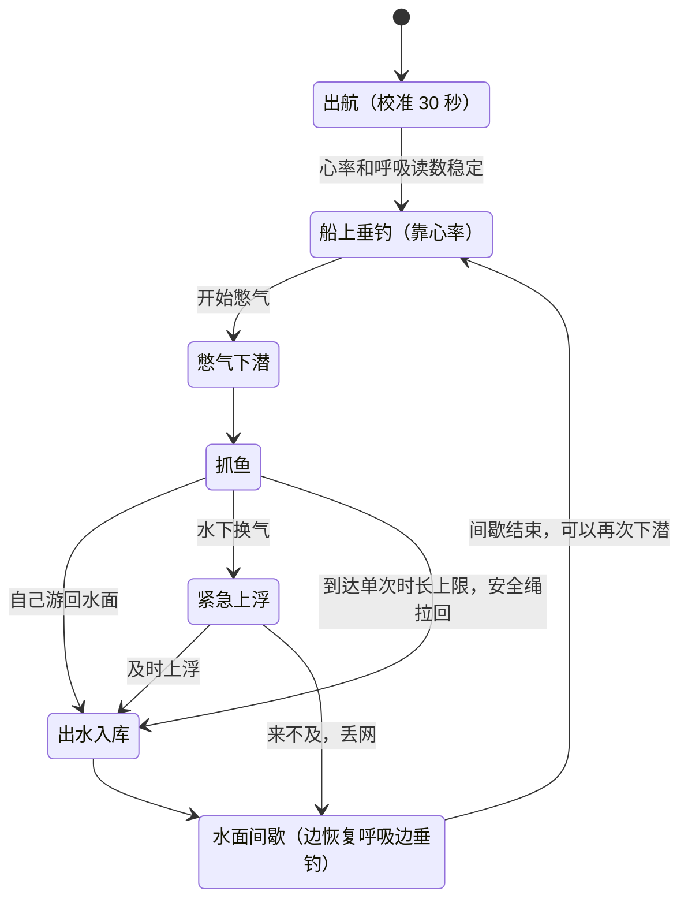

# 《屏息》Breathless 策划案 v3（融合版）

> HackRU Fall 2026 · 2026-10-10 · 提交截止以 Devpost 为准：**周日 10:00**
>
> 游戏正式名：**《屏息》/ Breathless**。代码和 README 里目前仍叫 Deep Breath，下文提到"现有实现"指的就是它。
>
> 本文把三份东西合到一起：最初的钓鱼策划案（三张图、小怪、鱼竿 / 鱼饵 / 船）、v2 生理信号设计（平静值、安全规则、报告口径），以及已经合进 `main` 的现有实现（Deep Breath）。**实现细节以 [README](../README.md) 为准，本文只写设计意图和要改的地方。**

## 1. 一句话

开船去三片水域：峡湾、天池、汪洋。在船上垂钓，心越静鱼咬钩越快；憋住气才能下潜，越深鱼越稀有。夜里有野兽和海怪。游戏安静地记录每次憋气和心率，按需生成身心报告；抓到的鱼可以铸成 Solana NFT 交易。

## 2. 三份来源怎么合

| 主题 | 原策划案 | 现有实现 | 融合后 |
| --- | --- | --- | --- |
| 核心动作 | 钓鱼，图 3 才能潜水 | 憋气潜水抓鱼 | **两样都要**：在船上用鱼竿钓（靠心率），憋气下潜用网抓（靠憋气）。两次下潜之间的休息时间正好用来钓鱼 |
| 心率 | "和钓鱼正相关" | 只进报告，不影响玩法 | **心率越平稳，咬钩越快、水下的鱼越不怕你**（§4.2） |
| 地图 | 图 1 挪威冰岛、图 2 张家界 / 长白山、图 3 汪洋 | 一片海，三个深度区 | **三张图全部保留**，各有场景、时间、小怪和可下潜深度（§6） |
| 小怪 | 野鹿、野熊、巨人、海怪，夜间出现 | 夜晚只提高稀有度，海怪在待办 | 原样保留，按图分配（§6） |
| 升级 | 鱼竿、鱼饵、船（速度 / 耐久 / 鱼台） | 待办：气瓶、脚蹼、头灯、大网 | 鱼竿、鱼饵、船原样保留，另加一组潜水装备（§7） |
| 永久损失 | 图 3 全部装备 | 换气后来不及上浮则丢光网里的鱼 | 丢鱼保留；图 3 沉船则全部装备永久丢失 |
| 开场动画 / 主界面 | 有时间就做 | 标题卡 + 校准提示 | 开场并进出航校准；主界面加地图选择（§6.1） |
| 健康报告 | 无 | 已有，按 `H` 生成 | 保留，修正统计口径（§5 D） |
| NFT / 交易 | 无 | 铸造已写好，市场在待办 | 保留，但排在信号和安全之后（§8） |

## 3. 融合后的核心循环



和现在的区别有四处：开头的校准拉长到 30 秒、新增"单次时长上限"、新增"水面间歇"、新增船上垂钓。水下部分不变。

垂钓和间歇是一回事：玩家在船上恢复呼吸的这段时间不是干等，而是在钓鱼。垂钓不需要憋气，也几乎不需要按键。

## 4. 生理信号怎么用

### 4.1 Presage 给的东西和它的限制

| 信号 | 生效时间 | 现在用了吗 | 融合后的用途 |
| --- | --- | --- | --- |
| 胸部呼吸波形 `upperTrace` | 实时，约 30 秒后才稳定 | 用了（憋气检测） | 不变 |
| `apnea`、`talking` | 实时 | 用了（辅助判定） | 说话时另外吓跑附近的鱼 |
| 心率 `pulseRate` | 12 秒滑动平均，有效范围 40–110 | 只显示和记录 | 平静值 → 垂钓咬钩速度、水下鱼的警觉距离 |
| 呼吸率 `rate` | 30 秒平均 | 只显示和记录 | 报告 |
| HRV | 60 秒 | **没请求** | 报告加 RMSSD、SDNN |
| 置信度 / `stable` | 每个读数都带 | **没用** | 不稳定的读数不显示、不记录 |
| LLM Insights | 按需 | 没用 | 报告的文字解读 |

硬限制：人要坐稳、脸和上胸入镜、光线均匀、镜头固定、只能有一张脸、不能说话；深色或细条纹衣服会干扰呼吸测量。指标只供健康参考，未经 FDA 批准。

### 4.2 平静值 Calm（新增）

```
HR0  = 校准结束前 15 秒稳定心率的中位数
Calm = clamp((1.10·HR0 − HR) / (0.20·HR0), 0, 1)      在基线时为 0.5
鱼的警觉距离 = RARITY.flee × (1.3 − 0.6·Calm)          平静时 ×0.7，紧张时 ×1.3
咬钩等待时间 = T图 × 鱼饵系数 × (1.5 − Calm)           平静时减半，紧张时 ×1.5
```

心率是 12 秒平均，所以 Calm 主要反映下潜前的状态。这正好对应真实自由潜水的做法：先在水面把自己放松下来再下去。只相对玩家自己的基线，不用绝对数值。

## 5. 改进点

按建议的处理顺序排列。每条都对照了 `main` 上的代码。

### A. 屏息安全（改动小，先做）

**A1. 现在的规则在奖励硬憋。** 水下一换气，3.2 秒内回不到水面就丢光网里的鱼（`EMERGENCY_SECONDS = 3.2`）。紧急上浮最快 10 m/s，算下来**约 30 米以下换气必丢**，而深渊区从 38 米开始。一趟深渊来回至少 16 秒，加上抓鱼通常要连续憋 20–30 秒以上。没有时长上限，没有强制休息，鱼还能变成可交易的 NFT。

改法（都在 `game/src/main.ts`）：

- **单次潜水上限 30 秒**：到点"安全绳"自动把人拉回水面，网里的鱼保留，多憋没有额外好处。
- **水面间歇**：出水后至少休息 `max(15 秒, 本次憋气时长)` 才能再下潜。
- **紧急时间随深度给**：`1.5 + depth / 8` 秒（58 米处约 8.8 秒）。这样只要立刻往上游就一定来得及，考的是反应，不是肺活量。失败仍然丢网，紧张感还在。*这一条改了核心手感，需要队内确认。*
- **首次启动安全页**：坐着玩；憋气前不要连续深吸快呼；头晕、胸闷、手麻立刻呼吸；有心肺疾病、高血压、癫痫或在孕期请用键盘模式。
- 不做最长憋气排行榜；交易市场不展示憋气时长。

### B. 信号可信度（Best Use of Presage 看的就是这个）

**B1. 真机还没测过。** PR #3 自己写了"尚未验证真实摄像头下的憋气检测"。这是现在最大的风险，排第一。测的时候重点看三件事：

1. 从真的憋住到显示 HOLDING 的延迟。
2. **按 WASD 游泳时，手臂动作会不会让波形漂移。** Presage 要求人静止，而游戏要求一直按键；现在只要波形偏离超过 `0.4 × 基线` 就判为换气，一误判就丢鱼。
3. 呼吸慢的人在呼气末的自然停顿，会不会被当成憋气。

**B2. 换气判定没有去抖。** `main.ts` 里 `holding` 只要有一帧为假就触发 OUT OF AIR。改成持续 0.5 秒才算。如果 B1 发现按键确实会引起漂移，再加一条：憋气时自动缓慢下沉、靠近鱼自动收网，把按键量降下来。

**B3. 置信度没用上。** `sensor/index.mjs` 发了 `confidence`，但 `game/src/breath.ts` 只取了 `value`。心率在前 12 秒、呼吸率在前 30 秒置信度是 0，这些读数现在照样显示并写进健康记录。改成：心率置信度低于 40、呼吸率低于 45 时置空；心率超出 40–110 时标记为不可靠。

**B4. 校准太快。** 检测器 4 秒就学完基线（`AMP_WINDOW_US`），但 Presage 的呼吸波形约 30 秒才稳定。改成等呼吸率有了置信度再提示"现在憋气"，这 30 秒做成出航过场，顺便记下 `HR0`。

**B5. 信号丢失时沿用了最后的状态。** 没脸、SDK 重启时，检测器停在最后一次的 `holding` 值。改成信号丢失即暂停计时并提示，不罚也不白送。

**B6. 加请求 HRV。** `requestedMetrics` 里加 `MetricType.HRV`，报告多两项。

**B7. sensor 不要部署到公网。** README 待办里有"sensor 多人并发部署"。现在传的是未压缩画面，640×480×30 帧约 37 MB/s 每人，公网传不动；有损压缩又会破坏心率信号。建议 sensor 永远跑在玩家本机，`SENSOR_URL` 固定为 `ws://localhost:8787`（现在用的是 `location.hostname`，页面一旦部署到域名就会连错地方）。只部署静态页面和交易后端。

### C. 玩法（把原策划案的东西接回来）

**C1. 让心率进玩法。** 见 §4.2，改动集中在 `fish.ts` 里 `dist < r.flee` 那一处。HUD 加一个平静值圆环。这也是原策划案"心率和钓鱼相关"的落地方式。

**C2. 说话吓鱼。** `talking` 已经传到前端，加一条：说话时附近的鱼立刻逃散。

**C3. 夜晚改成时钟驱动。** 现在按 `N` 手动切换。改成游戏内时钟（05:00–20:00 为白天），天黑前回船还是留下来由玩家选。演示时保留 `N` 键。

**C4. 船上垂钓。** 原策划案的鱼竿和鱼饵落在这里，规则见 §6.3。实现上复用现有的 `rollFish`，不需要新的鱼。

**C5. 三张图做成配置。** 每张图一份配置：天空和水的颜色、岸线模型、最大深度、咬钩基准、小怪表。现有场景是图 3 的底子，图 1 和图 2 主要是换色、加岸线、限制深度。见 §6。

**C6. 小怪**，见 §6.4–6.6。**C7. 鱼竿、鱼饵、船和潜水装备**，见 §7。

### D. 健康报告（统计口径）

**D1. 静息心率偏高。** 现在取下潜前 30 秒的中位数（`PRE_WINDOW_MS`），连续下潜时这 30 秒正好是上一潜的恢复期，心率还在反弹，于是"潜水反射"被夸大。有了水面间歇后改取间歇的最后 10 秒，第一潜用校准基线。

**D2. 短潜水算不出潜水反射。** 心率是 12 秒平均，短潜水里的"最低心率"其实还是下潜前的值。现在只要有 3 个采样就参与统计，改成只统计憋气 15 秒以上的潜水。

**D3. 恢复时间经常拿不到。** 下一潜开始时会清掉上一潜的恢复计时（`health.ts` 的 `begin()`）。水面间歇顺带解决。

**D4. 键盘和模拟数据混进了报告。** `report.ts` 的 `compute()` 不看 `source`，按住 Shift 30 秒也会成为"最长憋气"，模拟心率也会画进图里。改成只统计 `source === 'presage'`，其余单独标"演示数据"。

**D5. 加三样**：数据质量（有效读数占比，太低时提示仅供娱乐）、HRV、文字解读。文字解读用 Presage 的 LLM Insights：它只能看到心率、HRV、呼吸率，所以憋气统计要自己写进 prompt；上限 2048 字节；可能不返回，现有的 `insights()` 模板正好当兜底。

### E. 范围

离截止约 19 小时。README 待办里还有交易市场、后端、Tiger Data、部署、ElevenLabs、.tech 域名，全做不现实。建议顺序：

1. 真机憋气检测（B1、B2）
2. 安全（A1）
3. 置信度和报告口径（B3、B4、D1–D4）
4. 心率进玩法和船上垂钓（C1、C4）
5. 三张图配置化，主界面加地图选择（C5）
6. NFT 铸造端到端跑通
7. 每张图一种小怪，或最小交易（挂单和购买），二选一
8. 其余只在路演里讲，不做

## 6. 地图

原策划案的三张图全部保留。每张图有自己的场景、时间、小怪、可下潜深度和失败代价；船上垂钓三张图都有。

### 6.1 开场与主界面

- **开场过渡动画**（原案"有时间就做"）：并进出航。小船从码头驶向水域，这 30 秒同时是校准，不单独做片头。
- **主界面**：三张地图卡片，每张显示缩略图、难度、可下潜深度、解锁条件，未解锁的上锁。下方四个入口：商店、收藏（NFT）、健康报告、键盘模式。现有标题卡上的 "Start with camera / Play with keyboard" 放到选图之后。

### 6.2 时间与昼夜

- 1 游戏小时 = 现实 15 秒。白天 05:00–20:00（3 分 45 秒），夜晚 20:00–05:00（2 分 15 秒）。
- 白天安全。夜晚每条鱼的稀有度掷两次取高（现有规则），同时小怪出现。
- 天黑前返航还是留下来，由玩家选。演示时保留 `N` 键手动切换。

### 6.3 船上垂钓（三张图通用）

这是原策划案"心率和钓鱼相关"的落地。

- 人在船上、没在憋气时，鱼竿自动下钩。
- 等待时间 = `T图 × 鱼饵系数 × (1.5 − Calm)`，心越静咬钩越快。
- 咬钩时按一下空格收竿。**不需要憋气**，这段时间本来就是用来恢复呼吸的。
- 钓上来的鱼按当前图浅水区的掉率表抽。鱼竿等级决定抽几次取最好的一次，夜晚再加一次，和现有的"夜晚掷两次"是同一套代码。
- 说话会让咬钩进度清零。
- 钓到的鱼直接入库。竿钓只出浅水区的鱼，值钱的鱼仍然要下潜去抓。

### 6.4 图 1 · 挪威 / 冰岛峡湾（休闲）

| 项 | 内容 |
| --- | --- |
| 场景 | 雪山夹着的峡湾，岸边有木屋和松林，夜里有极光 |
| 时间 | 白天 05:00–20:00（原案设定），天黑后小怪出现 |
| 可下潜深度 | 只开放浅水区，0–18 米。来回约 5 秒，憋气压力最小，适合教学 |
| 咬钩基准 `T图` | 12 秒 |
| 夜间小怪 | **野鹿**：突然从岸边林子里窜出来，只吓人，没有惩罚；报告里会记下这次受惊后的心率变化。**野熊**：守在船边，出水时如果 Calm 低于 0.4（心跳太快）会被它发现，抢走网里最贵的一条 |
| 失败代价 | 只丢网里的鱼 |
| 解锁 | 初始 |

### 6.5 图 2 · 张家界 / 长白山天池（普通）

| 项 | 内容 |
| --- | --- |
| 场景 | 石柱峰林环绕的高山湖，清晨和夜里起雾 |
| 时间 | 全天循环 |
| 可下潜深度 | 浅水区 + 第二层，0–38 米。第二层在这张图里画成沉木和岩架，掉率表沿用珊瑚礁 |
| 咬钩基准 `T图` | 16 秒 |
| 夜间小怪 | **野熊**：同图 1。**巨人**：每晚从山间走来一次，脚步声有 3 秒预兆；踏地时水下的鱼全部惊散，潜水员被推向水面，船耐久 −1 |
| 特有机制 | 夜雾：水面能见度低，小怪只能靠声音判断 |
| 失败代价 | 丢网里的鱼，加上船耐久损失 |
| 解锁 | 累计入库价值 150 |

### 6.6 图 3 · 汪洋（困难）

| 项 | 内容 |
| --- | --- |
| 场景 | 开阔海面，远处有风暴云。现有场景就是这张图的底子 |
| 时间 | 全天循环 |
| 可下潜深度 | 全部开放，0–58 米。**唯一能下深渊的图**，对应原案"图 3 有潜水功能" |
| 咬钩基准 `T图` | 20 秒 |
| 海浪 | 不定时来一阵大浪，持续 20 秒。期间 Calm 低于 0.4 则船耐久 −1，垂钓中断 |
| 海怪 | 在深渊巡游。被追上则丢网、船耐久 −2。可以献祭一条已入库的鱼（销毁对应的 NFT）让它离开 |
| **永久损失** | 船耐久归零即沉船：鱼竿、鱼饵、船的升级和潜水装备**全部永久丢失**，回到 Lv1。已入库的鱼和 Pearl 保留。随时可以返航止损 |
| 解锁 | 累计入库价值 1000 |

### 6.7 两条共同原则

- 小怪的威胁要么催玩家上浮，要么考验平静，**不能逼玩家多憋**。
- 每张图是一份配置：天空色、水色、雾、岸线模型、最大深度、`T图`、小怪表。`fish.ts` 的 `ZONES` 按最大深度过滤，`world.ts` 的颜色和海底深度从配置读。

## 7. 经济与升级

货币是 **Pearl**（README 待办里的 SPL token），把入库的鱼卖给市场得到，售价沿用现有的 `RARITY.value`（1 / 3 / 10 / 35 / 150 / 800）。

### 7.1 鱼竿、鱼饵、船（原策划案，船上用）

| 升级 | Lv1（初始） | Lv2 | Lv3 |
| --- | --- | --- | --- |
| 鱼竿 | 竿钓抽 1 次 | 60 Pearl：抽 2 次取最好 | 400 Pearl：抽 3 次取最好 |
| 鱼饵 | 咬钩等待 ×1.0 | 40 Pearl：×0.8 | 300 Pearl：×0.6 |
| 船 · 速度 | 出航、返航各耗 2 游戏小时 | 80 Pearl：1 小时 | 500 Pearl：半小时 |
| 船 · 耐久 | 3 | 80 Pearl：5 | 500 Pearl：8 |
| 船 · 鱼台 | 1 根竿 | 80 Pearl：2 根竿同时下钩 | 500 Pearl：3 根 |

鱼饵也可以用入库的鱼合成，这是 NFT 的消耗出口（`burnFish` 已写好）。

### 7.2 潜水装备（README 待办，水下用）

| 装备 | 效果（对应常数） |
| --- | --- |
| 渔网 | 容量 6 → 8 → 10（`NET_CAPACITY`） |
| 脚蹼 | 游速 7.5 → 8.5 → 9.5（`MAX_SPEED`） |
| 应急气瓶 | 紧急上浮时间 +1 秒 / +2 秒（`EMERGENCY_SECONDS`）；有耐久，用几次就坏 |
| 头灯 | 深渊和夜晚的可见范围 |

红线：**装备只能加速度、容量、应急时间，不能卖"憋得更久"。** 单次 30 秒上限对所有人一样。

价格和解锁门槛都是占位，等核心循环稳定后再调。

## 8. NFT 与交易

设计上不变，见 README 第 8 节。两点补充：

- 链上属性只放鱼的信息（稀有度、物种、深度、seed），不放任何生理数据。
- 交易是加分项，不是演示主线。演示主线是"憋气 → 下潜 → 抓鱼 → 报告"，铸造放在最后 20 秒。

## 9. 时间表（美东时间）

| 截止 | 目标 |
| --- | --- |
| 周六 18:00 | 真机测通憋气检测，调好阈值和去抖；置信度过滤 |
| 周六 21:00 | 安全：时长上限、水面间歇、安全页、30 秒校准 |
| 周日 00:00 | 报告口径修正；心率进玩法；船上垂钓 |
| 周日 03:00 | 三张图配置化 + 地图选择；NFT 铸造端到端 |
| 周日 06:00 | 二选一：每张图一种小怪，或最小交易 |
| 周日 07:00 | **功能冻结** |
| 周日 09:00 | 现场光线下彩排，录备用视频，写 Devpost |
| 周日 10:00 | 提交 |
| 周日 13:00 | 评审，全员到场 |

## 10. 演示现场的风险

| 风险 | 应对 |
| --- | --- |
| 背后站着围观的人，触发"只能有一张脸" | 让玩家背对墙或展板坐 |
| 现场光线差或逆光 | 自带一盏灯从正面打光 |
| 评委穿深色或条纹衣服，呼吸测不准 | 键盘模式随时能切（`K`） |
| 评委刚走过来，心率超过 110 | 按 B3 当作不可靠读数，Calm 冻结在 0.5 |
| Presage 额度用完或场馆断网 | 提前查额度，备手机热点和录屏 |
| 开局 30 秒校准让评委等 | 出航过场做好看，这段时间口头讲原理 |

## 11. 待确认

1. A1 里"紧急时间随深度给"是否接受（它改了核心手感）。
2. 单次上限定 30 秒是否合适。
3. 三张图的岸线美术做到什么程度（最省的做法是换色加几个低多边形山体）。
4. Presage 后台的额度上限。

## 参考

- [SmartSpectra 文档](https://smartspectra.presagetech.com/) · [数据结构](https://smartspectra.presagetech.com/docs/data-types.md) · [指标适用范围与限制](https://smartspectra.presagetech.com/docs/model-cards-and-limitations.md) · [如何获得好的测量](https://smartspectra.presagetech.com/docs/measurement-quality.md)
- [Node.js API 参考](https://smartspectra.presagetech.com/docs/nodejs/api-reference.md) · [LLM Insights](https://smartspectra.presagetech.com/docs/llm-insights.md) · [写 prompt 的注意事项](https://smartspectra.presagetech.com/docs/llm-insights/writing-prompts.md)
